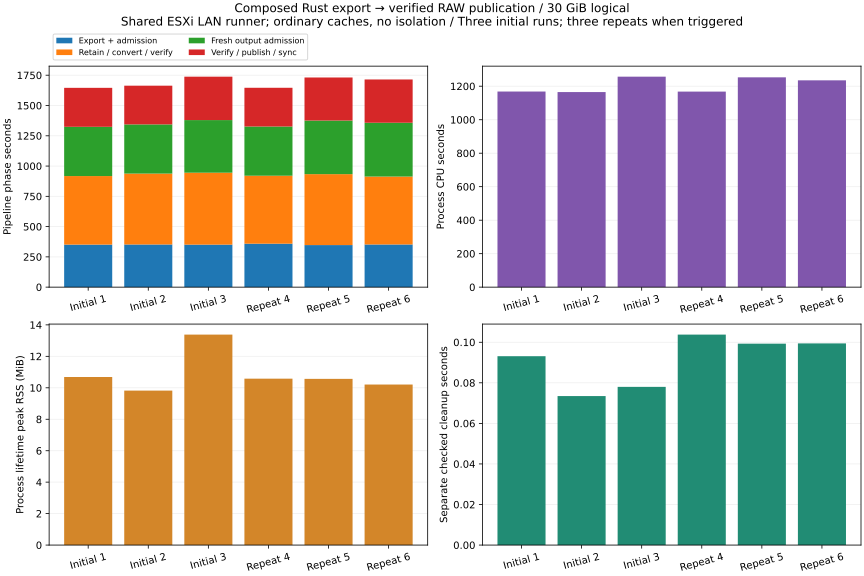
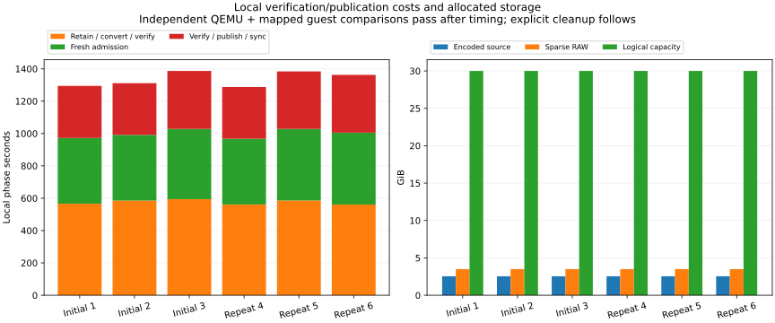
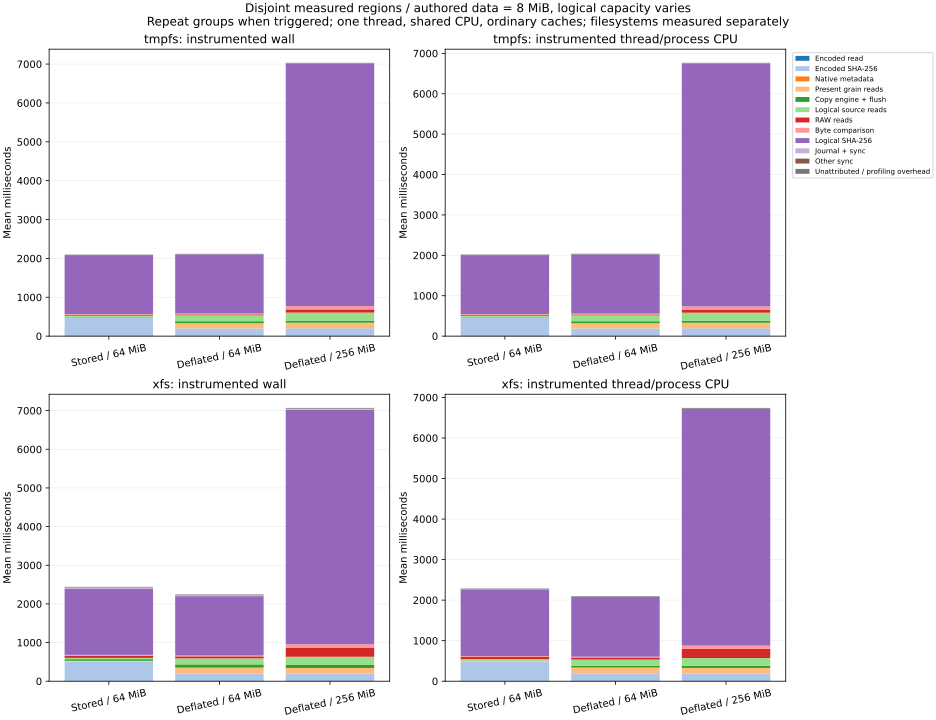
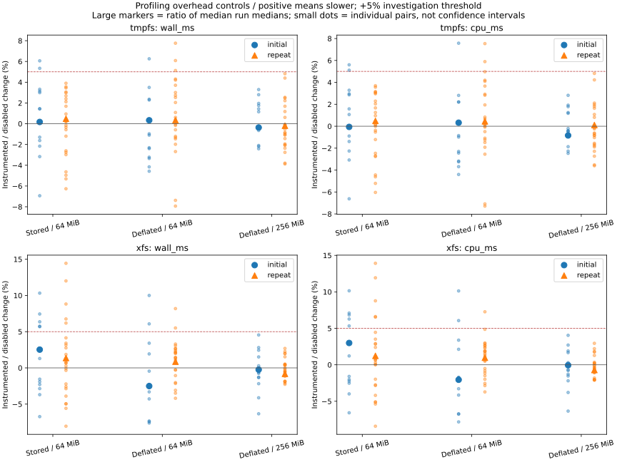

# R6.1c.5p — repeated composed-pipeline measurements and local profiles

This campaign measures the existing composed Rust workflow and introduces test-only
local profiling. It does not change the production algorithm or weaken verification,
identity, cancellation or durability checks. Six complete live observations and
432 authored profiling operations passed. This completes the bounded diagnostic
package; performance tuning and unresolved timing variation remain open.

## Live results

**Six complete observations passed**, with three initial runs and three required repeats.
Every run passed complete QEMU equivalence, the mapped guest oracle and explicit
output/source cleanup; both Cleaned journals remain privately. Full logical digest
consistency also passed across the series. [Computed summary](summary.json),
[repeat decision](repeat-decision.json), [run 1](run-1.json), [run 2](run-2.json), [run 3](run-3.json), [run 4](run-4.json), [run 5](run-5.json), [run 6](run-6.json).

| Measurement | Initial median | Initial spread | Repeat median | Repeat spread |
|---|---:|---:|---:|---:|
| Pipeline wall (s) | 1,663.644 | 5.60% | 1,714.977 | 5.16% |
| Process CPU (s) | 1,168.140 | 7.89% | 1,235.223 | 7.30% |
| Export and admission (s) | 351.455 | 0.36% | 352.462 | 3.33% |
| Retained conversion and verification (s) | 585.384 | 4.97% | 561.281 | 4.46% |
| Fresh output admission (s) | 406.622 | 6.96% | 442.651 | 9.37% |
| Verification and publication (s) | 321.817 | 12.12% | 355.446 | 11.74% |
| Checked cleanup wall (ms) | 77.985 | 26.75% | 99.439 | 4.49% |
| Checked cleanup CPU (ms) | 50.689 | 33.84% | 66.299 | 43.06% |

Medians are computed separately; phase medians need not sum to the whole median.
Spread is descriptive `100 * (max/min - 1)`, not a confidence interval.

RAW allocation remained **3.497 GiB** for the **30 GiB** logical disk
in every observation. Peak RSS ranged from **9.82 to 13.38 MiB**.
Local phases accounted for **78.2–79.9%** of each pipeline's wall time.

**Variation remains unresolved after repetition.** Repeat wall, CPU, fresh admission,
publication and cleanup CPU still exceed the 5% investigation threshold. No slow
sample is dropped, no matched speedup is claimed, and PERF.0 remains open. The
observations do not isolate CPU frequency, shared-host scheduling, storage or cache
effects. The earlier single observation remains separate from this series.



[PNG](plots/pipeline.png).



[PNG](plots/local-and-allocation.png).

Final [lab checks](lab-checks.json) confirm unchanged source binding across all six
configs, unchanged version/power/snapshot state, source off, runner on, no recent
source tasks and successful Logout. All source/RAW payloads and profiling fixture
parents are gone; twelve terminal journals remain privately. Available runner space
is **7,937,200,128 bytes**. No VM power change was performed.
QEMU's original success logs are retained for [run 1](qemu-compare-1.txt),
[run 2](qemu-compare-2.txt), [run 3](qemu-compare-3.txt), [run 4](qemu-compare-4.txt),
[run 5](qemu-compare-5.txt) and [run 6](qemu-compare-6.txt).

## Method and provenance

The live series uses the frozen R6.1c.5c release executable from commit `428fbe4`,
identified in [binaries.json](binaries.json) and every observation. Its source is the
[previous source manifest](../2026-10-02-r61c5c/source-hashes.json). The separately
built release profiling test executable uses the [current source manifest](source-hashes.json).
[Provenance checks](provenance-checks.json) verify the baseline manifest against its
commit and both executable hashes against their frozen copies.
[Campaign conditions](campaign.json) and [environment](environment.json) record the
new series; the older October 2 observation is kept separately and excluded from
its initial/repeat groups. No matched implementation speedup is claimed.

The authorized source remains powered off. One source/output pair is present at a
time on the one-vCPU LAN runner. Each complete observation includes export and
artifact admission, retained admission/conversion/readback, fresh output admission,
then verification and durable publication. The report uses `pipeline.data.elapsed_ms`,
which excludes password entry. Stage timing includes each stage's validation and
sync work; export timing is not pure network throughput. Process CPU and lifetime
peak RSS have the [existing runner boundaries](../../composed-export-pipeline.md).

After timing, QEMU independently compares the complete 30 GiB logical disk. The
separate mapped 8 MiB guest fixture checks independently authored known bytes.
The complete published RAW digest is compared privately across runs to detect content
drift; only the match boolean is retained publicly. Explicit checked output and source
cleanup then preserves both Cleaned journals. No additional complete RAW is needed.
Actual endpoints, identities, passwords, image/fixture digests and journals remain
private. Rust performs all VMware access and disk operations; Python handles offline
measurement orchestration, the existing mapped-byte oracle and plot rendering.

Three initial complete observations are required. Any initial whole-operation,
phase, CPU or cleanup spread `100 * (max/min - 1)` above 5% requires three additional
complete observations. Keep both groups, every sample and unresolved variation.
Shared-host CPU/storage/network scheduling and caches are uncontrolled. No guest
benchmark overlaps another; workstation development runs on a separate host. No cache
drops, CPU-frequency/SMT isolation or VM power changes are part of the campaign.

The initial group exceeded the threshold and the required three further complete
observations are retained alongside it; the repeat decision was recorded before
collecting that group.

## Local profiling controls

The [profiling contract](../../pipeline-performance-profiling.md) and
[ADR-0067](../../adr/0067-disjoint-test-only-pipeline-profiling.md) define disjoint
wall/thread-CPU regions, call/byte accounting and the same-binary disabled controls.
The release test uses alternating controls for stored/deflated 64 MiB logical disks
and a deflated 256 MiB disk, each with 8 MiB of independently checked authored data.
Every operation checks full RAW bytes, source bytes and the source journal, then
performs explicit output cleanup outside the primary timing.

Each fixture/filesystem has three rounds of four pairs. Instrumented wall/CPU
increases above 5%, or initial run-median wall/phase/CPU/cleanup spreads above 5%,
require three rounds of eight pairs. All samples and both groups remain visible.
RSS is the process lifetime peak, including fixture/oracle work. Region counts are
bytes traversed, not unique stored bytes or physical IO. These small warm working
sets cannot establish the private live disk's exact cost breakdown. Sequential XFS
and tmpfs sessions are not paired evidence of a causal filesystem speedup.
Tmpfs provides an in-memory timing control rather than persistent-storage qualification.

The runner exposes no SHA-NI feature. Inspection of the locked `sha2 0.11.0` source
shows default x86 SHA-256 dispatch falling back to its unrolled software backend
when the required SHA feature is absent. [Source hashes and interpretation](hash-backend-inspection.json)
record this observation; feature availability alone does not measure hashing's
share of pipeline cost. No hash algorithm, dependency or backend override is changed.

## Profile results

**432 operations / 216 pairs passed**: 216 operations on XFS, then 216 on tmpfs.
Each of the six fixture/filesystem combinations triggered three longer repeat
rounds after its three initial rounds. All full RAW oracles, source/journal
preservation checks, byte accounting and explicit output cleanups passed.

[XFS samples](profile-xfs/measurements.json), [XFS environment](profile-xfs/environment.json),
[tmpfs samples](profile-tmpfs/measurements.json), [tmpfs environment](profile-tmpfs/environment.json),
[computed groups and regions](profile-summary.json). Per-round JSON and test logs
are retained beside each aggregate, and the plotter verifies their agreement.

The following values use the repeat groups. Overhead is the instrumented/disabled
ratio of median run medians; CPU attribution uses mean instrumented region CPU
divided by mean whole-operation CPU. These are different statistics.

| Filesystem | Fixture | Disabled wall median (ms) | Wall change | CPU change | Encoded + logical SHA-256 CPU share |
|---|---|---:|---:|---:|---:|
| xfs | Stored / 64 MiB | 2,417.485 | +1.36% | +1.23% | 92.89% |
| xfs | Deflated / 64 MiB | 2,219.341 | +0.85% | +0.97% | 79.26% |
| xfs | Deflated / 256 MiB | 7,088.227 | -0.82% | -0.71% | 89.32% |
| tmpfs | Stored / 64 MiB | 2,082.563 | +0.48% | +0.49% | 93.96% |
| tmpfs | Deflated / 64 MiB | 2,097.570 | +0.34% | +0.44% | 81.11% |
| tmpfs | Deflated / 256 MiB | 6,881.201 | -0.19% | +0.11% | 91.63% |

**Hashing dominates these authored workloads:** the two SHA-256 regions account
for **79.26–93.96%** of measured process CPU. Logical RAW hashing alone accounts
for **70.31–88.84%**. Keeping data at 8 MiB while increasing logical capacity from
64 to 256 MiB increases the disabled repeat wall median by **3.19× on XFS** and
**3.28× on tmpfs**. The asserted three full logical hash/readback traversals explain
why logical capacity matters even when physical allocation is small. These small,
warm fixtures do not establish the exact private live-disk CPU breakdown.

Repeat median profiling changes range from **−0.82% to +1.36% wall** and
**−0.71% to +1.23% CPU**. Individual pairs still exceed 5% in both directions;
all remain plotted. Disabled controls retain the inactive test wrapper check, so
these ratios quantify added recording overhead inside the measured operation.
They do not measure the complete test-executable cost relative to production.

**Variation remains open in the local controls too.** For example, the tmpfs
256 MiB disabled repeat group has **11.09% wall / 10.59% CPU spread**, with
**7.28% / 7.13%** in the instrumented group. XFS retains phase/cleanup spreads
up to **14.72%**; tmpfs cleanup reaches **22.33%**. The small aggregate overhead
ratios are not blanket performance clearance or confidence intervals.

Every profiled RAW remains **8 MiB allocated**. Recorded lifetime peak RSS reaches
**30.51 MiB** at the sampling points; fixture setup and earlier oracle allocations
can contribute. It is not an isolated peak for the timed operation.



[PNG](profile-plots/regions.png).



[PNG](profile-plots/overhead.png).

## Decisions and next work

No production optimization is accepted in this package. The first tuning target is
digest-equivalent SHA-256 throughput on CPUs without SHA-NI. A candidate must retain
the same algorithm, every full readback/hash gate, source binding, sparse allocation,
cancellation behavior and durability ordering. Compare against a frozen reference
with independent bytes/digests, alternating controls, larger working sets and the
same adverse-result repeat rule. Do not infer a production gain from a different
CPU, changed VM resources, a warm small fixture or a skipped verification pass.

Keep CPU/frequency/SMT, storage/cache controls, live variance and profiling overhead
in PERF.0. Native decoding, map/cache sensitivity and prior storage/stream follow-ups
remain tracked; the current results prioritize hashing without clearing those areas.

The next architectural package remains **R6.1d.1**, explicit reconciliation of an
unambiguous PublishIntent. Design the original store/destination/source bindings,
unique owned staged OR published bundle, fresh full checks, directory syncs and
durable acknowledgment before adding mutation. Both/neither/foreign namespaces,
pending transactions and unstamped stages remain blocked; no remote replay or
cleanup authority is inferred. See the [implementation log](../../implementation-log.md).

## Validation

Workspace: **737 passed, 10 ignored**, no failures; all-target Clippy with warnings
denied and formatting pass. The three authored profiling fixtures also pass explicit
release smoke runs. Two profiler tests check thread isolation, disabled controls,
byte accounting and reset after unwinding. The expected caught panic in the unwind
test is retained in the log. Production library/example builds omit the new clocks
and counters through `cfg(test)`.

[Workspace tests](workspace-tests.txt), [counted test summary](workspace-test-summary.json), [Clippy](clippy.txt), [formatting](fmt.txt),
[profiler tests](profile-tests.txt), [release build](build.txt),
[final release fixture smoke checks](profile-smoke-final.txt).
An additional [workstation functional check](harness-smoke.json) completed 216
operations, exercised the harness's longer repeats and regenerated both plot types.
Its timings are excluded from the runner campaign. Altered logical-byte accounting
was rejected by the report validator.

Reproduce the saved plots without lab access:

```sh
target/benchmark-plots/bin/python scripts/vsphere/plot_pipeline.py docs/benchmark-results/2026-10-07-r61c5p
target/benchmark-plots/bin/python scripts/benchmarks/plot_pipeline_profile.py docs/benchmark-results/2026-10-07-r61c5p
```

[Live plot audit](plots/audit.json), [profile plot audit](profile-plots/audit.json),
[tool hashes](tool-hashes.json), [artifact hashes](artifact-hashes.json).
