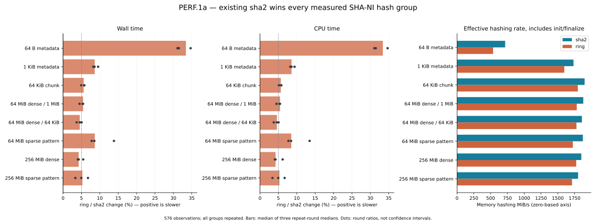
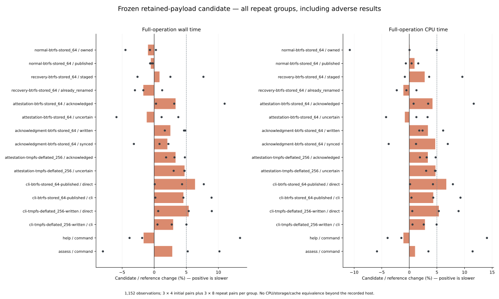
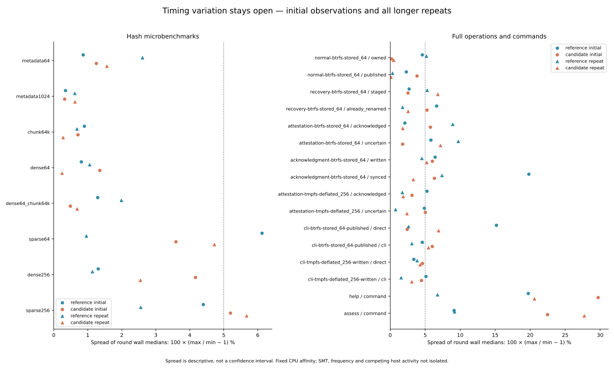
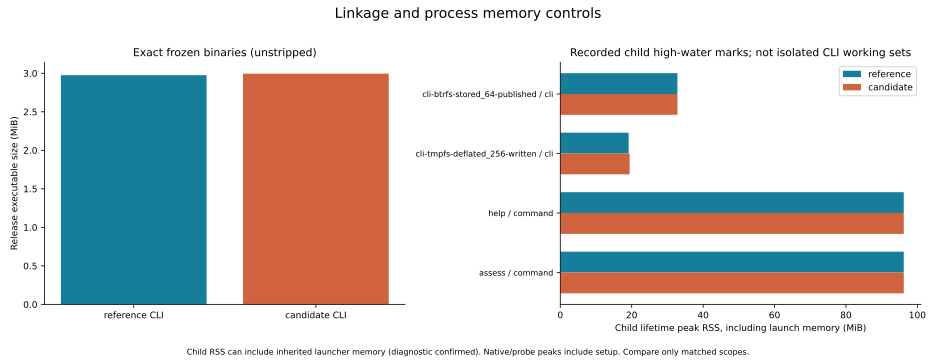

# PERF.1a — SHA-256 backend qualification

Investigation started 2026-10-14 and completed 2026-10-15. Reference:
`95ca5245a60438965bec71a461687d41b6ce292d`. **Retain `sha2 0.11.0`.**
The isolated `ring 0.17.14` candidate is rejected on this SHA-NI host. This package
adds benchmark tooling, evidence and planning; production source and workspace
dependencies remain identical to the reference.

## Recorded scope and provenance

[Plan](plan.json), [supplemental workflow decision](workflow-plan.json),
[baseline source/binary hashes](baseline.json), [probe provenance](hash-provenance.json),
[candidate source/binary hashes](candidate-provenance.json), [patch replay](patch-replay.json), and
[exact rejected patch](rejected-candidate.patch) identify the experiment.
The workflow scope was recorded after the adverse microbenchmarks and before its
timings. It is a bounded confirmation, not a full alternate-backend production
qualification. No ESXi, guest, vCenter or network export was accessed.

The machine is an Intel i7-11850H. Probe CPU detection confirms SHA, SSE2, SSSE3,
SSE4.1, AVX and AVX2. The default locked `sha2` SHA-256 dispatch selects SHA-NI on
this host and software when the required features are absent. Locked `ring`
SHA-256 dispatch selects SHA+SSSE3, then Intel AVX, then SSSE3/fallback. These are
[source-audit findings](backend-audit.json) supported by the recorded runtime feature checks; they are
not an instruction trace. The SHA-512 AVX2 implementation is not SHA-256 evidence.
API references: [sha2 0.11.0](https://docs.rs/sha2/0.11.0/sha2/),
[ring 0.17.14 digest](https://docs.rs/ring/0.17.14/ring/digest/index.html).

The experiment changes only retained encoded-container hashing, full owned RAW
verification hashing and fresh publication/recovery verification hashing. Full
source/output comparisons, all 1 MiB buffers, control checks, journal/identity
hashes, sparse writes and durability order remain unchanged. Export/worker hashing
was audited but not changed or timed. See the
[architecture decision and next package](../../sha256-performance-qualification.md).

## Correctness and diagnostics

- **624 checks per configuration:** standard empty/`abc`/padding/million-`a` vectors,
  padding/block/chunk boundaries, dense and sparse-pattern bytes; both backends.
  [Native](hash-check-native.json) and
  [QEMU SHA-masked](hash-check-no-sha-emulated.json) runs pass. The 36 saved cases
  per configuration also pass 72 independent Python `hashlib` digest checks.
- **805 candidate workspace tests pass**, with 19 opt-in tests ignored by the
  ordinary workspace run. This excludes 28 nested child-test executions from the
  count. The new private wrapper adds 144 digest/chunk comparisons in one test;
  existing fault, process-loss, cancellation, identity and sparse checks remain.
  [Workspace log](candidate-tests-rerun.txt), [Clippy](candidate-clippy.txt),
  [probe Clippy](hash-probe-clippy.txt). Formatting also passes.
- Three actual-candidate CLI fixture groups pass separately:
  [histories](candidate-cli-executable_histories.txt),
  [exclusions](candidate-cli-executable_exclusions.txt), and
  [transaction candidates](candidate-cli-executable_reconciliation_candidates.txt).
- The [first workspace run](candidate-tests.txt) had one setup failure: the copied
  workspace lacked its `target/` directory because build output used a separate
  directory. The existing cross-filesystem test calls `metadata` on that path.
  Creating the directory, without changing code, resolves the failure; the complete
  rerun passes. This was not a failed timed sample and is not hidden.
- [Evidence validation](evidence-validation.json) replays the timing validators,
  checks completeness/hashes/digests, and rejects corrupted copies. Real samples
  are never edited to pass a gate.

The first help comparison stopped on its output oracle: Clap uses the executable
filename in `Usage`, so `reference-cli` and `candidate-cli` differ there. The
[diagnostic](workflow-help-diagnostic.json), [interruption log](workflow-interrupted.txt)
and [original driver](workflow-driver-before-help-fix.py) are retained. Two successful
help executions occurred before that assertion; their timings were not persisted
and cannot be recovered. They are excluded from the 1,152 accepted observations.
Only the exact displayed program-name token is normalized by the corrected oracle.
All 42 completed workflow rounds (1,008 observations) retain their original files
and hashes; all 144 help/assessment controls run under the
[resumed environment](workflow-environment-resumed.json). No workload sample is
replaced or selectively discarded. There was no production CLI change.

QEMU masks SHA-NI only for correctness. No emulated timing is presented as native
performance of a physical CPU or VM without SHA-NI. This probe is a Linux x86-64
qualification tool, not a portable production hash API.

## Measurement conditions

The microprobe performs 576 timed observations across eight groups. An observation
can contain many complete digests: 262,144 for 64-byte records, 16,384 for 1 KiB,
256 for 64 KiB, and one for 64/256 MiB. Normalize elapsed time by iterations.
Initialization, streaming updates, finalization, `black_box` and digest assertion
are inside the timed loop. Input allocation and expected-digest calculation are
outside it. Sparse-pattern inputs contain real zero bytes in memory; this does not
measure a sparse filesystem optimization.

The workflow campaign retains 1,152 validated timed observations: 720 native operations,
288 direct/CLI observations and 144 help/assessment commands. Each group has three
initial rounds of four alternating pairs followed by three rounds of eight pairs,
regardless of timing sign. Full-operation binary invocation order alternates by
round; each native history or direct/CLI pair alternates inside that invocation.
Help/assessment alternate frozen binaries per pair. Cleanup is measured separately
where the inherited native harness provides it. Setup and independent byte oracles
remain outside primary operation timing.

[Workflow environment](workflow-environment.json) records fixed CPU affinity,
binary hashes and filesystems. Runs are serial with no simultaneous test, build,
trace, validation or plotting workload. Normal page cache is retained. Btrfs is
the local filesystem; private user/mount/network namespace tmpfs uses
`size=512m,mode=0700,huge=never`. The harness accepts synthetic local fixtures and binary paths, without VMware credentials or endpoints.
Host SMT, frequency and other host activity are not isolated. These 64/256 MiB
working sets exceed LLC but do not establish cold-cache or disk-scale behavior.

Summary percentages use the ratio of median-of-three repeat-round medians. Dots
show individual round ratios. Initial samples and all repeat spread stay in the
raw indexes and variation chart. These are descriptive statistics, not confidence
intervals or a general performance clearance. Native/probe peak RSS includes setup
and earlier work; CLI child peak RSS is measured in a separate process but can
include inherited launcher memory before exec. An
[untimed diagnostic](child-rss-diagnostic.json) runs the same frozen help command
with fresh launchers retaining 0 or 128 MiB: reported child peak rises from about
12.2 MiB to 140.1–140.3 MiB. Thus the high help/assessment values in the resource
chart are not isolated CLI working-set measurements. Compare only matched launcher
scopes; do not infer algorithm memory or cross-harness memory gains. Raw counters
are preserved. [Diagnostic source](child-rss-diagnostic.py).

## Results

All eight hash groups favor the existing backend. Positive values below mean the
experimental candidate is slower. Percentages use complete-operation elapsed time.

| Hash input / chunk | Wall change | CPU change |
|---|---:|---:|
| 64 B metadata | +33.40% | +33.41% |
| 1 KiB metadata | +8.61% | +8.57% |
| 64 KiB chunk | +5.61% | +5.65% |
| 64 MiB dense / 1 MiB | +5.45% | +5.44% |
| 64 MiB dense / 64 KiB | +4.55% | +4.58% |
| 64 MiB sparse pattern / 1 MiB | +8.64% | +8.51% |
| 256 MiB dense / 1 MiB | +4.26% | +4.22% |
| 256 MiB sparse pattern / 1 MiB | +5.28% | +5.29% |

Full-operation changes compare the isolated candidate with its frozen reference.
Native measurements include their unchanged verification/persistence work; direct
and whole CLI observations are separate costs.

| Workflow / history | Reference wall (ms) | Wall change | CPU change |
|---|---:|---:|---:|
| normal-btrfs-stored_64 / owned | 222.919 | -0.97% | +0.04% |
| normal-btrfs-stored_64 / published | 400.504 | -0.53% | +0.95% |
| recovery-btrfs-stored_64 / staged | 97.491 | +0.83% | +2.79% |
| recovery-btrfs-stored_64 / already_renamed | 91.481 | -1.70% | -1.08% |
| attestation-btrfs-stored_64 / acknowledged | 80.770 | +3.33% | +4.20% |
| attestation-btrfs-stored_64 / uncertain | 80.298 | -1.17% | -0.81% |
| acknowledgment-btrfs-stored_64 / written | 93.180 | +2.52% | +3.37% |
| acknowledgment-btrfs-stored_64 / synced | 88.534 | +2.05% | +4.69% |
| attestation-tmpfs-deflated_256 / acknowledged | 200.096 | +3.32% | +3.36% |
| attestation-tmpfs-deflated_256 / uncertain | 200.706 | +4.73% | +4.73% |
| cli-btrfs-stored_64-published / direct | 80.935 | +6.36% | +6.70% |
| cli-btrfs-stored_64-published / cli | 85.883 | +4.55% | +4.34% |
| cli-tmpfs-deflated_256-written / direct | 212.084 | +5.37% | +5.34% |
| cli-tmpfs-deflated_256-written / cli | 228.336 | +2.95% | +2.83% |
| help / command | 0.548 | -1.66% | -1.06% |
| assess / command | 0.883 | +2.81% | +1.04% |

All native RAW outputs remain **8 MiB allocated**. Native lifetime peak RSS reaches
**41.39 MiB** at the recorded sampling points, including fixture
setup and earlier operations. The frozen candidate CLI is **20,344 bytes larger**
(**+0.65%**); the resource chart keeps
its child-process high-water RSS separate from native lifetime RSS and explicitly
labels inherited launcher memory. This does not measure post-exec CLI allocation.

Repeat-round wall spread reaches **5.67%** in the hash groups and
**9.73%** in full native/direct/CLI operations. Help/assessment
variation and every phase/cleanup spread are retained in the JSON summaries.
Mixed full-operation ratios cannot establish a supported backend improvement in
the presence of the uniformly adverse hash results and these timing limits. Keep
`sha2`; do not add a production backend selector or relax any verification gate.




[PNG](plots/hash-backends.png).



[PNG](plots/workflow-changes.png).



[PNG](plots/round-variation.png).



[PNG](plots/cli-resources.png).

## Reproduction and remaining work

The standalone [Rust probe](../../../scripts/benchmarks/hash_probe/src/main.rs)
has its own manifest/lock and is not linked into production. Build with:

```sh
cargo build --release --locked --manifest-path scripts/benchmarks/hash_probe/Cargo.toml --target-dir target/perf1a/probe-build
target/perf1a/probe-build/release/rvddk-hash-probe check
qemu-x86_64 -cpu max,sha-ni=off target/perf1a/probe-build/release/rvddk-hash-probe check
```

The [micro driver](../../../scripts/benchmarks/measure_hash_backends.py) and
[workflow driver](../../../scripts/benchmarks/measure_hash_workflows.py) accept
explicit binary/report paths; use their `--help`. Never overwrite this campaign.
Reproduce the candidate by archiving the recorded baseline, applying the patch
with `git apply --unidiff-zero`, creating its `target/` directory for existing test
fixtures, and building into an isolated target directory. The candidate's ordinary
workspace tests and all-target Clippy must pass before timing. Freeze release CLI
and vSphere library-test executables and record their hashes. The workflow driver
requires empty Btrfs and tmpfs fixture parents; mount tmpfs privately with the
recorded options. It checks teardown and all inherited work/allocation gates.

Replay evidence and render the figures without rerunning workloads:

```sh
python3 scripts/benchmarks/check_hash_evidence.py docs/benchmark-results/2026-10-14-perf1a
target/benchmark-plots/bin/python scripts/benchmarks/plot_hash_backends.py docs/benchmark-results/2026-10-14-perf1a
```

[Plot manifest](plots/manifest.json) records generator/input/output hashes and
package versions. [Artifact manifest](artifact-manifest.json) covers the committed
report excluding itself. [Text-log whitespace normalization](log-normalization.json) records before/after
hashes; numerical JSON evidence is unchanged. Build outputs, copied workspaces and private fixture
paths/configuration are excluded from the commit.

**Next: PERF.1b — native qualification on the earlier runner without SHA-NI.**
Reconfirm its actual CPU features, freeze a same-runner baseline and repeat the
digest and workload gates before considering a conditional fallback. No new ESXi
trial is required for this CPU investigation. PERF.0 timing/storage/CLI variation,
larger cold workloads, live recovery integration and general production recovery
remain open. This package establishes a reason to keep the current implementation;
it does not claim a production speedup.
