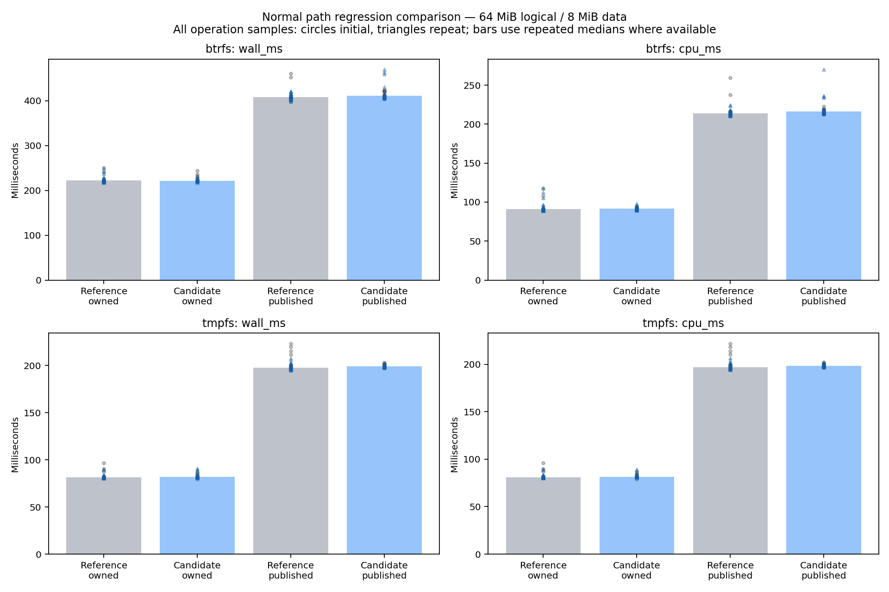
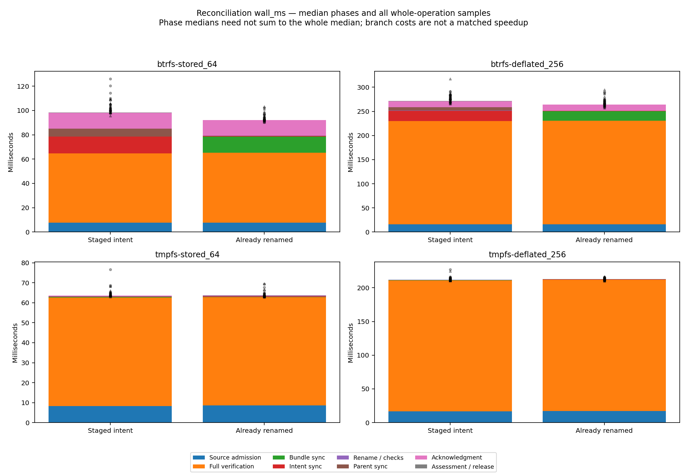
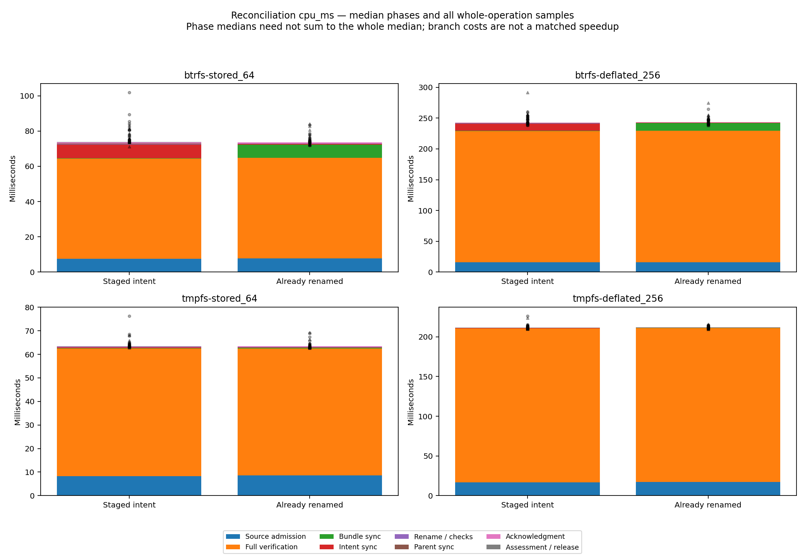
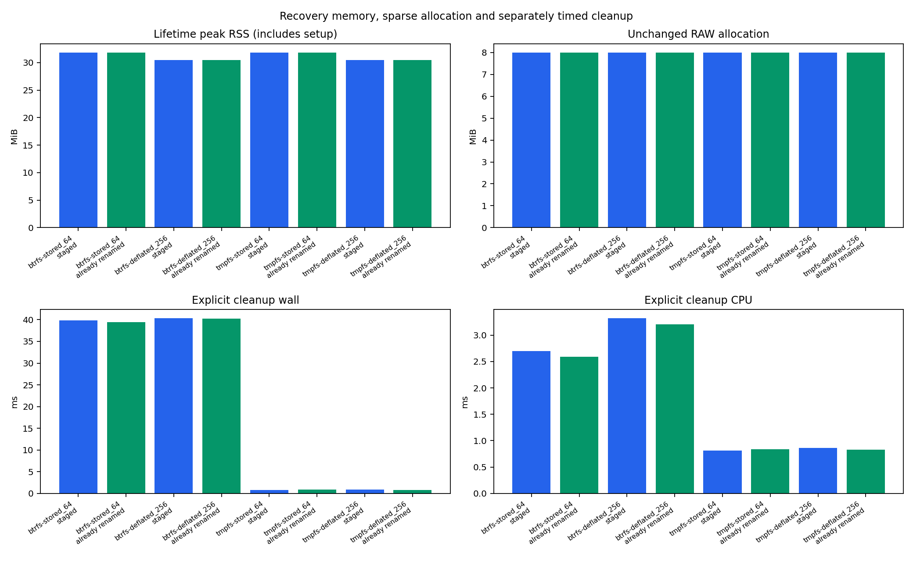
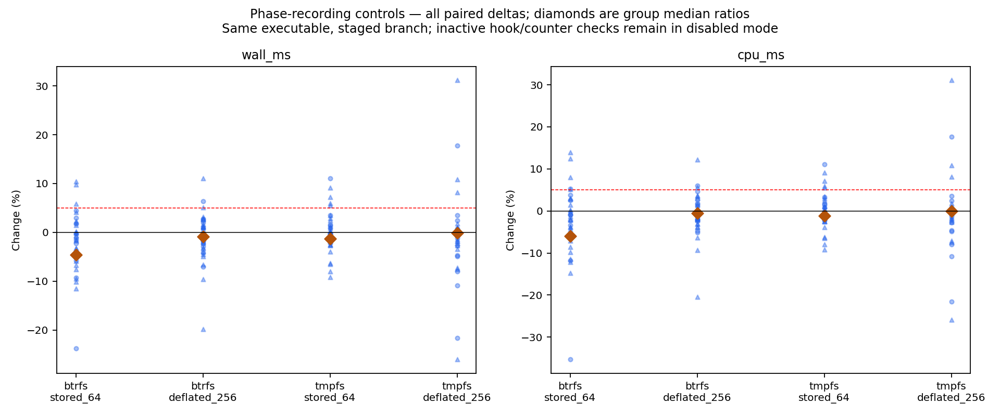

# R6.1d.1b — explicit PublishIntent reconciliation

**Completed within the local scope below, 2026-10-14.**
`JobStore::reconcile_publication` now finishes an unambiguous interrupted publication
from either its original staged bundle or its already-renamed final bundle. Both
paths require the original retained source and fresh full verification, re-establish
intent durability, sync both parents and commit a new Published acknowledgment.
There is no recopy, automatic deletion, transaction repair or remote replay.
Published-at-entry and ambiguous/unstamped resources remain ineligible.

[Contract](../../publish-intent-reconciliation.md) ·
[Acceptance matrix](../../publish-intent-reconciliation-qualification.md) ·
[ADR-0068](../../adr/0068-explicit-publish-intent-reconciliation.md)

## Validation and acceptance

[Workspace results](workspace-test-summary.json): **753 passed, 0 failed, 11 ignored**.
Nested process-loss child summaries are not double-counted.
[Clippy](clippy.txt) passed for all workspace targets with warnings denied;
[formatting](fmt.txt) passed. Release publication/reconciliation checks passed on
[Btrfs](release-focused-btrfs.txt) and [private tmpfs](release-focused-tmpfs.txt):
29 passed and 3 ignored on each. The ignored benchmarks were invoked explicitly.

The new tests are in
[reconciliation/tests.rs](../../../crates/rvvdk-vsphere/src/ownership/retained/output/publication/reconciliation/tests.rs)
and [tests/crash.rs](../../../crates/rvvdk-vsphere/src/ownership/retained/output/publication/reconciliation/tests/crash.rs).
The following maps the pre-implementation acceptance IDs to executed checks:

| Acceptance IDs | Evidence / disposition |
|---|---|
| R01–R02, R15–R16 | Both branches: independent literal full-byte oracle, original member inodes/length/allocation, exact sync/rename order, unchanged source journal, lock custody/reacquisition, redacted report and explicit cleanup. Dense and deflated fixtures also checked. |
| R03–R05 | Nine namespace pairs, all non-intent states, malformed records, source/output transactions including partial, full, symlink and directory entries. Rejected resources preserved. |
| R06–R09 | Wrong selections/bindings, source damage/loss, data and zero corruption, forged matching digest claims, metadata/length/member/marker changes, symlink/hardlink/mode cases. |
| R10–R13 | Original destination checks, existing wrong-device/private-directory regressions, late journal/source/RAW substitutions, file/directory/dangling-link collisions, real no-replace EEXIST race and pinned parent path replacement. Same-device unsupported rename filesystems remain unqualified; injected rename errors retain uncertainty. |
| R14, R17 | Shared deadline, invalid budgets, cancellation at admission/chunks/sync/rename/pre-ack and inside acknowledgment; all five commit fault boundaries, separate assessment failure, no false success from visible Published. |
| I/O failures | Private statically dispatched seam returns EIO at each of eight explicit syncs and a rename error. These are simulated syscall results, distinct from hook failures and process loss. |
| Process loss | 51 SIGKILL cases: six initial publication boundaries (including visible intent before directory sync), then 45 reconciliation boundaries. Bounded/reaped children, reopened state checked, no automatic transaction or Published repair. |

Eight additional release counter smoke operations (two branches × two fixtures ×
two filesystems) confirm two encoded hash/read traversals, one native admission,
8 MiB present-grain read, one full logical comparison/hash and one output journal
commit. The `release-smoke-*.json` files retain counters and phase regions. The
campaign disables those counters. Existing normal-publication verification counts
remain unchanged. A test-only source-stage locator was corrected during development;
its original failure is retained in [diagnostics](diagnostics/fixture-helper-failure.txt).

## Measurement design

The unchanged normal-publication test binary was frozen at
[`63cc9b0`](reference.json). Candidate and reference use the same release build flags
and fixture. [Source hashes](source-hashes.json),
[reference source hashes](reference-source-hashes.json), [binary hashes](binaries.json),
[build conditions](build-conditions.json), [toolchain](toolchain.txt),
[environment](environment.json) and [commands](commands.json) bind the observations.
No builds, tests or plotting were deliberately overlapped with timed workloads.
CPU affinity is fixed to CPU 0; host frequency, SMT and competing work are not isolated.
Caches are ordinary, with small warm fixtures; these are not live VM disk results.

The [offline harness](../../../scripts/benchmarks/measure_reconciliation.py) records
three initial rounds of four alternating pairs per group. Any >5% round-median
spread or matched adverse wall/CPU observation requests three longer rounds of
eight pairs. All ten groups triggered repeats; [decisions](repeat-decisions.json)
and all initial observations are retained. **864 operations passed**: 288 normal
(reference/candidate), 288 reconciliation and 288 recording controls.
[Measurements](measurements.json) index every raw JSON by hash;
[summary](summary.json) retains initial/repeat summaries and unresolved flags.

Reconciliation fixtures contain 8 MiB authored data, with 64 MiB stored or 256 MiB
deflated logical size. Setup, conversion and inducing the interruption are outside
timing. Both locks are preopened. Timing spans fresh source admission through final
assessment and capability release. An independent full-byte oracle and source/journal
checks follow timing; explicit output cleanup is separately timed. Lifetime process
RSS includes setup and earlier oracles. Phase medians need not sum to the whole median;
standalone rename timing is nested detail, not an additional phase.

Every final reconciliation/control observation preserved RAW inode, length and
**8,388,608 allocated bytes**, checked before recovery, immediately afterward and
again after the independent oracle. Recovery writes no RAW bytes. Eight explicit
sync calls precede/cover publication, followed by one acknowledgment commit (with
its own two syncs); explicit cleanup uses two journal commits.

## Normal-path regression comparison

These are repeat medians of round medians, in milliseconds. They measure the existing
complete retained conversion/verification/publication workload, not reconciliation.

| Filesystem / mode | Reference wall | Candidate wall | Wall change | Reference CPU | Candidate CPU | CPU change |
|---|---:|---:|---:|---:|---:|---:|
| Btrfs / owned | 222.109 | 221.610 | −0.22% | 90.915 | 91.657 | +0.82% |
| Btrfs / published | 408.068 | 410.432 | +0.58% | 214.165 | 216.252 | +0.97% |
| Private tmpfs / owned | 81.451 | 81.915 | +0.57% | 81.039 | 81.564 | +0.65% |
| Private tmpfs / published | 197.740 | 199.103 | +0.69% | 196.908 | 198.407 | +0.76% |

No whole-operation repeat-median regression exceeds 5%. This does not clear every
phase or cleanup cost: seven Btrfs and two tmpfs repeat flags remain. Published
cleanup Btrfs reference/candidate wall is 42.551/43.826 ms, CPU 6.179/7.004 ms;
tmpfs wall 0.854/0.837 ms, CPU 0.846/0.833 ms. All observations are retained.



## New reconciliation costs

Repeat medians below describe the two capabilities; branch differences are not a
matched implementation speedup. Encoding and logical capacity change together
between fixtures, so this does not isolate either scaling effect.

| Filesystem / fixture | Origin | Wall ms | CPU ms | Peak RSS MiB | Cleanup wall / CPU ms |
|---|---|---:|---:|---:|---:|
| Btrfs / stored 64 MiB | Staged | 101.318 | 74.803 | 31.824 | 39.882 / 2.695 |
| Btrfs / stored 64 MiB | Already renamed | 93.020 | 74.522 | 31.824 | 39.388 / 2.590 |
| Btrfs / deflated 256 MiB | Staged | 275.473 | 249.179 | 30.504 | 40.334 / 3.320 |
| Btrfs / deflated 256 MiB | Already renamed | 267.664 | 247.260 | 30.504 | 40.225 / 3.206 |
| Private tmpfs / stored 64 MiB | Staged | 63.719 | 63.523 | 31.852 | 0.818 / 0.813 |
| Private tmpfs / stored 64 MiB | Already renamed | 63.725 | 63.551 | 31.852 | 0.840 / 0.835 |
| Private tmpfs / deflated 256 MiB | Staged | 212.006 | 211.355 | 30.504 | 0.862 / 0.858 |
| Private tmpfs / deflated 256 MiB | Already renamed | 212.865 | 212.269 | 30.504 | 0.838 / 0.829 |

Staged Btrfs stored CPU has 5.34% round-median spread. Some short phases remain much
more variable: Btrfs deflated staged admission wall 54.08%, Btrfs stored staged
parent-sync CPU 35.09%, and tmpfs stored staged rename CPU 23.91%. Spread means
100 × (maximum/minimum − 1), not a confidence interval. Absolute phase values remain
in the raw records. Broader PERF.0 qualification remains open.





Same-binary phase-recording controls compare disabled/enabled staged operations.
Repeat group-median wall/CPU changes are −4.61%/−6.01% (Btrfs stored),
−0.84%/−0.50% (Btrfs deflated), −1.26%/−1.15% (tmpfs stored) and
−0.08%/+0.01% (tmpfs deflated). **Negative ratios do not prove a speedup or zero
recording overhead.** Inactive hooks/counter checks remain in disabled mode; frequency,
scheduling and cache effects are not isolated. Individual outliers and unresolved
repeat flags (12, 5, 12 and 16 respectively) remain visible. Production gains no
clock/counter instrumentation or option to skip verification.



All five figures also have same-named SVG files in [plots](plots/).
[Plot audit](plots/audit.json) binds raw inputs, summaries and generated artifacts;
all PNGs were visually inspected. [Final checks](final-validation.json) verified source,
reference, binary and plot hashes, relative link targets, and six deliberate invalid
measurement cases (pair order, allocation, verification work, phase omission, cleanup
failure and hash mismatch). [Log normalization](log-normalization.json) lists the
23 text logs with whitespace-only changes; original logs remain private.

## Ambient tmpfs allocation finding

The initial ambient `/tmp` tmpfs smoke failed the strict allocation assertion:
8,388,608 bytes became 8,859,648; a traced reproduction reached 10,657,792. Inode
and length stayed constant. The trace contained no RAW writes/punches after normal
publication sync. The [trace summary](diagnostics/trace-summary.json) records that
observation; the full trace remains local because it contains generated paths.
A standalone [read/hash/fsync probe](../../../scripts/benchmarks/probe_tmpfs_allocation.py)
without rvddk reproduced changes in **2/30** fresh sparse files
([raw probe](diagnostics/ambient-allocation-probe.json)). **Cause is unresolved.**
This does not identify THP, quota, kernel behavior or another process as the cause.

The isolated mount probe changed **0/30** files
([raw probe](private-mount-allocation-probe.json)); a temporary diagnostic build also
preserved allocation in 16 recovery operations. The final campaign therefore uses
an unprivileged user/mount namespace with its own tmpfs (512 MiB, mode 0700,
`huge=never`), for both binaries and both paths. No global mount, swap or THP setting
was changed. An attempted unprivileged `noswap` mount was unsupported and omitted.
Strict allocation gates were kept unchanged; all final campaign checkpoints passed.
Ambient `/tmp` allocation remains unqualified under PERF.0. A stable isolated control
does not resolve the ambient failure. Tmpfs is a volatile control and establishes
no persistence guarantee; see the [kernel tmpfs documentation](https://cdn.kernel.org/doc/html/latest/filesystems/tmpfs.html).

[Pre-control-check diagnostics](diagnostics/pre-control-check/disposition.json)
retain a preliminary campaign interrupted deliberately to add final control checks
immediately before rename/acknowledgment. Those complete observations and older
binary/source hashes are excluded from the final 864-operation count. The final
candidate was rebuilt and all required tests/measurements rerun. No failed/adverse
result was replaced by a retry. No physical power-cut/controller qualification,
large working-set capacity proof, real unsupported same-device rename filesystem,
ESXi, SSH, VM action or live integration was performed.

## Reproduction and next work

Build reference `63cc9b0` in a separate checkout and candidate using
`cargo test -p rvvdk-vsphere --lib --release --no-run --message-format=json`.
Copy each emitted test executable to distinct frozen paths and record SHA-256 hashes.
Keep build flags/toolchain equal. Use a **fresh** report directory and a Btrfs fixture
parent. Inside an unprivileged user/mount namespace, create the private tmpfs mount
with the options in [build conditions](build-conditions.json), then run:

```sh
python3 scripts/benchmarks/measure_reconciliation.py \
  --reference /path/to/frozen-reference --candidate /path/to/frozen-candidate \
  --report /path/to/new-report --btrfs-parent /path/on/btrfs \
  --tmpfs-parent /path/to/private-tmpfs
```

The harness records exact commands and refuses an existing measurement index.
Save `binaries.json` with the `reference`/`candidate` SHA-256 fields before plotting.
Use Python with Matplotlib (this run used 3.10.9):

```sh
python3 scripts/benchmarks/plot_reconciliation.py /path/to/new-report
```

The Python programs only orchestrate local Rust test executables, validate evidence,
plot it or probe a filesystem. VMware and reconciliation remain Rust. Raw samples
are unchanged; any whitespace-only text-log normalization is separately recorded.

Next: **R6.1d.2a**, design explicit fresh attestation for Published-at-entry after an
uncertain/lost acknowledgment. Do not treat a journal read as a witnessed durable
commit. Keep transaction repair and unstamped-stage adoption separate. Continue
PERF.0 allocation diagnosis, controlled timing and digest-equivalent SHA-256 tuning
without dropping full verification or durability gates.
