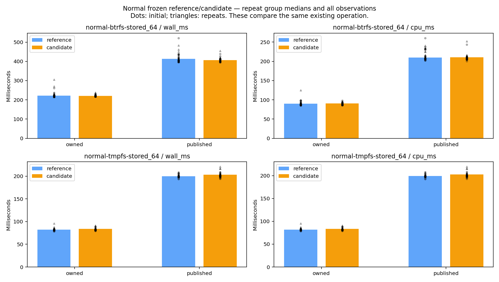
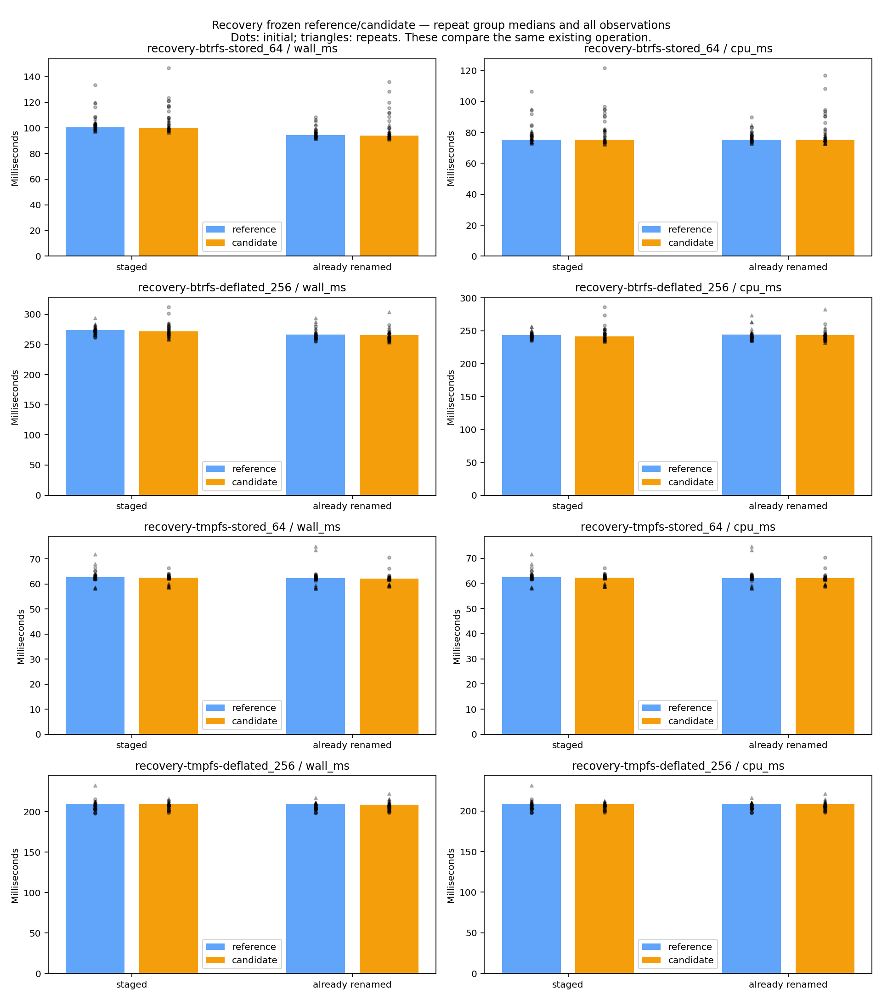
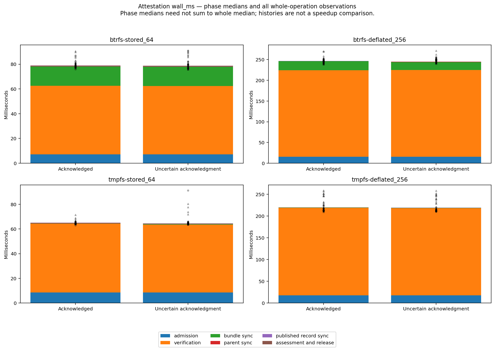
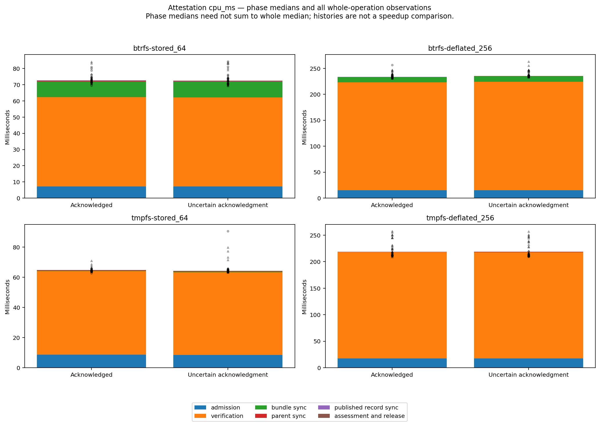
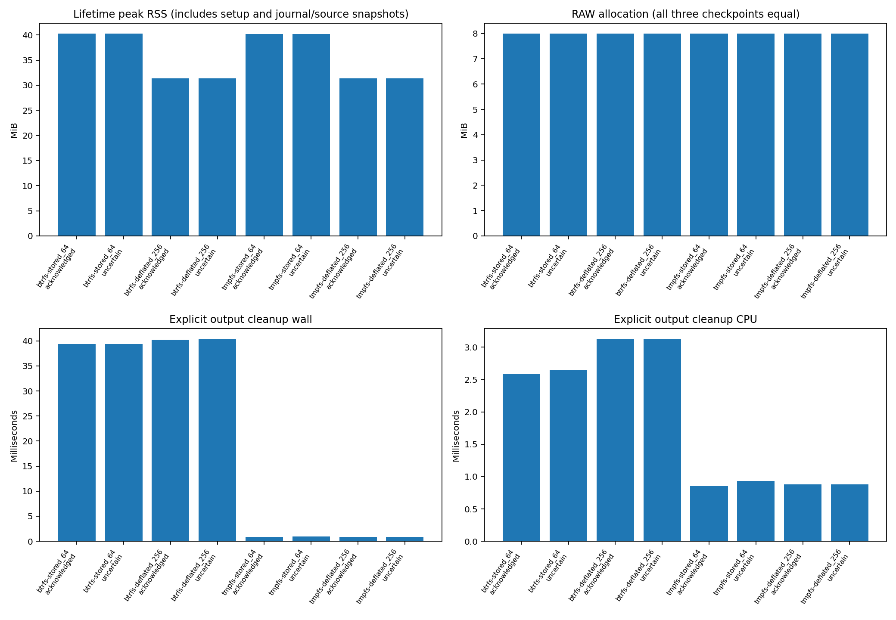
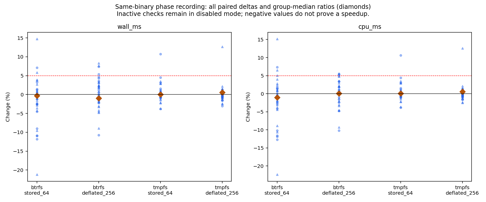

# R6.1d.2b — fresh Published-output attestation

**Completed within the bounded local scope below, 2026-10-14.**

`JobStore::attest_publication` freshly verifies an already-Published output and
observes new bundle/namespace/journal sync barriers. It requires the original retained
source, original locked parents, no source/output transaction, absent stage and owned
final bundle. It leaves the Published journal's bytes, inode and sequence 8 unchanged.
A separate report describes this invocation; it never infers earlier success or
performs a new acknowledgment, rename, deletion or remote operation.

[Contract](../../published-output-attestation.md) ·
[Acceptance matrix](../../published-output-attestation-qualification.md) ·
[ADR-0069](../../adr/0069-fresh-published-output-attestation.md)

## Correctness and failure qualification

[Workspace results](workspace-test-summary.json): **772 passed, 0 failed, 12 ignored**.
Nested child summaries are not counted twice. All-target [Clippy](clippy.txt) with
warnings denied and [formatting](fmt.txt) passed. Ignored benchmarks are invoked
separately during release qualification. The release-focused logs preserve tests on
[Btrfs](release-focused-btrfs.txt) and [private tmpfs](release-focused-tmpfs.txt):
**46 passed, 0 failed, 4 ignored** on each.

The new [test module](../../../crates/rvvdk-vsphere/src/ownership/retained/output/publication/attestation/tests.rs)
adds 19 non-ignored tests, with parameterized cases rather than one test per assertion.
[Process-loss tests](../../../crates/rvvdk-vsphere/src/ownership/retained/output/publication/attestation/tests/crash.rs)
add **36 SIGKILL cases**: 18 originating acknowledgment boundaries across normal
publication and both reconciliation origins, plus 18 inside/after attestation.
Each child must reach its selected hook, exit by SIGKILL and be reaped within its
bound; a timeout is failure. Existing intent reconciliation still rejects Published
and pending transactions. An earlier failed report remains a failure even when a
separate fresh attestation succeeds.

| Acceptance groups | Executed evidence and scope |
|---|---|
| A01–A02 | Normal and uncertain Published histories, repeated full attestation, original source/output journal bytes/inodes, exact eight-sync order and journal descriptor identity; six acknowledgment hook failures and originating SIGKILL cases. |
| A03–A04 | Full nine-pair classifier, realizable missing/misplaced/foreign/extra namespaces, all non-Published states through real state transitions, malformed versions/sequences/stamps/checksums/fields/bindings. Existing shared record validation remains unchanged. |
| A05–A07 | Source/output transactions including matching complete records, partial, symlink and directory entries; source loss/cleanup/corruption; wrong selection/destination/store and late identical-byte journal replacements. |
| A08–A11 | Independent literal complete RAW oracle for sparse/dense and stored/deflated fixtures; data/zero corruption and jointly forged digest/metadata, length/member/marker/extra entry/symlink/hardlink/mode changes, late substitutions, pinned parent replacements. Existing destination privacy/device/containment regressions retained. |
| A12–A13 | Pre-cancellation, invalid timeout bounds, shared expiry during admission/verification and final assessment, control checks around all sync boundaries, paired-sync deferral, locks held through final checks and reacquired on return. |
| A14–A17 | Original source/output bytes/inodes, RAW length/allocation checkpoints, every report success gate, redacted Debug/JSON, primary/assessment error separation, final post-assessment source transaction/journal checks and independent cleanup eligibility after source cleanup. |
| I/O faults | EIO, EINTR and EINVAL simulated at each of eight sync calls: 24 cases. Stop on failing call, preserve resources and repeat full work on explicit retry. Private seam results are distinct from hook failures and SIGKILL. |

The shared source binding helper moved to the publication parent module. Existing
normal publication and reconciliation code retain their protocols; narrowly increased
private hook visibility permits tests of both originating reconciliation paths.
Attestation uses the existing private full validator, with its encoded/native source
admission and post-read checks. Final binding checks bracket assessment because output
assessment alone cannot detect a late source transaction. Production has no clocks,
counters, verification bypass, journal-repair policy or cleanup-on-drop behavior.

Eight additional release counter smoke operations (two histories × two fixtures ×
two filesystems) confirm two encoded-source hash/read traversals, one native admission,
8 MiB present-grain read and one full logical comparison/hash. They observed eight
explicit syncs and no journal-commit region; `release-smoke-*.json` retains exact work
and phase regions. Main campaign counters are disabled.

The [syscall audit](syscall-audit.json) independently checks two marker-delimited
attestation intervals from the release binary. Each contained exactly eight successful
`fsync` calls, **zero application mutation syscalls and zero writable/creating opens**.
This includes no write/pwrite, rename, unlink, truncate, allocation, link or mkdir
calls. Setup and later oracles/cleanup lie outside the intervals; diagnostic timings
in [syscall-smoke.json](syscall-smoke.json) are excluded from the main campaign. The
full trace remains local and its hash is retained. This supports the no-write/no-rename
contract without treating protocol constants in benchmark rows as syscall measurement.

## Measurement boundaries and provenance

Reference code/executable was frozen at [`0e621b9`](reference.json) before Rust edits.
[Reference sources](reference-source-hashes.json), [candidate sources](source-hashes.json),
[binaries](binaries.json), [build conditions](build-conditions.json),
[toolchain](toolchain.txt), [environment](environment.json) and [commands](commands.json)
bind the campaign. The prior [R6.1d.1b evidence](../2026-10-14-r61d1b/README.md) is unchanged.

The [harness](../../../scripts/benchmarks/measure_attestation.py) compares the existing
normal workload and both reconciliation branches against their frozen reference,
then measures new attestation histories and same-binary recording controls separately.
It preserves the preceding benchmark row schemas and work/allocation gates; the
preceding campaign script is unchanged. Normal
publication is 64 MiB logical/8 MiB data; recovery/attestation use stored 64 MiB and
deflated 256 MiB logical fixtures, each with 8 MiB authored data. Encoding and capacity
change together; no independent scaling attribution is justified.

All workloads run serially inside one unprivileged user/mount namespace. Btrfs is the
persistent local filesystem; tmpfs is a private 512 MiB volatile control with mode
0700 and `huge=never`. No global filesystem, swap or THP setting changes. CPU affinity
is fixed to CPU 0; frequency, SMT and competing host work are not isolated. Ordinary
caches and small warm fixtures do not establish live-disk or capacity performance.
No build, test or plot generation is deliberately overlapped with timed operations.

Setup, conversion/publication and inducing the uncertain acknowledgment are outside
attestation timing. Both parent locks are preopened. Timing covers fresh source
admission through final assessment, binding/control checks and capability release.
Phase clocks divide admission, verification, bundle sync, parent sync, Published
record sync and final assessment/checks/release. Lifetime peak RSS includes setup and
independent source/journal snapshots; it is not an isolated production-memory bound.
An independent full RAW oracle plus source/journal checks follows timing; explicit
output cleanup is timed separately. Final fixture teardown is excluded.

Three initial rounds of four alternating pairs are retained for every group. Any
>5% round-median spread or adverse matched wall/CPU observation triggers three longer
rounds of eight pairs, with decisions saved before repeats. [Raw measurements](measurements.json)
index per-run numeric JSON by hash; [repeat decisions](repeat-decisions.json) and
[summary](summary.json) retain initial results and unresolved flags. No outliers are
removed or failed observations replaced by a passing retry.

Every new timing sample requires equal RAW allocation at initial, immediately after
attestation and post-oracle checkpoints, plus original inode/length and both journal
bytes/inodes. The operation writes no RAW or journal bytes. The isolated mount does
not resolve the prior ambient `/tmp` allocation finding, which remains in PERF.0.
Performance variations and recording overhead must be evaluated from the observations
below; negative recording deltas do not establish speedup or zero overhead.

## Timer-resolution correction and continuation

The first campaign segment stopped in Python validation after a successful tmpfs
reconciliation sample reported **0.0 ms CPU** for a 0.000404 ms wall parent-sync phase.
The prior validator required every CPU phase to be strictly positive. The Rust test
and both executables' round completed successfully; this was a validator rejection,
not an attestation or reconciliation failure. [Original rejection](diagnostics/timer-resolution-rejection.txt),
[original harness](diagnostics/measure_attestation-before-resolution-fix.py) and
[original environment](diagnostics/original-environment.json) are retained.

The new validator accepts finite nonnegative CPU values for short phases/standalone
rename only. Whole-operation, cleanup and wall times remain strictly positive;
negative/nonfinite measurements still reject. Zero stays zero, with no epsilon or
sample removal. Summaries count zero-resolution samples, use null for an undefined
relative spread and retain a resolution-limited flag when a round median is zero.

[Resume provenance](resume.json) records the unchanged executables, prior/current
harness hashes and numeric-file hashes. All 28 indexed rounds and their repeat
choices revalidated unchanged. Both completed files from the rejected next round
were admitted with their successful command records, then only missing work ran.
The private tmpfs mount was recreated with identical options; this pause is part of
the environmental limits. [Pre-resume hashes](diagnostics/pre-resume-hashes.json)
preserve the original record. No raw numeric observation was edited or discarded.
The harness supports `--resume` only with matching binary/kernel/affinity/mount
conditions and validated prior results; it refuses unexplained existing output files.

## Campaign results

**1,440 timed operations passed** across 14 groups and 84 rounds: 288 normal,
576 reconciliation, 288 attestation and 288 recording-control operations. All 14 groups
triggered longer repeats. All initial samples
and scheduled repeats are retained. Tables use the median of round medians from
repeats when triggered (otherwise initial rounds). Changes compare the same existing
operation between frozen builds; new attestation histories have no old implementation
to compare as a speedup.

Existing-path whole wall/CPU repeat-median changes lie between **−1.65% and +2.03%**;
none exceeds the 5% regression threshold. This does not clear every phase or cleanup
metric. Normal-workload repeat flags remain on Btrfs (11) and tmpfs (6); reconciliation
flags remain for all fixture/filesystem groups. The large initial Btrfs stored
reconciliation gap did not persist in longer repeats. Keep those initial samples and
host/cache/frequency limits visible rather than attributing a causal speedup.

### Existing normal workload

| Filesystem / mode | Reference wall ms | Candidate wall ms | Wall change | Reference CPU ms | Candidate CPU ms | CPU change |
|---|---:|---:|---:|---:|---:|---:|
| btrfs / owned | 221.902 | 221.043 | -0.39% | 89.668 | 90.691 | +1.14% |
| btrfs / published | 412.787 | 406.004 | -1.64% | 209.969 | 210.130 | +0.08% |
| tmpfs / owned | 82.261 | 83.924 | +2.02% | 81.928 | 83.550 | +1.98% |
| tmpfs / published | 200.034 | 203.340 | +1.65% | 199.290 | 202.467 | +1.59% |



### Existing reconciliation

| Filesystem / fixture / branch | Reference wall ms | Candidate wall ms | Wall change | Reference CPU ms | Candidate CPU ms | CPU change |
|---|---:|---:|---:|---:|---:|---:|
| btrfs / stored_64 / staged | 100.335 | 99.647 | -0.69% | 75.375 | 75.403 | +0.04% |
| btrfs / stored_64 / already_renamed | 94.234 | 94.016 | -0.23% | 75.299 | 75.038 | -0.35% |
| btrfs / deflated_256 / staged | 273.652 | 271.562 | -0.76% | 243.460 | 241.383 | -0.85% |
| btrfs / deflated_256 / already_renamed | 266.329 | 265.514 | -0.31% | 244.320 | 243.644 | -0.28% |
| tmpfs / stored_64 / staged | 62.622 | 62.473 | -0.24% | 62.432 | 62.276 | -0.25% |
| tmpfs / stored_64 / already_renamed | 62.342 | 62.197 | -0.23% | 62.145 | 62.014 | -0.21% |
| tmpfs / deflated_256 / staged | 209.651 | 209.200 | -0.22% | 209.012 | 208.561 | -0.22% |
| tmpfs / deflated_256 / already_renamed | 209.467 | 208.728 | -0.35% | 208.835 | 208.168 | -0.32% |



### New attestation

| Filesystem / fixture / history | Wall ms | CPU ms | Peak RSS MiB | Cleanup wall / CPU ms |
|---|---:|---:|---:|---:|
| btrfs / stored_64 / acknowledged | 79.436 | 73.181 | 40.305 | 39.394 / 2.589 |
| btrfs / stored_64 / uncertain | 79.029 | 72.857 | 40.305 | 39.404 / 2.647 |
| btrfs / deflated_256 / acknowledged | 246.832 | 235.553 | 31.336 | 40.264 / 3.128 |
| btrfs / deflated_256 / uncertain | 248.054 | 235.415 | 31.336 | 40.410 / 3.128 |
| tmpfs / stored_64 / acknowledged | 64.952 | 64.689 | 40.230 | 0.866 / 0.853 |
| tmpfs / stored_64 / uncertain | 64.478 | 64.249 | 40.230 | 0.939 / 0.929 |
| tmpfs / deflated_256 / acknowledged | 219.421 | 218.608 | 31.336 | 0.891 / 0.880 |
| tmpfs / deflated_256 / uncertain | 219.722 | 218.844 | 31.336 | 0.889 / 0.880 |

All new attestation/control samples retained **8,388,608 allocated RAW bytes** at
all three checkpoints. Whole-operation sample dots include initial observations and
repeats; phase medians need not sum to the whole median.







### Recording controls and unresolved variation

| Filesystem / fixture | Enabled/disabled wall change | Enabled/disabled CPU change | Repeat unresolved flags |
|---|---:|---:|---:|
| btrfs / stored_64 | -0.30% | -1.03% | 6 |
| btrfs / deflated_256 | -0.98% | +0.05% | 9 |
| tmpfs / stored_64 | +0.06% | +0.06% | 12 |
| tmpfs / deflated_256 | +0.59% | +0.58% | 5 |

These ratios are diagnostic observations, not causal overhead estimates. Inactive
hook/counter checks remain in disabled mode; CPU frequency, scheduling and cache
effects are not isolated. All paired outliers remain in the plot.



The 256 MiB tmpfs attestation repeats still have **15.02% acknowledged wall spread**
(14.92% CPU) and **14.43% uncertain-history wall spread** (14.33% CPU). The third
repeat was slower in both histories, mainly in full verification: acknowledged
verification CPU rose from 197.092 to 227.152 ms between the first and third repeat.
Required longer repeats did not settle this variation. Recorded frequency endpoints
and host load are not in-operation averages and do not establish its cause. This new
operation's timing stability remains open in PERF.0, alongside shorter phase and
cleanup variation; bounded functional qualification does not imply performance clearance.

The [summary](summary.json) retains every unresolved phase, cleanup and whole-metric
flag. Spread is 100 × (maximum/minimum − 1) across round medians, not a confidence
interval. Short phase ratios must be read with absolute timings. PERF.0 remains open.

All six figures also have same-named SVG files. The [plot audit](plots/audit.json)
binds inputs, summaries, script and generated artifacts. [Final validation](final-validation.json)
checks source/reference/binary hashes, retained pre-resume sample hashes and eleven
deliberately invalid measurement cases. [Log normalization](log-normalization.json)
records whitespace-only changes to eight text logs; numeric JSON is unchanged.
All six PNGs were visually
inspected. [Phase accounting](phase-accounting.json) retains four zero-CPU phases and
checks per-observation phase totals. Callback bookkeeping gaps remain in whole wall
time (maximum 0.055302 ms); CPU totals agree within floating rounding. These gaps
are not assigned to an I/O phase or removed from the recording controls.

## Reproduction and limits

Build the reference commit in a separate checkout and candidate with the command in
[build conditions](build-conditions.json); freeze each emitted test executable before
running anything else. Keep compiler flags/toolchain equal. Create a fresh report
path, Btrfs fixture parent and private tmpfs within an unprivileged user/mount namespace
(`unshare --user --map-root-user --mount`). Mount tmpfs with the recorded options, then:

```sh
python3 scripts/benchmarks/measure_attestation.py \
  --reference /path/to/frozen-reference --candidate /path/to/frozen-candidate \
  --report /path/to/new-report --btrfs-parent /path/on/btrfs \
  --tmpfs-parent /path/to/private-tmpfs
```

The harness refuses an existing measurement index. Save `binaries.json` with the
reference/candidate SHA-256 fields. With Python and Matplotlib available, generate
standalone SVG/PNG artifacts from all retained observations:

```sh
python3 scripts/benchmarks/plot_attestation.py /path/to/new-report
```

Counter smokes use the ignored `attestation_histories` Rust test with
`RVVDK_ATTEST_COUNTERS=1`, one pair and each fixture/filesystem. Syscall auditing uses
`RVVDK_ATTEST_AUDIT=1` and `--nocapture`; start/end markers exclude fixture setup and
oracles from audited intervals. Numeric samples from these diagnostic runs are
separate from the main campaign. Python only orchestrates local Rust executables,
validates evidence and plots; VMware/data/recovery logic remains Rust.

This package does not qualify physical power cuts, controllers, prior writeback-error
repair, hostile same-user mutation, large working sets, other filesystems, live runner
integration or general recovery. No ESXi/SSH connection or VM action occurred. Source
cleanup makes attestation unavailable; explicit output cleanup remains independently
eligible. Transaction promotion/repair and unstamped-stage adoption remain blocked.

Next: **R6.1d.3a**, design explicit recovery of interrupted Published-acknowledgment
transactions. Define acceptable old/new journal pairs and fresh source/content/
namespace evidence before adding mutation. Preserve partial/foreign transactions;
keep source transactions and unstamped stages separate. Retain PERF.0 timing,
allocation, CPU-feature/hash tuning and capacity follow-ups.
