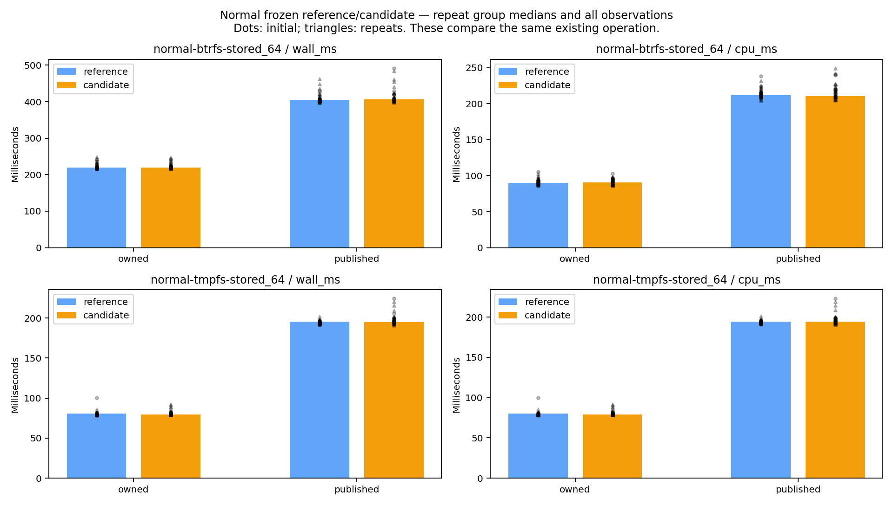
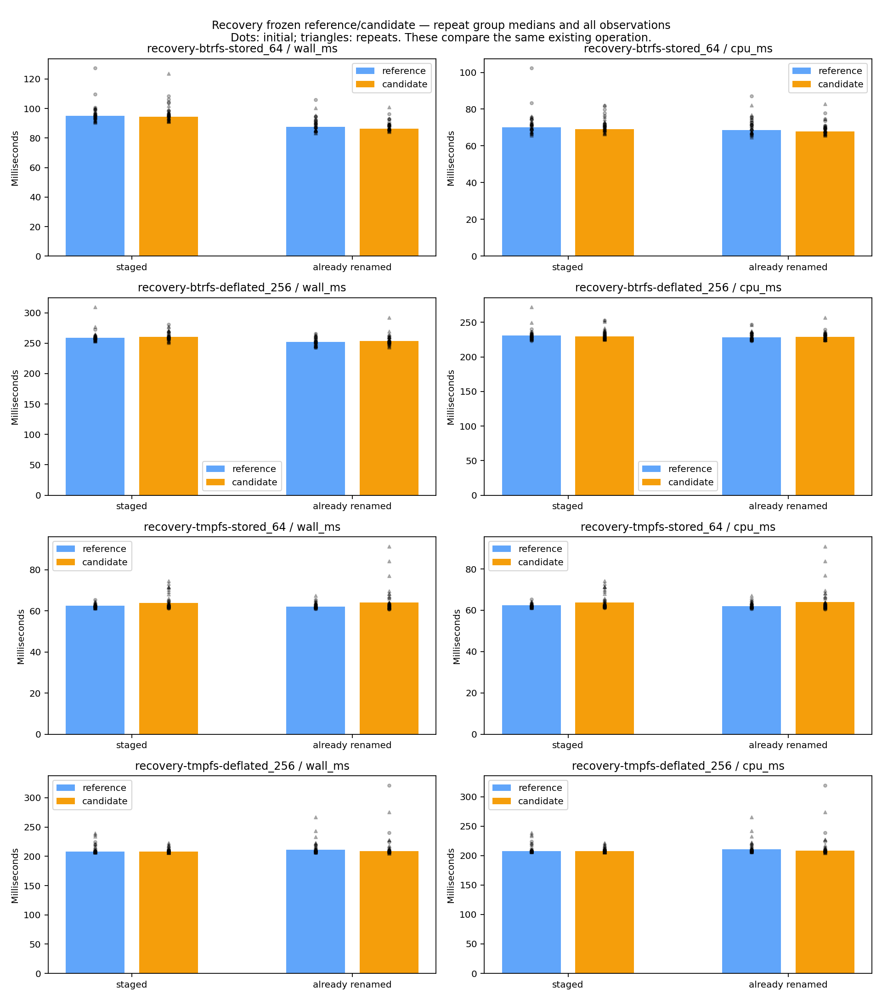
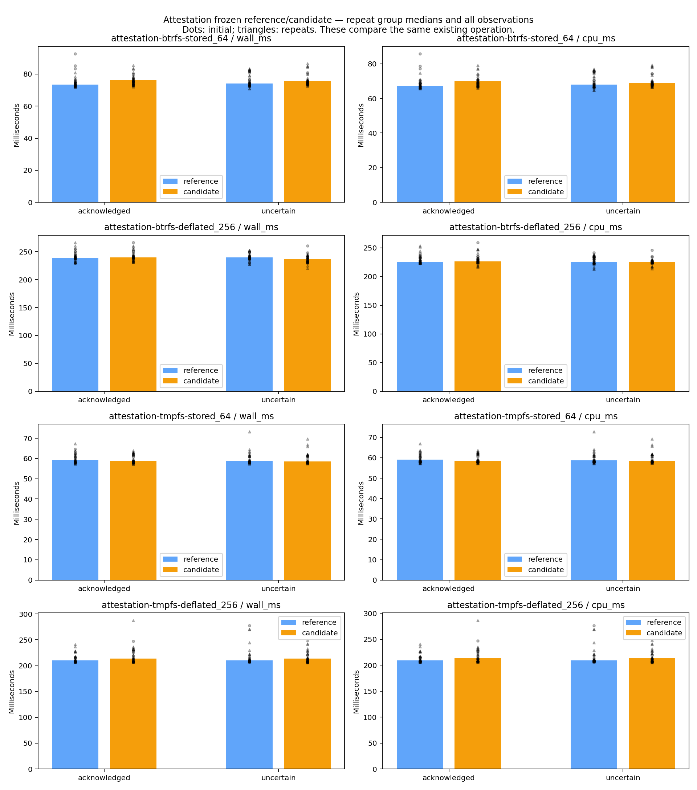
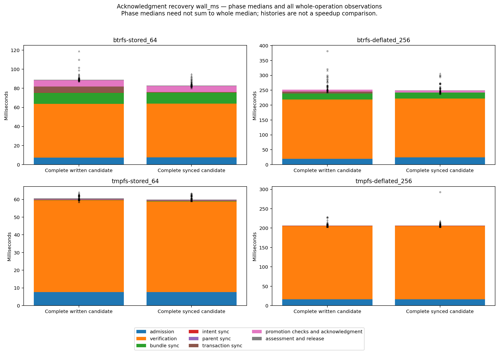
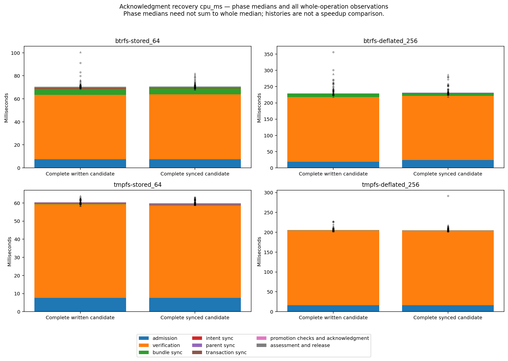
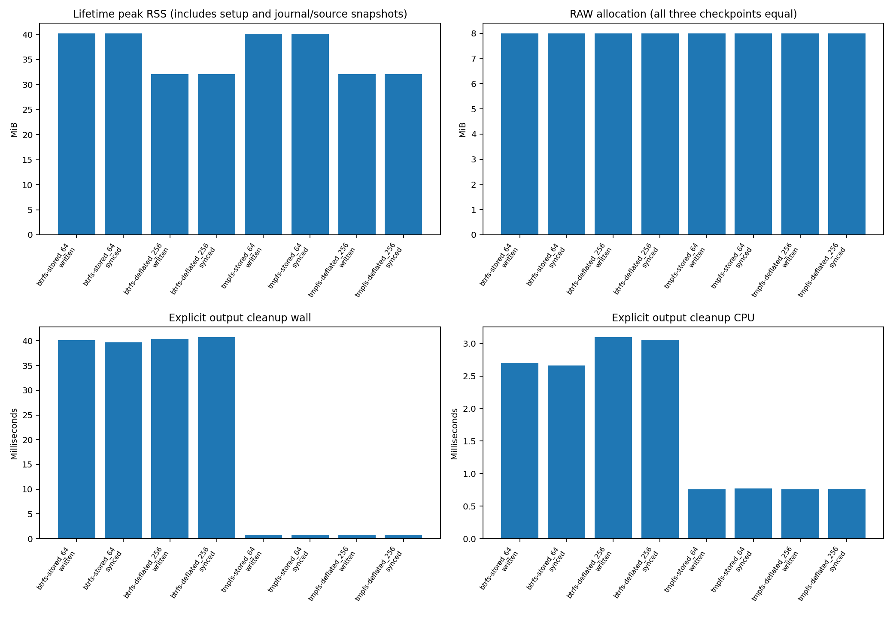
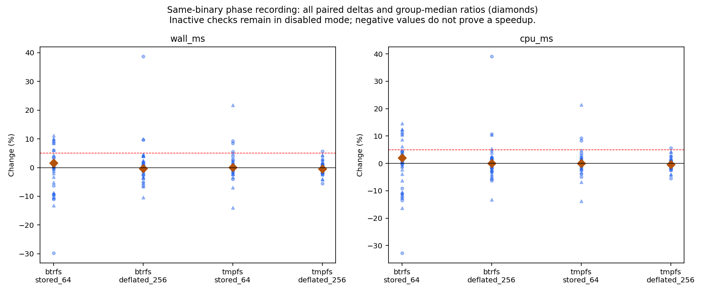

# R6.1d.3b — matched Published acknowledgment transaction recovery

**Completed within the bounded local scope below, 2026-10-14.**

`JobStore::recover_publication_acknowledgment` freshly verifies the original retained
source and full RAW output, then promotes only the complete Published sequence-8
transaction matching the current PublishIntent sequence-7 record. All other record
fields must match. Ten syncs and one journal replacement preserve the candidate's
exact bytes/inode at the journal name. No payload/journal byte write, new transaction,
bundle rename, automatic retry or cleanup is performed.

[Contract](../../published-acknowledgment-recovery.md) ·
[Acceptance plan](../../published-acknowledgment-recovery-qualification.md) ·
[ADR-0070](../../adr/0070-matched-published-transaction-recovery.md)

## Correctness, failures and limitations

[Workspace results](workspace-test-summary.json): **792 passed, 0 failed, 13 ignored**.
Nested child summaries are not double-counted. [Clippy](clippy.txt), with all targets
and warnings denied, and [formatting](fmt.txt) passed. Ignored benchmarks run separately.
Release publication tests passed on [Btrfs](release-focused-btrfs.txt) and
[private tmpfs](release-focused-tmpfs.txt): **66 passed, 0 failed, 5 ignored** each
(307.98 seconds and 17.19 seconds respectively).

The new [tests](../../../crates/rvvdk-vsphere/src/ownership/retained/output/publication/acknowledgment/tests.rs)
add 20 non-ignored tests with parameterized assertions, plus one ignored benchmark.
[Process-loss tests](../../../crates/rvvdk-vsphere/src/ownership/retained/output/publication/acknowledgment/tests/crash.rs)
execute **60 SIGKILL cases**: 18 originating boundaries across three publication paths,
and 21 recovery boundaries for each complete-written/complete-synced candidate history.
Each child must reach its hook and be reaped within the bound; timeout is failure.

| Acceptance groups | Evidence and bounded scope |
|---|---|
| T01–T03 | Six genuine originating histories, all fourteen successor fields independently corrupted, all incompatible states through real transitions with absent/complete candidate cases, missing/invalid old records, partial/equal/foreign/cleanup candidates. Existing APIs still reject pending transactions. |
| T04–T07 | Bounded malformed/duplicate/trailing/oversized envelopes; checksum, unknown-field, symlink/directory/FIFO/hardlink/mode exclusions; nine namespace classifier pairs and realizable invalid states; retained-source transactions/loss/cleanup; explicit selection and destination constraints; pinned-parent replacements. |
| T08–T12 | Independent stored/deflated, dense/sparse full RAW oracle; zero/data corruption and jointly forged digest/metadata; length/metadata/owner/unknown-member faults; exact candidate promotion, same-byte inode and same-inode byte substitutions, late source/output transaction and namespace changes. Original source bytes/inodes and RAW allocation/identity preserved. |
| T13–T17 | Both locks held through final checks; one deadline, pre-cancellation/options and phase cancellation with paired-sync deferral; all report gates and redaction; separate primary/assessment errors; explicit retry/attestation and cleanup boundaries; existing publication/reconciliation/attestation regressions retained. |
| T18 and I/O faults | Exact ten-sync order and old/candidate descriptor identity; one promotion and zero commit_output calls. Thirty sync errors (EIO/EINTR/EINVAL), four rename-error labels and four simulated promotion-with-error returns retain uncertainty and prohibit rollback or in-call retry. |

The rename seam returns the API's sanitized Uncertain error; its four error labels
exercise the same return contract, not four real kernel errno-producing faults.
The promotion-with-error cases perform the real rename before returning an injected
error. They deliberately keep promotion/durability flags false despite visible
Published. Hook errors, simulated syscall results and SIGKILL are distinct evidence.
Wrong-owner and actual device-node fixtures were not created in this unprivileged
campaign; existing private-file checks remain in use. Special-file exclusion has a
real FIFO case with nonblocking descriptor opening, plus symlink/directory cases.

A [first workspace attempt](diagnostics/workspace-first-attempt.txt) failed in a new
test fixture: the late-output-transaction label fell through to stage-directory
creation, so its expected transaction-existence assertion failed. The explicit
fixture branch was added; production code was unchanged. The full corrected workspace
run passed before release freeze. The failed log is retained; no benchmark sample
was removed or replaced for this correction.

Only bounded envelope decoding and the private full-content binding guard are shared
changes. Existing callers still use the no-transaction guard. The new admitted pair
pins read-only descriptors, exact envelope bytes and distinct identities; the old
journal pathname is intentionally replaced only after full verification. Source/output
checks bracket assessment. No clocks/counters/skip options exist in production.

Six-origin counter assertions run in each focused release suite. Eight additional
release counter smoke operations (two histories × two fixtures × two filesystems)
confirm two encoded-source read/hash traversals, one native admission, 8 MiB present
grain reads and one complete logical comparison/hash, ten syncs and one promotion.
No journal-commit region occurs during recovery; cleanup's two commits are separately
counted and asserted. `release-smoke-*.json` retains the work counters.

The [syscall audit](syscall-audit.json) checks two marker-delimited release intervals.
Each must contain ten successful fsync calls, one same-store flags-0 journal rename,
no writable/creating opens and no application byte-write, unlink, bundle rename or
allocation syscall. Setup, oracle and cleanup are outside the measured markers.
Raw trace paths remain private; the public artifact records its hash and verdicts.
The trace shows `renameat`: the installed libc routes the requested flags-zero
`renameat2` call to it, as verified by [local disassembly](diagnostics/libc-renameat2.txt).
The first private audit parser assumed a literal renameat2 syscall and rejected that
name. The [recorded correction](diagnostics/audit-parser-correction.json) accepts the
equivalent renameat form while retaining exact source/destination name, same-store,
sync-order and no-write gates. Neither trace, Rust binary nor measured sample changed.

## Measurement method and provenance

Frozen reference: `bdc26ef`; [reference metadata](reference.json),
[source hashes](reference-source-hashes.json), [candidate source hashes](source-hashes.json),
[binary hashes](binaries.json), [build conditions](build-conditions.json),
[toolchain](toolchain.txt), [environment](environment.json), [commands](commands.json).
The reference contains all three unchanged existing benchmark entry points.

One workload runs at a time. Normal publication, both reconciliation branches and both
attestation histories compare reference/candidate builds with alternating execution
order. New recovery measures written/synced candidates from normal publication;
all six originating paths have correctness/counter coverage. Recording controls use
the written-candidate history with identical verification gates. Different histories,
operations, encodings or logical sizes are not optimization comparisons.

Fixture setup, original interruption and lock opening are outside timing. Whole timing
includes fresh pair/source admission through final checks, assessment and capability
release. Disjoint phases include admission, full verification, bundle, old intent,
parents, candidate sync, promotion checks/acknowledgment and assessment/release. The
final pre-promotion binding/control gate belongs to promotion_checks_and_acknowledgment,
keeping all arbitrary callbacks before that gate. Phase medians need not sum to whole
medians; callback bookkeeping gaps are retained in [phase accounting](phase-accounting.json).

Fixtures are stored 64 MiB and deflated 256 MiB logical RAW with 8 MiB data. Btrfs is
the persistent local filesystem; private tmpfs uses size=512m,mode=0700,huge=never and
establishes no persistence guarantee. Normal caches, fixed CPU affinity; host work,
SMT and frequency are not isolated. Frequency endpoints are not in-operation averages.
Lifetime peak RSS includes setup, native maps and independent source/journal snapshots.
RAW allocation is checked initially, immediately after recovery and after the complete
independent oracle. Explicit output cleanup is measured separately.

Three initial rounds of four pairs precede three longer rounds of eight pairs whenever
spread exceeds 5%, a matched wall/CPU observation is adverse, or a short phase reaches
zero CPU resolution. Adverse means any positive observed delta for repeat selection,
not statistical significance. All initial/repeat samples are retained. Short-phase CPU
zeros stay exactly zero; relative spreads with zero denominators are null and flagged.
Whole/cleanup time gates stay positive; negative/nonfinite data is rejected.

[Measurements](measurements.json), [repeat decisions](repeat-decisions.json),
[summary](summary.json), [validator/provenance checks](final-validation.json) and
[artifact manifest](artifact-manifest.json) retain the audit trail.

**2,016 timed operations** across 18 groups. All measured operations and independent byte/allocation/cleanup checks passed.

Existing-path whole wall/CPU repeat-median changes range from **−1.42% to +3.85%**;
none exceeds 5%. This does not establish statistical equivalence or clear individual
rounds, phases, cleanup or recording overhead. The largest positive median change is
acknowledged Btrfs 64 MiB attestation CPU (+3.85%).

The new 256 MiB Btrfs written-candidate history retains **5.71% wall spread** and
**5.23% CPU spread** after longer repeats. Existing 64 MiB tmpfs staged reconciliation
retains **11.68% wall spread**, and 256 MiB tmpfs uncertain attestation retains
**10.45% wall spread** (10.36% CPU). These observations remain PERF.0 findings; host
frequency/load endpoints do not establish their cause. No extra samples replaced
those observations, and no resumed campaign was needed.

## Existing normal publication

| Filesystem / fixture / mode | Reference wall ms | Candidate wall ms | Wall change | Reference CPU ms | Candidate CPU ms | CPU change |
|---|---:|---:|---:|---:|---:|---:|
| btrfs / stored_64 / owned | 220.025 | 219.700 | -0.15% | 90.159 | 90.519 | +0.40% |
| btrfs / stored_64 / published | 403.347 | 406.910 | +0.88% | 211.899 | 210.463 | -0.68% |
| tmpfs / stored_64 / owned | 80.400 | 79.633 | -0.95% | 80.037 | 79.285 | -0.94% |
| tmpfs / stored_64 / published | 195.225 | 194.833 | -0.20% | 194.521 | 194.112 | -0.21% |

## Existing reconciliation

| Filesystem / fixture / mode | Reference wall ms | Candidate wall ms | Wall change | Reference CPU ms | Candidate CPU ms | CPU change |
|---|---:|---:|---:|---:|---:|---:|
| btrfs / stored_64 / staged | 95.197 | 94.430 | -0.81% | 70.126 | 69.134 | -1.42% |
| btrfs / stored_64 / already_renamed | 87.585 | 86.352 | -1.41% | 68.661 | 67.985 | -0.98% |
| btrfs / deflated_256 / staged | 258.493 | 260.005 | +0.58% | 230.723 | 229.485 | -0.54% |
| btrfs / deflated_256 / already_renamed | 252.241 | 253.592 | +0.54% | 228.515 | 229.257 | +0.32% |
| tmpfs / stored_64 / staged | 62.620 | 63.896 | +2.04% | 62.364 | 63.710 | +2.16% |
| tmpfs / stored_64 / already_renamed | 62.219 | 64.121 | +3.06% | 61.995 | 63.900 | +3.07% |
| tmpfs / deflated_256 / staged | 208.346 | 208.508 | +0.08% | 207.710 | 207.870 | +0.08% |
| tmpfs / deflated_256 / already_renamed | 211.589 | 209.169 | -1.14% | 210.862 | 208.467 | -1.14% |

## Existing attestation

| Filesystem / fixture / mode | Reference wall ms | Candidate wall ms | Wall change | Reference CPU ms | Candidate CPU ms | CPU change |
|---|---:|---:|---:|---:|---:|---:|
| btrfs / stored_64 / acknowledged | 73.442 | 76.027 | +3.52% | 67.168 | 69.750 | +3.85% |
| btrfs / stored_64 / uncertain | 74.166 | 75.720 | +2.10% | 67.944 | 69.018 | +1.58% |
| btrfs / deflated_256 / acknowledged | 239.378 | 239.931 | +0.23% | 226.125 | 226.526 | +0.18% |
| btrfs / deflated_256 / uncertain | 239.594 | 236.945 | -1.11% | 225.796 | 225.218 | -0.26% |
| tmpfs / stored_64 / acknowledged | 59.256 | 58.694 | -0.95% | 59.108 | 58.539 | -0.96% |
| tmpfs / stored_64 / uncertain | 58.886 | 58.486 | -0.68% | 58.729 | 58.348 | -0.65% |
| tmpfs / deflated_256 / acknowledged | 209.939 | 213.843 | +1.86% | 209.329 | 213.069 | +1.79% |
| tmpfs / deflated_256 / uncertain | 210.092 | 213.915 | +1.82% | 209.420 | 213.101 | +1.76% |

## New acknowledgment recovery

| Filesystem / fixture / history | Wall ms | CPU ms | Peak RSS MiB | Cleanup wall / CPU ms |
|---|---:|---:|---:|---:|
| btrfs / stored_64 / written | 89.802 | 71.254 | 40.230 | 40.084 / 2.699 |
| btrfs / stored_64 / synced | 84.124 | 71.780 | 40.230 | 39.716 / 2.665 |
| btrfs / deflated_256 / written | 252.527 | 229.479 | 32.117 | 40.364 / 3.097 |
| btrfs / deflated_256 / synced | 247.418 | 231.028 | 32.117 | 40.734 / 3.056 |
| tmpfs / stored_64 / written | 60.568 | 60.400 | 40.105 | 0.765 / 0.758 |
| tmpfs / stored_64 / synced | 59.988 | 59.833 | 40.105 | 0.778 / 0.772 |
| tmpfs / deflated_256 / written | 206.977 | 206.442 | 32.117 | 0.767 / 0.761 |
| tmpfs / deflated_256 / synced | 206.259 | 205.131 | 32.117 | 0.765 / 0.763 |

All new recovery/control RAW allocations are 8,388,608 bytes at all three checkpoints.
Histories supply baselines and failure context, not a speedup claim.

## Recording controls and unresolved variation

| Filesystem / fixture | Enabled/disabled wall change | Enabled/disabled CPU change | Longer-repeat unresolved flags |
|---|---:|---:|---:|
| btrfs / stored_64 | +1.57% | +1.98% | 15 |
| btrfs / deflated_256 | -0.33% | -0.04% | 12 |
| tmpfs / stored_64 | +0.07% | +0.05% | 8 |
| tmpfs / deflated_256 | -0.44% | -0.44% | 3 |

Negative recording deltas do not prove speedup or zero overhead. Inactive hook/counter
checks remain in disabled mode; these are noisy observations, not causal estimates.

| Group | Final wall spreads by mode (%) | Final CPU spreads by mode (%) | Unresolved flags |
|---|---|---|---:|
| normal-btrfs-stored_64 | reference_owned: 4.17; reference_published: 4.70; candidate_owned: 2.03; candidate_published: 1.13 | reference_owned: 5.77; reference_published: 4.13; candidate_owned: 2.88; candidate_published: 1.19 | 10 |
| normal-tmpfs-stored_64 | reference_owned: 1.70; reference_published: 1.08; candidate_owned: 4.11; candidate_published: 3.89 | reference_owned: 1.73; reference_published: 1.03; candidate_owned: 4.04; candidate_published: 3.77 | 10 |
| recovery-btrfs-stored_64 | reference_staged: 5.16; reference_already_renamed: 5.79; candidate_staged: 3.11; candidate_already_renamed: 1.37 | reference_staged: 6.84; reference_already_renamed: 7.69; candidate_staged: 3.18; candidate_already_renamed: 3.22 | 46 |
| recovery-btrfs-deflated_256 | reference_staged: 1.99; reference_already_renamed: 2.89; candidate_staged: 2.73; candidate_already_renamed: 3.34 | reference_staged: 1.09; reference_already_renamed: 0.71; candidate_staged: 3.47; candidate_already_renamed: 2.57 | 38 |
| recovery-tmpfs-stored_64 | reference_staged: 0.86; reference_already_renamed: 2.16; candidate_staged: 11.68; candidate_already_renamed: 9.27 | reference_staged: 0.90; reference_already_renamed: 2.09; candidate_staged: 11.64; candidate_already_renamed: 9.20 | 63 |
| recovery-tmpfs-deflated_256 | reference_staged: 4.91; reference_already_renamed: 3.56; candidate_staged: 1.86; candidate_already_renamed: 1.34 | reference_staged: 4.88; reference_already_renamed: 3.54; candidate_staged: 1.85; candidate_already_renamed: 1.36 | 29 |
| attestation-btrfs-stored_64 | reference_acknowledged: 1.47; reference_uncertain: 8.94; candidate_acknowledged: 4.24; candidate_uncertain: 2.44 | reference_acknowledged: 1.20; reference_uncertain: 9.79; candidate_acknowledged: 4.02; candidate_uncertain: 2.16 | 37 |
| attestation-btrfs-deflated_256 | reference_acknowledged: 1.24; reference_uncertain: 1.53; candidate_acknowledged: 0.98; candidate_uncertain: 3.22 | reference_acknowledged: 2.79; reference_uncertain: 4.84; candidate_acknowledged: 0.69; candidate_uncertain: 1.67 | 33 |
| attestation-tmpfs-stored_64 | reference_acknowledged: 5.39; reference_uncertain: 5.85; candidate_acknowledged: 7.11; candidate_uncertain: 6.15 | reference_acknowledged: 5.33; reference_uncertain: 5.80; candidate_acknowledged: 7.03; candidate_uncertain: 6.04 | 36 |
| attestation-tmpfs-deflated_256 | reference_acknowledged: 6.04; reference_uncertain: 8.54; candidate_acknowledged: 9.69; candidate_uncertain: 10.45 | reference_acknowledged: 5.99; reference_uncertain: 8.46; candidate_acknowledged: 7.91; candidate_uncertain: 10.36 | 59 |
| acknowledgment-btrfs-stored_64 | written: 0.93; synced: 2.10 | written: 1.08; synced: 2.74 | 20 |
| acknowledgment-btrfs-deflated_256 | written: 5.71; synced: 3.35 | written: 5.23; synced: 1.43 | 32 |
| acknowledgment-tmpfs-stored_64 | written: 2.21; synced: 1.74 | written: 2.17; synced: 1.69 | 4 |
| acknowledgment-tmpfs-deflated_256 | written: 1.10; synced: 0.76 | written: 1.06; synced: 0.49 | 6 |
| controls-btrfs-stored_64 | disabled: 2.59; enabled: 8.07 | disabled: 4.32; enabled: 9.76 | 15 |
| controls-btrfs-deflated_256 | disabled: 1.92; enabled: 1.46 | disabled: 1.47; enabled: 0.11 | 12 |
| controls-tmpfs-stored_64 | disabled: 0.80; enabled: 1.19 | disabled: 0.81; enabled: 1.16 | 8 |
| controls-tmpfs-deflated_256 | disabled: 1.93; enabled: 1.81 | disabled: 1.83; enabled: 1.78 | 3 |

All adverse observations, repeats and small-phase/cleanup/recording variation remain
visible. No causal optimization claim or blanket PERF.0 clearance follows from the
bounded qualification. Ambient tmpfs sparse-allocation findings and the prior 256 MiB
tmpfs attestation variation remain open even if a particular new control is stable.
Physical power loss, prior writeback repair, hostile mutation, network filesystems,
capacity, larger working sets and live/CLI integration remain unqualified here.

No ESXi/SSH connection, VM action or remote replay occurred. Python orchestrates local
Rust executables and plots only. Recovery and data-path code remain Rust. Credentials,
private VM bindings and real image digests are excluded from the public artifacts.
