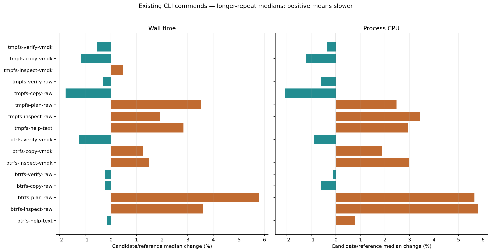
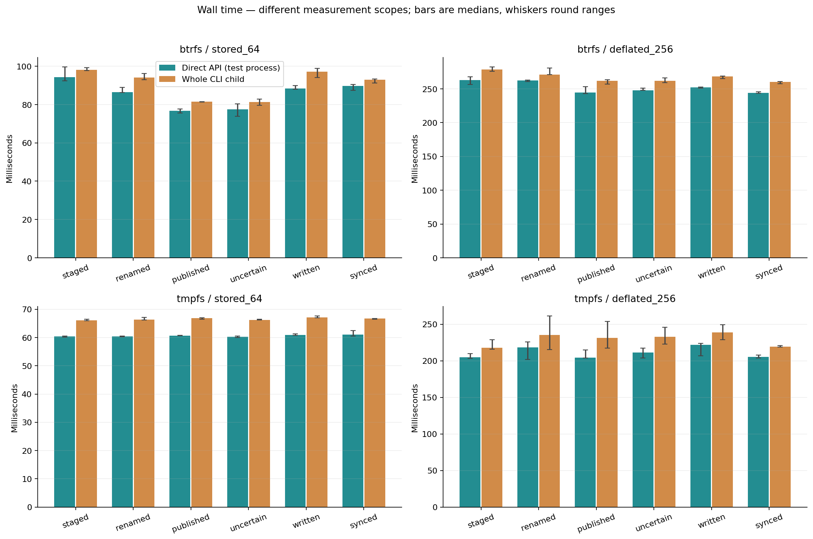
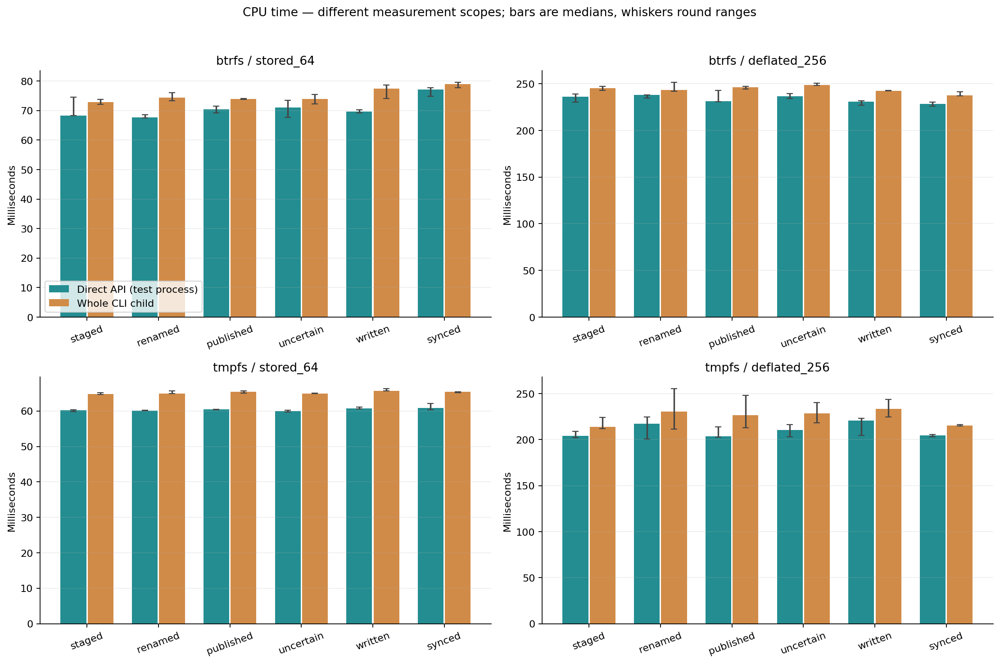
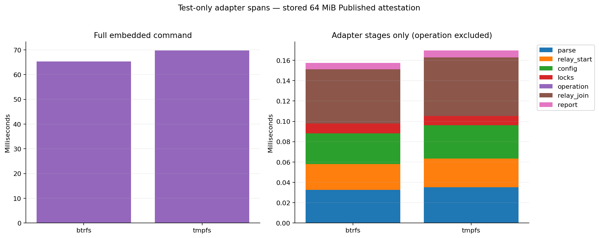
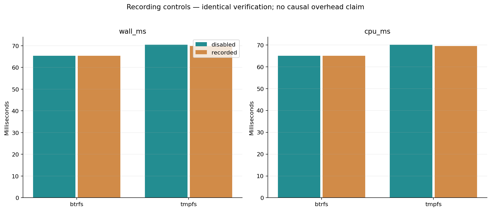
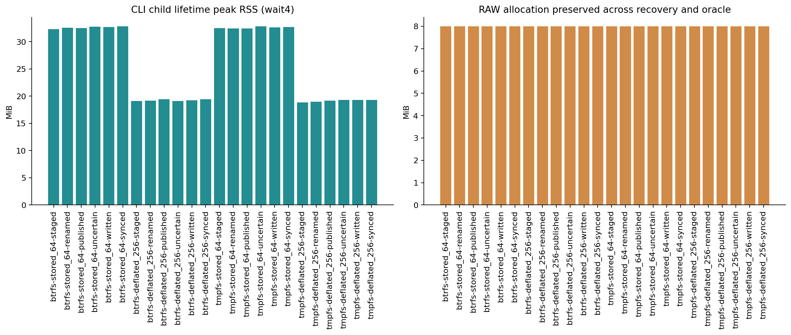
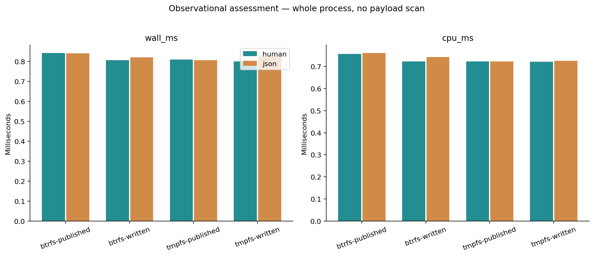
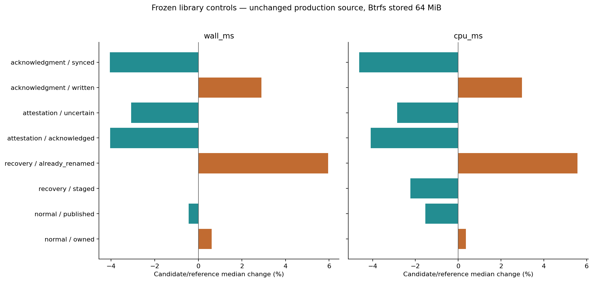
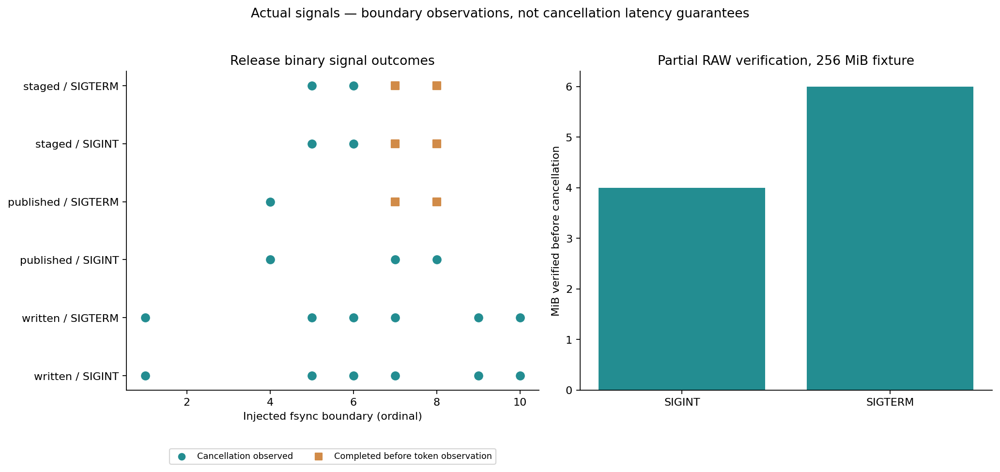
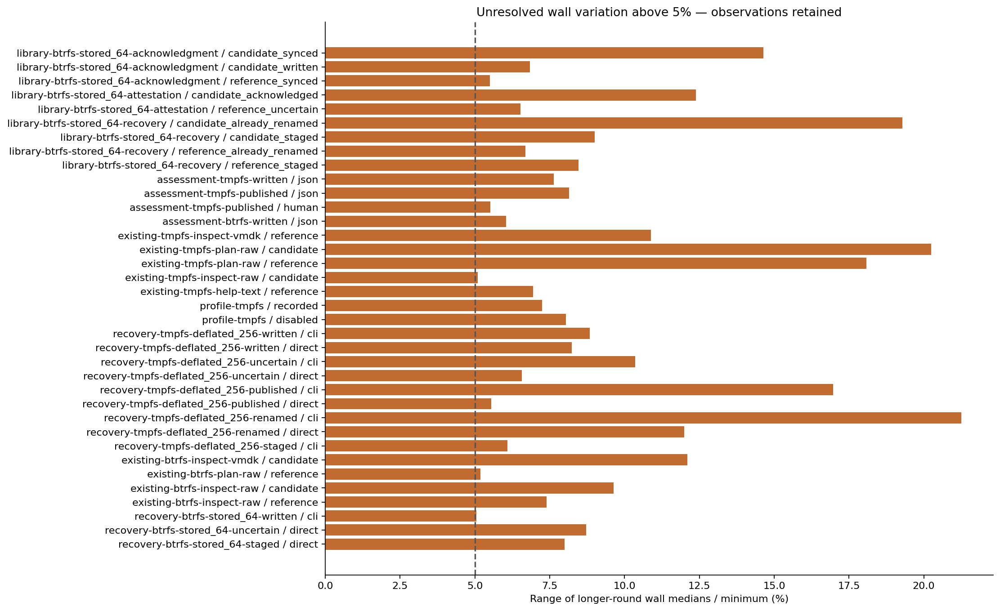

# R6.1d.4b — explicit local recovery commands

Implemented and locally qualified on 2026-10-14. `rvddk recover` now exposes
`assess`, `reconcile-intent`, `attest-published` and `acknowledge-published` through
one private original-source config. Every effectful verb invokes exactly its native
operation and success predicate. No networking, retry, cleanup or journal editing.

[Command contract](../../local-recovery-cli.md) ·
[Acceptance plan](../../local-recovery-cli-qualification.md) ·
[ADR-0071](../../adr/0071-explicit-local-recovery-commands.md)

## Implementation and verification

The CLI adds bounded strict configuration with original pin provenance, fixed parent
lock order, one deadline, a joined 10 ms cancellation relay, allowlisted reports,
explicit unknown-outcome exit 3 and checked final output flush. All recovery arguments
are constructed lazily. Existing disk-command contracts and native production
recovery code are unchanged; the vSphere addition is a test-only fixture/harness.
No production profiling or skip-check option is present.

Commands: `cargo test --workspace`, `cargo fmt --all -- --check`, and
`cargo clippy --workspace --all-targets -- -D warnings`.

[Workspace results](workspace-test-summary.json): **804 passed, 0 failed,
19 ignored**; child summaries are not double-counted. Formatting and
[all-target Clippy](clippy.txt) with warnings denied passed. [CLI regression tests](cli-final-tests.txt)
cover the final lazy parser. New unit tests cover strict inputs and constructor
bounds, actual file types (including FIFO/socket and /dev/null), private file rules,
lock release, cancellation, relay/dispatch unwind, injected spawn failure, native
report classification, safe argument routing and partial/failed output writes/flush.

The three opt-in executable tests passed on [Btrfs](executable-tests-final-btrfs.txt)
and [private tmpfs with networking disabled](executable-tests-final-tmpfs.txt):
**72 command invocations per filesystem**. They cover both reconciliation branches,
both attestation histories, all six complete-candidate origins, human/JSON output,
explicit subsequent invocations, independent complete RAW/source bytes, original
source journal preservation, RAW inode/length/allocation and representative exclusions.
[Additional argument checks](argument-routing.json) include non-UTF-8 config filenames.
[Independent assessment](independent-assessment.json) preserves pending source state
and successful source observations when output assessment fails.

| Actual release-binary evidence | Observed scope |
|---|---|
| [Six syscall audits](syscall-audit.json) | Assessment: zero sync/rename/payload scan. Reconciliation: ten fsyncs and two/one renames by branch (includes journal commit). Attestation: eight fsyncs, no mutation. Exact acknowledgment: ten fsyncs and one journal promotion. No network syscalls. |
| [26 fsync-boundary signals](signal-cases.json) | SIGINT/SIGTERM across bundle/intent/parent/candidate/final syncs; 20 observed cancellation exits and 6 completed before token observation. |
| [Mid-verification signals and kill](verification-signals.json) | Actual RAW read marker, SIGSTOP with store lock proven Busy, then SIGINT/SIGTERM cancels a partial verification before persistence; SIGKILL preserves the pair for a separate recovery invocation. |
| [Four I/O faults](io-fault-cases.json) | Actual syscall EIO injection at initial/final fsync; retain native flags/errors and uncertainty despite visible Published. |
| [Four other process-loss cases](process-loss.json) | Kill during startup, after verification, before promotion and after promotion. Together with the verification kill: five actual SIGKILL cases, bounded/reaped children and explicitly chosen following recovery/attestation. |
| [Failed report delivery](output-failure.json) | /dev/full returns exit 1 after successful recovery, retaining operation_succeeded and the native report. No second mutation. |

A signal delivered near completion can race the relay's sampling interval. Completed
native success remains success; it is not rewritten by a later signal. This is
cooperative cancellation, not a hard latency bound. The first checker incorrectly
required cancellation unconditionally; [the retained correction](diagnostics/signal-checker-correction.json)
records the completed observation. A separate [watcher correction](diagnostics/verification-marker-correction.json)
changed the RAW marker from pread64 to read; the first child completed without an
injected signal. Neither correction changed runtime code. The final [retained-data checker correction](diagnostics/validator-correction.json)
likewise matches the native already-renamed predicate: it requires rename_observed
false for that branch, true for a new staged rename. No samples changed.
[Final validation](validation.json) checks code/binary/sample identities and rejects
12 malformed copies; [the archived validator](validation-driver.py) records those checks. The archived [qualification driver](qualification-driver.py) records the exact
checks and campaign-fixed private paths; use a fresh report location before rerunning.
The final validator also requires the expected nonzero EIO outcomes (the original
driver allowed zero, but none of these injected cases returned zero). Raw traces remain private;
public verdicts record hashes, counts and sanitized reports. Process loss and syscall
fault injection do not simulate physical power loss or historical writeback repair.

The first [compile check](diagnostics/initial-compile.txt) caught a relay receiver
capture that needed ownership transfer. [Initial unit tests](diagnostics/initial-unit-tests.txt)
caught test expectation/fixture mistakes (attestation field count and optional-timeout
schema cases). Corrected suites passed before the final release freeze.

Plot [input hashes](plots/audit.json), [visual inspection](plots/inspection.json),
and [text-log whitespace normalization](log-normalization.json) are retained.

## Measurement method and provenance

Reference commit: **852b0e8**. [Reference metadata](reference.json),
[reference source hashes](reference-source-hashes.json), [candidate source hashes](source-hashes.json),
[frozen binary hashes](binaries.json), [environment](environment.json),
[build and mount conditions](build-environment.json), [artifact manifest](artifact-manifest.json).

The release CLI grew from 2,115,040 to 3,119,608 bytes (+47.50%) after linking the
local recovery dependency. Saved build logs are cached/incremental observations,
not comparable clean-build throughput measurements.

**3,888 final-candidate timed operations**:
3,024 main and 864 supplemental. Each group has three
initial rounds of four pairs and three longer rounds of eight pairs, retaining every
sample. Longer characterization was predeclared for the new whole-command/direct-call
scopes and the linked-binary baselines, rather than stopping when a favorable sample
appeared. [Main index](measurements.json), [repeat decisions](repeat-decisions.json),
[main summary](summary.json), [supplement index](supplement-measurements.json),
[supplement summary](supplement-summary.json).

One workload runs at a time; builds/tests/audits/plots do not overlap timed work.
Fixed CPU affinity and normal page cache; host load/SMT/frequency are not isolated.
No cold-cache or in-operation frequency claim. Stored 64 MiB and deflated 256 MiB
recovery fixtures have 8 MiB present data. Persistent Btrfs and private tmpfs
(size=512m, mode=0700, huge=never) are separate results; tmpfs proves no persistence.
Equivalent fixtures alternate direct/CLI order. Existing commands alternate frozen
reference/candidate order on authored 64 MiB RAW and equivalent FLAT VMDK data.
The standalone verify target is a separate independently matched file.

The direct call runs in a test process and includes original lock opening, the native
API and native report projection. Its peak RSS includes fixture setup and previous
iterations. Whole CLI child timing includes process startup, parsing, config, relay,
locks, native operation, report flush and exit; its peak RSS is individual child rusage, with launch/exec high-water effects not
isolated.
These are different scopes, not a causal startup-only estimate or a speedup claim.
Inactive test-only library profiling checks also remain in the direct test binary.
The Rust whole-CLI scope also includes parent-side capture-file opening.
Child wait4 wall sampling uses a 100 microsecond poll, which can add completion
observation delay; child CPU/RSS come from its individual rusage. Direct self CPU is
measured separately. Full setup, independent oracle and fixture teardown are outside
effectful-operation timing. Existing copy timings include its requested verification.

The embedded attestation profile uses disjoint test-only marks for parse, relay
start, config, locks, operation/report projection, relay join and report delivery.
Recorded/disabled controls have identical full verification. Profile-session setup
and extraction are outside whole-call timing. The first mark's clock origin differs
slightly from the whole-call clock; signed accounting differences are retained in
[phase accounting](phase-accounting.json). Phase medians need not sum to whole medians.
Zero-resolution CPU phases remain zero; no artificial epsilon is used.

During review the recovery argument tree was made lazy before the final campaign.
[The exact parser change](diagnostics/lazy-parser.patch) removes eager work from
unrelated commands. **512 earlier timed operations** remain in the separate
[eager-parser disposition](diagnostics/eager-parser/disposition.json) and its indexed
raw data. They are not pooled with final-candidate results. An interrupted setup is
recorded there. The earlier driver continuation corrected an aliased verification
fixture before that command ran; completed earlier samples were retained.

The [summary correction](diagnostics/summary-correction.json) records a plot-review
fix: acknowledgment modes now retain their binary prefix, rather than pooling two
binaries under history-only names. Every raw sample is unchanged; all four native
comparison groups have four distinct modes.

## Existing CLI comparisons

| Group | Wall change | CPU change |
|---|---:|---:|
| btrfs-help-text | -0.16% | +0.78% |
| btrfs-inspect-raw | +3.59% | +5.79% |
| btrfs-plan-raw | +5.77% | +5.65% |
| btrfs-copy-raw | -0.22% | -0.61% |
| btrfs-verify-raw | -0.24% | -0.11% |
| btrfs-inspect-vmdk | +1.49% | +2.98% |
| btrfs-copy-vmdk | +1.27% | +1.90% |
| btrfs-verify-vmdk | -1.24% | -0.89% |
| tmpfs-help-text | +2.83% | +2.94% |
| tmpfs-inspect-raw | +1.92% | +3.43% |
| tmpfs-plan-raw | +3.53% | +2.47% |
| tmpfs-copy-raw | -1.77% | -2.07% |
| tmpfs-verify-raw | -0.30% | -0.59% |
| tmpfs-inspect-vmdk | +0.47% | +0.00% |
| tmpfs-copy-vmdk | -1.15% | -1.21% |
| tmpfs-verify-vmdk | -0.54% | -0.36% |

Changes are ratios of longer-round medians. Individual rounds/spreads and adverse
observations remain in the summaries; these values do not establish statistical
equivalence or causal improvements.

## New recovery and adapter costs

Chart histories map to commands as follows: `staged`/`renamed` use reconciliation;
`published`/`uncertain` use attestation; `written`/`synced` use acknowledgment recovery.

All direct/CLI pairs agree on the complete sanitized native result. Independent full
byte comparisons passed; RAW allocation remained exactly 8,388,608 bytes before
recovery, after it and after the independent oracle.

## Concrete performance disposition

The current measurement host advertises SHA-NI. Backend selection must be audited
before applying the earlier proposal to tune non-SHA-NI hashing. The next bounded
package records that audit and qualifies digest-equivalent changes only against
frozen full-verification baselines.

Existing CLI: longer-round wall changes range from -1.77% to +5.77%; CPU changes range from -2.07% to +5.79%. The largest wall delta is `existing-btrfs-plan-raw/candidate`: 0.612 → 0.647 ms. These observations remain open; they are not proof of a causal implementation regression or improvement.

Unchanged native library: longer-round wall changes range from -4.06% to +5.96%; CPU changes range from -4.63% to +5.57%. The largest wall delta is `library-btrfs-stored_64-recovery/candidate_already_renamed`: 89.212 → 94.530 ms. These observations remain open; they are not proof of a causal implementation regression or improvement.

Recording controls: longer-round wall changes range from -0.81% to -0.01%; CPU changes range from -0.82% to +0.07%. The largest wall delta is `profile-btrfs/recorded`: 65.355 → 65.351 ms. These observations remain open; they are not proof of a causal implementation regression or improvement.

| Whole recovery CLI | Wall median range | CPU median range | Child lifetime peak RSS range |
|---|---:|---:|---:|
| btrfs / stored_64 | 81.37–98.13 ms | 72.90–78.89 ms | 32.29–32.81 MiB |
| btrfs / deflated_256 | 260.10–278.57 ms | 237.73–248.81 ms | 19.09–19.46 MiB |
| tmpfs / stored_64 | 66.09–67.06 ms | 64.77–65.70 ms | 32.43–32.83 MiB |
| tmpfs / deflated_256 | 217.99–238.59 ms | 214.06–233.55 ms | 18.87–19.32 MiB |

Across the main and supplemental comparisons, **69 mode/metric repeat spreads exceed 5%** (wall and CPU counted separately). All are listed in [the performance disposition](performance-disposition.json), including unchanged-library and recording controls. No additional repetitions were selected to suppress these observations.

| Embedded adapter phase | Btrfs median | tmpfs median |
|---|---:|---:|
| parse | 0.0325 ms | 0.0353 ms |
| relay_start | 0.0254 ms | 0.0281 ms |
| config | 0.0303 ms | 0.0326 ms |
| locks | 0.0097 ms | 0.0092 ms |
| operation | 65.2242 ms | 69.6478 ms |
| relay_join | 0.0532 ms | 0.0577 ms |
| report | 0.0063 ms | 0.0068 ms |

Phase medians are descriptive pooled repeat observations, not additive per-invocation totals. Small phases and zero CPU observations remain resolution-sensitive.

## Remaining variance and qualification limits

PERF.0 remains open. Positive changes, >5% repeat spreads and resolution-limited
phases stay visible; recording controls are observations, not a causal zero-overhead
claim. Frozen library controls cover Btrfs stored 64 MiB; the new command matrix
covers both sizes and filesystems. Prior ambient tmpfs allocation and earlier
attestation/reconciliation variance are not cleared by this private control.

The native state/pair/content/fault matrices are inherited unchanged and exercised
by the workspace suite; the CLI adds representative exclusion and routing cases,
not a duplicate of every native permutation. Wrong-owner config fixtures and actual
concurrent config rewrites during the bounded read were not exercised; mode/link/type
checks and post-read metadata mismatch checks were. Signal-to-exit latency was not measured; these observations establish control and
retained effects, not a scheduling or cancellation-latency bound. Thread-spawn failure is a private
injection, not resource exhaustion. Embedded callers own their panic-hook policy;
only the binary installs the fixed recovery hook. Hostile same-user mutation, unusual
filesystems, capacity/larger working sets, live retained-artifact integration, remote
lease replay, source transaction repair, unstamped adoption and general production
recovery remain outside this package. No ESXi, SSH, VM or credential was used.
