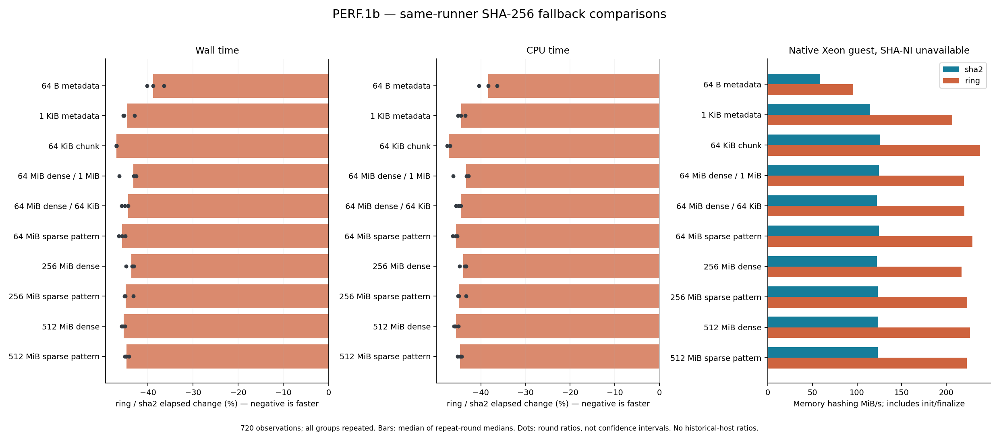
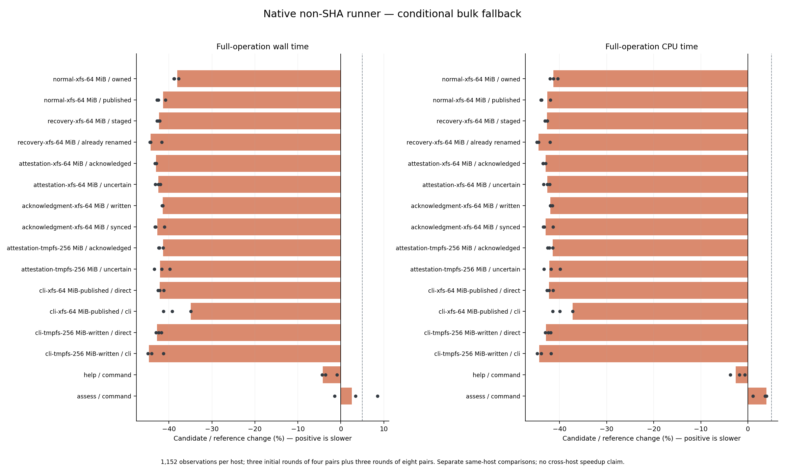
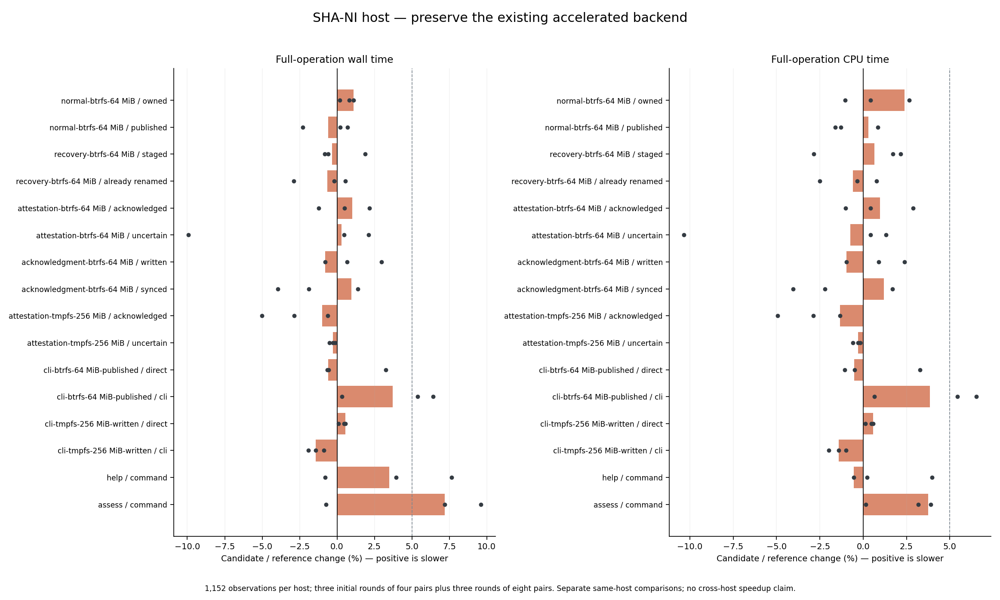
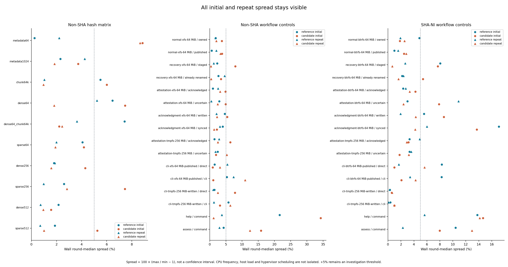
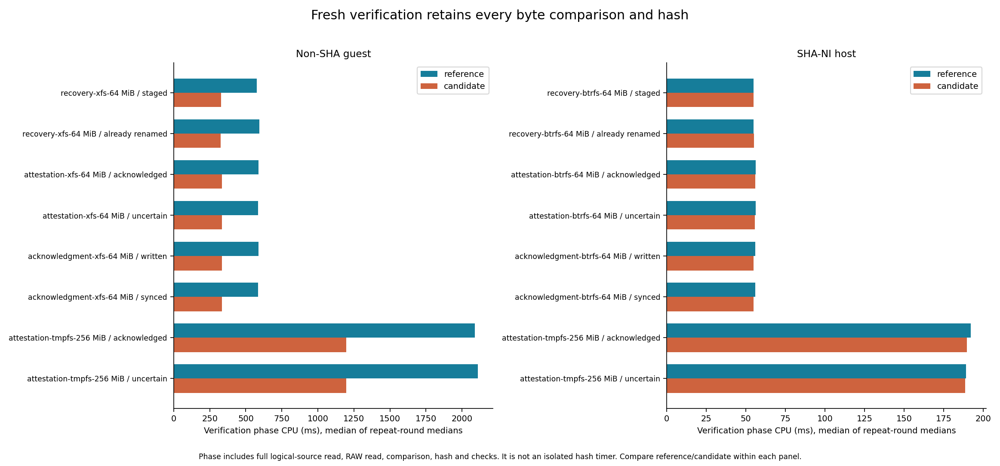
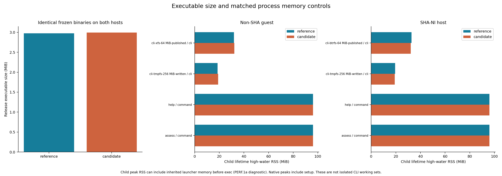
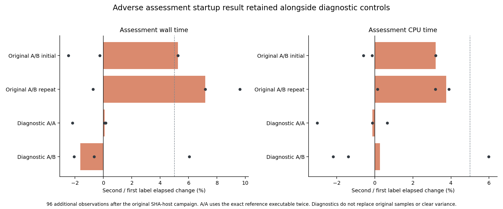

# PERF.1b — native SHA-256 fallback qualification

**Adopt the conditional backend in three retained payload hash contexts.**
Baseline `82c025d2571ee7fba1cf1ffbf854e0118519341e`; completed 2026-10-15.
Linux x86-64 without the existing SHA-NI prerequisites uses `ring 0.17.14`;
accelerated x86-64 and other architectures retain `sha2 0.11.0`.
This is a bounded same-host improvement, with timing variation kept open in PERF.0.

## Measured outcome

Native bulk hashing on the non-SHA runner uses **43.22–46.94% less wall time**
across the repeated bulk matrix (64 KiB through 512 MiB). Small-input microbenchmarks
also improve, but production metadata/identity/journal hashing is unchanged.
Full-operation results below include all work and therefore differ from pure hash
speedups. Positive percentages mean slower; each value compares candidate/reference
on the same host, using the median of three repeat-round medians.

| Non-SHA runner operation | Wall change | CPU change |
|---|---:|---:|
| normal-xfs-64 MiB / owned | -38.03% | -41.27% |
| normal-xfs-64 MiB / published | -41.36% | -42.58% |
| recovery-xfs-64 MiB / staged | -42.33% | -42.66% |
| recovery-xfs-64 MiB / already renamed | -44.30% | -44.42% |
| attestation-xfs-64 MiB / acknowledged | -42.99% | -42.91% |
| attestation-xfs-64 MiB / uncertain | -42.45% | -42.61% |
| acknowledgment-xfs-64 MiB / written | -41.48% | -41.93% |
| acknowledgment-xfs-64 MiB / synced | -42.72% | -42.94% |
| attestation-tmpfs-256 MiB / acknowledged | -41.40% | -41.47% |
| attestation-tmpfs-256 MiB / uncertain | -42.09% | -42.14% |
| cli-xfs-64 MiB-published / direct | -42.15% | -42.20% |
| cli-xfs-64 MiB-published / cli | -34.95% | -37.23% |
| cli-tmpfs-256 MiB-written / direct | -42.82% | -42.84% |
| cli-tmpfs-256 MiB-written / cli | -44.65% | -44.32% |
| help / command | -4.18% | -2.61% |
| assess / command | +2.52% | +3.92% |

| SHA-NI host operation | Wall change | CPU change |
|---|---:|---:|
| normal-btrfs-64 MiB / owned | +1.10% | +2.40% |
| normal-btrfs-64 MiB / published | -0.60% | +0.30% |
| recovery-btrfs-64 MiB / staged | -0.33% | +0.64% |
| recovery-btrfs-64 MiB / already renamed | -0.65% | -0.60% |
| attestation-btrfs-64 MiB / acknowledged | +1.02% | +0.96% |
| attestation-btrfs-64 MiB / uncertain | +0.31% | -0.73% |
| acknowledgment-btrfs-64 MiB / written | -0.79% | -0.97% |
| acknowledgment-btrfs-64 MiB / synced | +0.97% | +1.21% |
| attestation-tmpfs-256 MiB / acknowledged | -0.98% | -1.34% |
| attestation-tmpfs-256 MiB / uncertain | -0.28% | -0.29% |
| cli-btrfs-64 MiB-published / direct | -0.59% | -0.53% |
| cli-btrfs-64 MiB-published / cli | +3.72% | +3.86% |
| cli-tmpfs-256 MiB-written / direct | +0.57% | +0.56% |
| cli-tmpfs-256 MiB-written / cli | -1.42% | -1.42% |
| help / command | +3.49% | -0.54% |
| assess / command | +7.18% | +3.75% |

## Scope, provenance and conditions

[Predeclared plan](plan.json), [candidate decision](candidate-decision.json), [final adoption decision](promotion-decision.json),
[baseline source](baseline-source.json), [build provenance](build-provenance.json),
[candidate source/binaries](candidate-provenance.json), [exact patch](candidate.patch)
and [patch replay](patch-validation.json) identify the measured implementation.
The conditional candidate was started after three repeated bulk groups completed;
all remaining groups and repeats still ran before the promotion decision.

The native runner is a Xeon Silver 4116 guest without SHA-NI, on XFS. Its current
configuration is two visible CPUs and approximately 8 GiB RAM, versus one CPU/2 GiB
in older project evidence. [Preflight](runner-preflight.json) records that change;
there are no historical timing ratios. The SHA-NI control is the i7-11850H
on Btrfs. Identical frozen executables run natively on both machines, built locally
with Rust 1.95.0 and the same default flags/dependencies. The guest has no Rust/C
compiler; none was installed. QEMU was not used for these timings.

Only retained container admission, owned RAW verification and fresh publication/
recovery verification change backend. The private facade preserves `sha2` where
SHA, SSE2, SSSE3 and SSE4.1 are present, uses `ring` on other Linux x86-64 CPUs, and
keeps `sha2` on other architectures. See the [locked dispatch audit](backend-audit.json)
and [architecture decision](../../sha256-fallback-qualification.md).
No read, comparison, zero-byte hash, 1 MiB chunk, cancellation check, source/identity
binding, journal check, sparse write, sync or promotion boundary is removed.
The new direct `ring` edge changes no locked version or already-enabled TLS feature.
Export, owned-transfer, worker, identity, journal, contract and TLS hash sites stay
unchanged. The CLI executable grows from 3,119,608 to 3,141,384 bytes: **21,776 bytes
(+0.70%)**. Test-only fixture-parent selection makes the cross-filesystem check
portable to the guest without requiring the compile-time checkout path.

Each primary group retains three initial rounds of four alternating pairs followed
by three rounds of eight pairs. Both implementations run under the same conditions
on each host, CPU affinity 0, with one measured workload at a time. Builds, tests
and plots do not run concurrently with timings on that host. Work on the other
host may proceed independently. Normal page cache is retained. Private
user/mount/network namespaces provide isolated tmpfs (`size=512m,mode=0700,huge=never`)
and loopback for authored test fixtures. Tmpfs is volatile, not durable storage.
The guest filesystem is XFS; the development filesystem is Btrfs. Environment
records retain exact binary/driver hashes and mount settings:
[non-SHA host](non-sha-host/workflow-environment.json),
[SHA host](sha-host/workflow-environment.json), [hash probe](non-sha-host/hash/hash-environment.json).

Host load, CPU frequency, SMT and hypervisor scheduling are not isolated. Hash
inputs up to 512 MiB and 64/256 MiB workflow fixtures do not establish cold-cache,
disk-scale or live-export throughput. Hash sparse patterns contain actual zero
bytes in memory. Metadata microbenchmarks are diagnostic only; production metadata
hashing does not change. Summary percentages are ratios of the medians of three
repeat-round medians. Plot dots are individual round ratios, not confidence
intervals. All initial/repeat spread and adverse results remain visible.
The [timing findings](timing-findings.json) enumerate every initial/repeat wall/CPU
metric (including phases) with a change above +5% or round spread above 5%. These
remain investigation flags, not a general regression clearance. Non-SHA repeat
wall spread still exceeds 5% for tmpfs uncertain attestation, XFS direct/CLI,
tmpfs CLI and assessment. Guest assessment changes are +2.52% wall/+3.92% CPU;
its candidate wall spread is 12.44%.

## Correctness and evidence validation

- The exact candidate passes **807 workspace tests** (19 opt-in tests ignored;
  31 nested child-test results excluded from the count),
  formatting and all-target Clippy. The facade covers three known vectors through
  three contexts (nine comparisons), plus **576** dense/zero streaming comparisons
  across block/chunk boundaries, and runtime-selection checks. The promoted root
  workspace passes the same checks and a release CLI build; see
  [final workspace validation](root-validation.json). The rebuilt release CLI is
  byte-identical to the measured candidate. Root-log nested child results (29) are
  also excluded from its 807-test total.
- The frozen guest library passes **139 tests**, with 12 opt-in tests ignored.
  Six actual CLI fixture groups pass on each host: histories, exclusions and
  reconciliation candidates on both primary storage and private tmpfs. Existing
  fault, process-loss, control, identity, sparse-allocation and persistence checks
  remain in force. Qualification records retain original log hashes and empty
  fixture-parent checks: [guest](non-sha-host/functional/qualification.json),
  [SHA host](sha-host/functional/qualification.json).
- The standalone probe passes **624 checks per native CPU configuration**. The 36
  saved digest cases per host also pass **72 independent Python hashlib checks**:
  [guest](non-sha-host/hash/hash-check-native.json), [SHA host](sha-host/hash-check-native.json).
- **3,120 timing observations** are validated: 720 native hash observations,
  1,152 complete-workflow observations per host, and 96 separately declared
  assessment diagnostics. Each workflow matrix has 720 native observations,
  288 direct/whole-CLI observations and 144 help/assessment controls. Full byte,
  allocation, identity and sync oracles are checked; all 2,016 native/direct/CLI
  observations retain [8 MiB output allocation](allocation-validation.json). The validators also reject
  **42** corrupt temporary copies. [Validation record](evidence-validation.json).
- The candidate patch replays against the baseline, matching all **297** frozen
  source hashes. Measured source and promoted production source are checked for
  equality. Original numeric samples and their index hashes remain unchanged.
  Text logs alone may have trailing whitespace normalized, with original and
  committed hashes recorded in [normalization metadata](text-log-normalization.json).
  [Final runner checks](runner-final-check.json) confirm unchanged CPU/resources and
  frozen binaries, empty fixture parents and no remaining benchmark processes.

No ESXi API, export, snapshot, VM power or resource operation was performed. Only
authored fixture work ran on the existing guest. Credentials, addresses, SSH
configuration, binaries and private fixture data stay outside the commit.

## Startup diagnostic and resource limits

The original SHA-host assessment repeat has **+7.18% wall / +3.75% CPU** change,
with 13.0% candidate wall spread (0.785 ms reference versus 0.841 ms candidate).
This adverse result remains in the primary matrix.
A [separately declared control](assessment-control-plan.json) then runs three rounds
of eight pairs for an exact-reference A/A comparison and a fresh A/B comparison.
A/A changes are **+0.09% wall / −0.13% CPU**; fresh A/B changes are **−1.62% wall /
+0.26% CPU**. The sign reversal does not support a consistent startup regression,
but neither these controls nor the bulk gains clear startup variability.
The fixture's file namespace, inodes, lengths, allocation and hashes remain equal
before/after assessment, and it is removed afterward.

Native peak RSS includes setup and earlier operations. Child high-water RSS can
include launcher memory inherited before exec, as demonstrated by the earlier
[PERF.1a diagnostic](../2026-10-14-perf1a/child-rss-diagnostic.json). Resource plots
therefore show measured process lifetime peaks, not isolated CLI working sets.

## Plots and raw data















Every plot also has an adjacent SVG. [Computed values](plots/computed.json) and
[plot manifest](plots/manifest.json) record generator/input/output hashes. The
[artifact manifest](artifact-manifest.json) covers the complete report except itself.
Raw observations and per-round indexes are in [native hashes](non-sha-host/hash/hash-measurements.json),
[guest workflows](non-sha-host/workflow-measurements.json),
[SHA workflows](sha-host/workflow-measurements.json) and
[assessment diagnostics](assessment-control-measurements.json).

## Reproduction and continuation

From the repository root, replay the saved evidence without accessing a lab:

```sh
python3 scripts/benchmarks/check_hash_fallback.py docs/benchmark-results/2026-10-15-perf1b
target/benchmark-plots/bin/python scripts/benchmarks/plot_hash_fallback.py docs/benchmark-results/2026-10-15-perf1b
```

The plot environment uses the repository's benchmark plotting requirements.
For new measurements, freeze separate reference/candidate release CLI and library
test executables; use new report/fixture directories. Build the standalone probe
with `cargo build --release --locked --manifest-path scripts/benchmarks/hash_probe/Cargo.toml`.
Run its `check` mode natively before `measure_hash_fallback.py` on a runner without
SHA-NI. Run `qualify_hash_candidate.py` before `measure_hash_workflows.py` on each
host, supplying frozen binaries, a private on-disk parent (`--disk-fs xfs` or
`btrfs`), and a separate private tmpfs parent. Use the recorded namespace/mount
settings and enable loopback only inside the private network namespace. See each
driver's `--help`; avoid running under `python -O`, which disables validators.
Drivers refuse campaign-index overwrite. No credentials belong in these tools.

PERF.0 remains open for timing variation, ambient tmpfs allocation, larger/cold
workloads, stream/map/cache costs and storage/journal performance. Next is
[PERF.1c](../../sha256-fallback-qualification.md#next-package-perf1c): separately
qualify remaining transfer/worker bulk hashes. This package does not qualify live
retained-artifact recovery commands, general production R6 recovery, snapshots,
CBT, restore, vCenter or vSphere 9.
