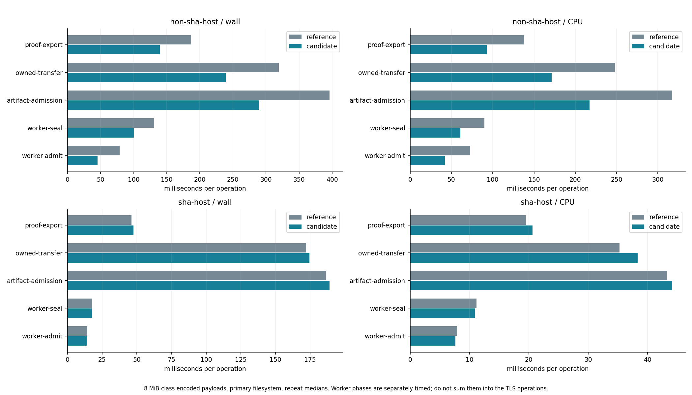
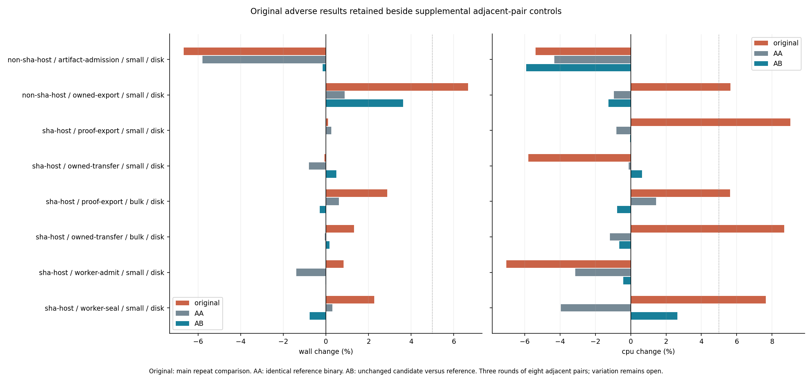

# PERF.1c — transfer and worker hash qualification

**Adopt the existing private conditional SHA-256 facade in four encoded-payload
paths.** Complete native bulk transfer/admission API calls use **14.37–30.09% less
wall time**; worker phases use **22.43–41.96% less**. Every full-byte, SHA-1,
source/ownership, cancellation, identity and persistence gate remains. The scope
is authored local/loopback fixtures on two native CPU profiles, not live ESXi
throughput or general production recovery.

Reference: `fb4ea8d`. The six-file [candidate patch](candidate.patch) changes four
production hash contexts, makes test digest imports independent, and updates the
facade's module description. There is no new dependency, format or public API.
The exact patch and identical [harness additions](harness.patch) replay against
298 reference/candidate source hashes. The rebuilt main CLI is byte-identical to
the measured candidate; both reference and candidate CLIs are **3,141,384 bytes**.

- [Decision, boundaries and continuation](../../transfer-hash-qualification.md)
- [Predeclared audit, measurement schedule and adoption gates](plan.md)
- [Separately declared regression controls](control-plan.md)
- [Source/compiler/binary provenance](provenance.json), [promotion replay](promotion.json)
- [Validation](validation.json), [evidence replay and corruption checks](evidence-check.json)

## Representative repeat results

Each value is the median of three round medians. Negative changes mean less time.
Comparisons are within one host; there is no cross-host speedup ratio. Native
runner absolute times are milliseconds per operation. Full group results, initial
rounds and spread remain in each host's summary and plots.

| Operation / storage / case | Native reference wall ms | Native candidate wall ms | Native wall change | Native CPU change | SHA-NI wall change |
| --- | ---: | ---: | ---: | ---: | ---: |
| transfer  /  XFS or Btrfs  /  bulk / proof-export | 186.800 | 139.374 | -25.39% | -32.90% | +2.88% |
| transfer  /  XFS or Btrfs  /  bulk / owned-transfer | 319.225 | 239.169 | -25.08% | -30.82% | +1.32% |
| artifact  /  XFS or Btrfs  /  bulk / artifact-admission | 396.040 | 289.164 | -26.99% | -31.52% | +1.38% |
| worker  /  XFS or Btrfs  /  bulk / worker-seal | 130.993 | 100.135 | -23.56% | -32.34% | -1.19% |
| worker  /  XFS or Btrfs  /  bulk / worker-admit | 78.701 | 45.676 | -41.96% | -42.10% | -2.51% |
| artifact  /  XFS or Btrfs  /  zeros / artifact-admission | 407.057 | 284.571 | -30.09% | -33.15% | +0.24% |
| artifact  /  tmpfs  /  bulk / artifact-admission | 340.269 | 251.158 | -26.19% | -26.84% | +0.86% |



## Original adverse results and controls

Original SHA-NI repeat wall changes span −3.90% to +2.88%. Four original CPU
changes cross the +5% investigation gate: small proof export +9.04%, bulk proof
export +5.62%, bulk owned transfer +8.68%, and small worker seal +7.64%. These
results are retained, including a +19.45% matched-round wall change for bulk
proof export visible in the plot. No outlier filtering is applied.

Three rounds of eight adjacent invocation pairs supply separate A/A controls
(the reference under both labels) and fresh A/B controls with the unchanged
candidate. For those four operations, A/B CPU changes are −0.04%, −0.76%, −0.64%
and +2.64%, respectively. The original small worker seal CPU medians were only
0.458 and 0.493 ms; process scheduling and instrumentation matter at this scale.

On the native runner, small owned export of a valid VMDK originally measured
+6.67% wall/+5.65% CPU. Its separate A/B control measured +3.63% wall/−1.25% CPU;
A/A measured +0.89% wall/−0.95% CPU. The companion native small artifact admission
A/A wall result is −5.80%, illustrating remaining variability. These observations
support bounded bulk adoption without proving that small cases never regress.



The main comparisons retain cleanup wall changes of −8.32% to +6.82% on the
native runner and −0.74% to +3.70% on the SHA-NI host. Process-lifetime RSS changes
span −2.90% to +6.43% and −6.22% to +0.73%, respectively. These are separate costs,
not discarded regressions. No cleanup implementation changed, and lifetime RSS
includes fixture/TLS allocations; an isolated production memory guarantee is not
established. PERF.0 keeps cleanup, phase and resource variation open.

## What was measured

| Item | Recorded scope |
| --- | --- |
| Native runner | Xeon Silver 4116, no SHA-NI, 2 visible CPUs, approximately 8 GiB, XFS |
| Development host | i7-11850H, SHA-NI, 16 visible CPUs, Btrfs |
| Execution | Identical locally built Rust 1.95.0 release binaries execute natively on both profiles, default flags, fixed CPU 0; no guest compiler/emulation |
| Primary groups | Proof export/owned transfer, owned export/native artifact admission, worker seal/admit; each with small, bulk and stored-zero data |
| Transfer sizes | 65,536 bytes small; 8,388,608 bytes bulk/zeros |
| Native fixture sizes | 140,288 bytes small; 8,528,384 bytes bulk/zeros; sparse 30 GiB logical capacity with one or 128 present stored 64 KiB grains |
| Storage controls | Bulk cases repeated on private 512 MiB tmpfs requested with `huge=never`, separate from primary disk results |
| Main schedule | Three initial rounds of two fixture pairs and three repeat rounds of four pairs per group; alternating version order by round and operation order by pair where possible |
| Startup | Separate whole-process `--help`: three rounds of four pairs then three rounds of eight pairs, alternating version order |
| Supplemental controls | Three rounds of eight adjacent pairs; 576 SHA-NI and 192 native observations; original data retained |
| Total | 1,728 workflow/phase observations + 144 startup observations + 768 controls = **2,640** |

Full API timers include the actual local/loopback transfer and lease protocol,
manifest verification, operation-specific readback/admission and completion.
Authored fixture creation, mock-server startup, initial `JobStore::open`, oracle
checks and explicit local cleanup are outside the API timers. Cleanup has its
own metric. TLS mock work and worker threads share the process CPU accounting.

Worker seal includes sync, writer close, fresh full SHA-256/SHA-1 readback and
identity checks. Worker admission includes map validation, present-grain decoding,
fresh full encoded rehash and metadata persistence. Seal precedes admission by
contract. These phase measurements are not pure hash throughput and must not be
summed into separately measured API times. The accepted
[PERF.1b native digest probe](../2026-10-15-perf1b/README.md) remains the isolated
hash evidence; it is not re-counted in this package's observations.

Every transfer checks full encoded equality. Native integration checks independent
RustCrypto container digests, every authored logical grain, absent zero ranges,
source binding, metadata claim and durable lifecycle state. Worker phases check
full encoded equality and independent expected digests. Outputs retain allocated
storage for all encoded bytes, including stored zero grains. No verification pass,
chunk size, SHA-1 computation, sync or journal transition is removed.

Normal page cache is used. Frequency, SMT, competing host activity and hypervisor
scheduling are not isolated. The sparse 30 GiB logical fixture is not a 30 GiB
encoded transfer or a cold/disk-scale measurement. Private tmpfs is volatile.
Process peak RSS includes fixture setup; startup child RSS may include launcher
memory inherited before exec. The results do not establish other-architecture
throughput, universal non-SHA gains or live VMware network performance.

## Correctness and provenance

Candidate and promoted workspaces each pass **807 tests**, with 20 opt-in tests
ignored. Nested child result lines are accounted for separately in
[validation.json](validation.json). Formatting and all-target Clippy pass.
The frozen native candidate library passes **139 tests** (13 ignored), and its
export integration group passes **60 tests** (4 ignored, 18 unrelated discovery
tests filtered). Existing tests cover malformed/truncated payloads, matching
container digests with corrupt grains, namespace/metadata tampering, write/seal
failure, slow-worker heartbeats, cancellation/deadline and process-loss boundaries.

Fourteen deliberately corrupted evidence copies are rejected. Source/binary
hashes, complete group/pair coverage, native byte/allocation/oracle claims, logs
and plots are replayed before committing. Original validation logs remain private;
committed logs remove checkout paths and trailing whitespace with both hashes
recorded. Raw numeric samples and their index hashes are unchanged.

The original measurement driver's final summary assertion incorrectly required
identical raw `--help` output across differently named binaries. All measurements,
completion checks and raw indexes had already been saved on both hosts. The
[output check](startup-output-check.json) verifies that only the expected argv[0]
filename differs. The current summarizer validates stable per-version hashes,
and the package checker verifies normalized equality. No timed sample was rerun
or replaced to fix this checker. The exact measured
[driver](measurement-driver.py) and first SHA-host [control driver](control-driver-sha.py)
are preserved; the current control driver only adds selection of the native case.
Linux may omit default `huge=never` from displayed mount options; the driver also
checks the recorded default/no-force policy. No global huge-page setting changed.

Only authored fixtures ran on the runner. No ESXi API, live export, snapshot,
VM power or VM resource operation occurred. [Final runner checks](runner-final-check.json)
confirm unchanged CPU/resources and frozen binaries, empty fixture parents and
no active benchmark processes. Credentials, private configs, binaries and SSH
connection state are excluded from Git.

## Plots and raw evidence

| Plot | PNG | SVG |
| --- | --- | --- |
| Native changes, initial/repeat and round range | [PNG](plots/non-sha-host-changes.png) | [SVG](plots/non-sha-host-changes.svg) |
| SHA-NI changes, including original adverse results | [PNG](plots/sha-host-changes.png) | [SVG](plots/sha-host-changes.svg) |
| Absolute bulk API/worker times | [PNG](plots/bulk-times.png) | [SVG](plots/bulk-times.svg) |
| Startup and process costs | [PNG](plots/process-costs.png) | [SVG](plots/process-costs.svg) |
| Supplemental A/A and A/B controls | [PNG](plots/regression-controls.png) | [SVG](plots/regression-controls.svg) |

Each host directory contains its sanitized environment, every native row and
invocation log, startup samples, complete summary, completion checks and index
hashes: [native runner](non-sha-host/summary.json), [SHA-NI host](sha-host/summary.json).
Supplemental controls have separate raw files, indexes and summaries in those
same directories. Plot lines show the range of matched round-median changes;
they are not confidence intervals. Purple crosses retain initial-round changes.

## Replay

Use ordinary Python execution; `-O` disables the assertion-based evidence gates.

```sh
python3 scripts/benchmarks/check_transfer_hashes.py docs/benchmark-results/2026-10-15-perf1c --self-test
python3 scripts/benchmarks/measure_transfer_hash_controls.py --report docs/benchmark-results/2026-10-15-perf1c/sha-host --summarize
python3 scripts/benchmarks/measure_transfer_hash_controls.py --report docs/benchmark-results/2026-10-15-perf1c/non-sha-host --summarize
target/benchmark-plots/bin/python scripts/benchmarks/plot_transfer_hashes.py docs/benchmark-results/2026-10-15-perf1c
```

At this implementation revision, add `--source .` to verify all 298 promoted
source hashes. To rebuild the original comparison, start from `fb4ea8d`, apply
`harness.patch` to both checkouts, then `candidate.patch` to the candidate only.
Build `cargo test --release -p rvvdk-vsphere --lib --test discovery --no-run` and
`cargo build --release -p rvvdk-cli --locked`. Freeze the library, discovery-test
and CLI executables before running `measure_transfer_hashes.py --help` for the
required binary/report/fixture paths. Use fresh empty report directories and
private writable parents. Mount the tmpfs control inside a private namespace
with `size=512m,mode=0700,huge=never` and enable its loopback interface. Commands
need no VMware credentials. Timings from new runs are new observations, not an
attempt to reproduce the recorded numbers exactly.

Next: [R6.1d.5a live retained-artifact recovery qualification planning and preflight](../../transfer-hash-qualification.md#limits-and-continuation).
PERF.0, larger/cold workloads and general production recovery remain open.
