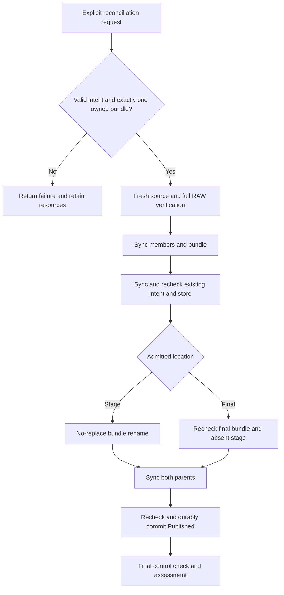

# Explicit PublishIntent reconciliation (R6.1d.1)

Status: implemented in **R6.1d.1b**, following the R6.1d.1a design accepted on
2026-10-14. The bounded local qualification and its filesystem/performance limits
are recorded in the [implementation report](benchmark-results/2026-10-14-r61d1b/README.md).
Ambiguous namespaces and pending transactions remain blocked. Published-at-entry is
excluded from this intent-only operation; [fresh attestation](published-output-attestation.md)
is a separate explicit API.

An interrupted bundle rename can leave a valid output PublishIntent and exactly
one owned bundle at its recorded stage or destination. An explicit local operation
freshly verifies that bundle, finishes the necessary durability work and acknowledges
Published. This contract covers the **output journal** (`OutputState`), not the
older source job's similarly named `JobState::PublishIntent`.

[ADR-0068](adr/0068-explicit-publish-intent-reconciliation.md) records the decision.
[Qualification plan](publish-intent-reconciliation-qualification.md) defines the
required fault, process-loss, correctness and performance evidence.

## Implementation structure

| Existing implementation | Design consequence |
|---|---|
| [`JobStore::read_output` and `OutputRecord`](../crates/rvvdk-vsphere/src/ownership/retained/output.rs) validate checksum, version, source/store binding and sequence | Keep version 2, PublishIntent sequence 7 and Published sequence 8. No new record fields, rollback or sequence reset. |
| [`assess_publication`, `location` and `bundle`](../crates/rvvdk-vsphere/src/ownership/retained/output/publication.rs) report namespace/identity observations | Assessment remains read-only. Reconciliation must independently admit records and contents under both locks. |
| `VerifiedOutput::open` requires Verified; private `CheckedOutput::validate_at` checks a bundle under a pinned parent | Normal publication still uses its private stage. Reconciliation selects its admitted location; the public Verified-only admission rule is unchanged. |
| `PublicationReport::is_success` requires a rename observed in that invocation | `ReconciliationReport` handles the already-renamed case without changing the existing publication success predicate. |
| `commit_output` can leave a visible new record before store-directory sync completes | A visible intent is insufficient: sync and recheck the admitted intent before any new rename. A visible Published record after a failed acknowledgment is not success. |
| [`RetainedArtifact::open`, `admit` and `check_current`](../crates/rvvdk-vsphere/src/ownership/retained.rs) require a retained CompletedLease source and check encoded bytes | Reuse fresh native/source admission. Retain the source journal and payload unchanged; no VMware connection is needed. |
| `cleanup_output` rejects PublishIntent | Preserve that rule. Reconciliation is a separate explicit request; it never deletes resources. |

The source and output journal checksums detect corruption; they are not signatures.
The existing private-store model still requires trusted stable ancestors, cooperating
writers, no outstanding writable handles, and no hostile same-user mutation or
offline rollback. Holding advisory locks does not freeze bytes against such writers.

## Admission and namespace table

The caller supplies the original locked `JobStore`, explicit `OutputId`, `ArtifactId`
and `SourceSelection`, the original locked `PublicationDirectory`, and bounded
`RetainedOptions`. Reconciliation consumes both locks through completion and final
assessment. It is synchronous blocking work that the caller must await. No borrowed
writer, recovered remote lease, reusable mutation capability or pathname escapes.

Before accepting either branch, require:

1. A valid version-2 output PublishIntent at sequence 7, with stage/member stamps,
   RAW digest, original operation, source binding and recorded destination identity.
   No output transaction may exist, regardless of its contents or file type.
2. The source journal must be CompletedLease, with no source transaction. Its
   original stage, metadata, encoded payload and native stream must still pass
   retained admission. A cleaned/missing source is ineligible, even if RAW appears
   complete. Do not regenerate a source or adopt a replacement.
3. Store and destination remain private, locked and identity-bound. Reuse the
   same-filesystem and destination-outside-store checks. Check the recorded
   destination inode/device, not a spelling of its path; never create a destination.
4. Observe the generated stage and final names through pinned parent descriptors.
   `Owned` requires the recorded directory and all three members, their types,
   private permissions, single-link regular files, operation marker and no unknown
   entries. It does **not** establish content correctness or durability.

Only two of the nine namespace combinations are eligible:

| Stage | Final bundle | Decision |
|---|---|---|
| Owned | Absent | Verify staged bundle, then attempt one no-replace rename. |
| Absent | Owned | Verify final bundle and re-establish durability without renaming. |
| Absent | Absent | Block; retain journals, never recreate missing payloads. |
| Owned | Owned | Block ambiguity; never choose one, merge or remove either. |
| Owned | ForeignOrInvalid | Block collision; preserve both entries. |
| ForeignOrInvalid | Owned | Block foreign stage; preserve both entries. |
| Absent | ForeignOrInvalid | Block invalid destination. |
| ForeignOrInvalid | Absent | Block invalid stage. |
| ForeignOrInvalid | ForeignOrInvalid | Block both invalid namespaces. |

A namespace inspection error also blocks; it must never be treated as absence.
After branch selection, a changed namespace pair ends the call. Do not switch
branches mid-call or infer that another actor finished the operation.

| Other observed state | Reconciliation behavior |
|---|---|
| Prepared or StageIntent | Reject; no unstamped-stage adoption. |
| Staged, ConvertIntent, Converted or VerifyIntent | Reject; no conversion resume. |
| Verified | Reject; use normal fresh publication. |
| Published | Reject this intent-only operation; assessment/explicit cleanup retain their existing contracts. |
| CleanupIntent or Cleaned | Reject; never reverse removal or reuse the output ID. |
| Invalid record, source/store/destination mismatch, or either pending transaction | Reject; no record repair, transaction promotion, unlink or replay. |

In particular, retrying after a lost success response may find Published and return
Transition. This operation is not an idempotent success query. Fresh attestation of
an uncertain Published acknowledgment is specified separately by the
[R6.1d.2 contract](published-output-attestation.md), implemented in R6.1d.2b.
Read-only assessment cannot prove that an earlier sync completed.

## API and report contract

Public API (synchronous, consuming):

```rust,ignore
impl JobStore {
    pub fn reconcile_publication(
        self,
        output: OutputId,
        artifact: ArtifactId,
        source: SourceSelection,
        destination: PublicationDirectory,
        options: RetainedOptions,
    ) -> ReconciliationReport;
}
```

Private `CheckedOutput` shares content validation with normal publication without
constructing a VerifiedOutput from an uncertain record. Its bundle parent/component
come only from an admitted branch. The existing record/member/metadata limits, full
comparison algorithm and normal publication gates remain in force. The operation
keeps the original store available for assessment even when source admission fails.

The new report contains only closed enums, booleans, byte counts and existing
sanitized errors/assessment. Do not serialize paths, IDs, fingerprints or digests.

| Report field | Meaning |
|---|---|
| `origin: Option<ReconciliationOrigin>` | `Staged` or `AlreadyRenamed`, set after valid record/namespace admission; an observation, not a capability. |
| `logical_bytes_verified` | Bytes actually compared during this call; partial progress may survive failure. |
| `content_verified` | Full native/source/RAW/metadata/digest and post-read identity checks passed. |
| `bundle_synced` | Every checked member and the selected bundle directory synced successfully. |
| `intent_synced` | The exact admitted intent journal and its store directory were synced and rechecked. |
| `rename_observed` | This call observed successful no-replace rename; false for AlreadyRenamed. |
| `directories_synced` | Both parent syncs completed in this call. |
| `acknowledgment_durable` | The Published commit completed all persistence steps in this call. |
| `primary_error`, `assessment_error`, `recovery` | Preserve the primary outcome independently from the final read-only namespace/record assessment. |

`is_success` requires no error, `content_verified`, `bundle_synced`, `intent_synced`,
`directories_synced` and `acknowledgment_durable`, final Published sequence 8, no
output transaction, absent stage and owned final bundle. It additionally requires
`Staged + rename_observed` or `AlreadyRenamed + !rename_observed`. Neither a final
assessment nor a progress flag can independently turn failure into success.
Before durable acknowledgment, recheck source transaction absence as well.

If admission fails, attempt only read-only assessment while both locks remain held;
failure of that assessment must not hide the primary error. Partial flags describe
observed steps even if a later check fails. Dropping the consumed operation releases
descriptors/locks only; it never removes, renames or retries anything.

## Verification and durability order

One absolute deadline covers the whole call, including source admission. Pass the
remaining budget or the same private Control through helpers; do not reset the
deadline at each phase. Cancellation is cooperative and cannot interrupt blocked
kernel I/O. Invalid options and already-cancelled calls fail before mutation.

1. **Admit records and location.** Hold both parent locks. Pin the output journal
   identity and record value, original source binding and selected bundle identities.
   Freshly admit the source's encoded/native content. Validate destination constraints
   and the exact namespace pair before proceeding.
2. **Verify all logical bytes.** Check bounded output metadata against the source
   container contract and record. Compare the complete RAW with fresh logical source
   reads, including zero ranges, and recompute SHA-256. Require exact RAW length and
   digest, re-read metadata, recheck encoded source bytes and journal/member identities.
   Recheck both transaction names and the selected namespace pair. Stored hashes
   never substitute for the comparison.
3. **Sync the bundle.** Sync checked RAW, metadata and owner files, then the bundle
   directory. Check identity immediately before each operation. An error stops the
   call; it does not authorize a fallback. Revalidate the journal and namespace pair.
4. **Re-establish intent durability.** Open/check the exact admitted output journal,
   verify that its record and inode still match, sync that file, then sync the job
   store directory. Re-read/check the record, journal identity, transaction absence,
   source binding and namespace pair. This closes the surviving `record_renamed`
   window where PublishIntent was visible without an observed directory sync.
   Do not rewrite intent, create a transaction, increment sequence or infer prior
   durability. A sync failure leaves the existing resources and journal in place.
5. **Resolve the selected branch.** Check control immediately before the mutation
   boundary and recheck the original destination and namespaces. For Staged, perform
   exactly one descriptor-relative `RENAME_NOREPLACE`; protect every existing target
   type. Mark rename observation only on syscall success. For AlreadyRenamed, require
   the final owned bundle and absent stage again; do not issue rename.
6. **Sync both parents.** Sync the store directory, then the destination directory
   on both branches, including AlreadyRenamed. Once this phase starts, defer control
   observation until both complete, except that an I/O failure stops immediately.
   Successful rename therefore cannot be followed by an early cancellation return
   that skips both sync attempts. Set `directories_synced` only after both succeed.
7. **Acknowledge.** Check control; recheck original source/output journals, no
   transactions, destination identity, absent stage and intact owned final bundle.
   Commit version-2 Published sequence 8 with the unchanged operation, stamps,
   destination binding, container contract and digest. Use `commit_output` once.
   Its transaction write/file sync/rename/store sync is not interruptible by control
   checks halfway through. Any commit error ends mutation and remains Uncertain.
8. **Report.** Set durable acknowledgment only after the commit returns success,
   then perform the final control check and read-only assessment under both locks.
   Account for the expected journal inode replacement by the successful commit;
   never compare it against the old intent inode as though no transition occurred.



Every failure edge retains resources; the diagram shows the successful branches.
The [qualification evidence](benchmark-results/2026-10-14-r61d1b/README.md) covers
this protocol's local process-loss boundaries. SIGKILL tests do not establish
physical power-loss/controller recovery.

## Failure and retry policy

| Boundary / event | Required outcome |
|---|---|
| Source/RAW/metadata drift or substituted member/journal | Content/identity failure; no rename or acknowledgment. Preserve all entries. |
| Cancellation/deadline before rename or AlreadyRenamed parent-sync phase | Return control error; retain current location and PublishIntent. Earlier successful syncs need no rollback. |
| Collision introduced just before staged rename | Preserve the foreign final entry and original stage; return Exists. No unlink, copy fallback or second rename. |
| Other rename error, including unsupported mount/subvolume behavior | Return Uncertain and assess; never assume that equal device IDs guaranteed a valid rename. |
| Cancellation after successful rename or during either branch's parent syncs | Finish the parent-sync phase unless I/O fails, then return the control error without acknowledgment. |
| Member, bundle or intent sync fails | Stop before rename/acknowledgment; report failure and retain the admitted resources. |
| Parent sync fails | Stop; keep PublishIntent and observations. An already visible final bundle is not durable success. |
| Published transaction write/file sync/rename/store sync fails | Return Uncertain regardless of visible state. Pending transactions remain blocked. No repair or retry within the call. |
| Cancellation after successful Published commit | Report the control error and durable-acknowledgment observation separately; `is_success` remains false. |
| Final assessment fails | Preserve any primary error and completed-step flags; no success claim or further mutation. |

A new explicit invocation may retry only if fresh admission still finds eligible
PublishIntent with exactly one owned location and neither transaction. The previous
report supplies no authority. Already-renamed retry repeats verification and all
required syncs. Pending transactions, a visible Published record after an uncertain
commit, both/neither locations and unstamped resources require separate treatment.

Cleanup remains separate and cannot accept PublishIntent. Existing explicit Published
cleanup still checks its own identities and namespaces; this design neither invokes
it nor treats it as evidence of durable publication. Source cleanup is also separate.

## Implementation boundary and acceptance

R6.1d.1b implements the consuming API, shared private validator, separate report and
private fault hooks in [reconciliation.rs](../crates/rvvdk-vsphere/src/ownership/retained/output/publication/reconciliation.rs).
Production instantiates the direct OS implementation of the private sync/rename seam;
tests inject errors without changing the persistence protocol. Normal publication and
pipeline behavior remain unchanged. No production flag bypasses verification, intent
persistence or sync barriers.

Verification is O(logical capacity), with fixed comparison buffers and the existing
bounded native map/decoder. Reconciliation does not copy or rewrite RAW, allocate a
second image, alter sparse layout or advance the source journal. The prior profile
identifies hashing cost but supplies no license to skip it. Record actual traversal,
allocation and sync/commit counts rather than treating this design as a measurement.

The bounded package uses local synthetic fixtures; no ESXi credentials, new VM,
license or vCenter are required. See the linked report for completed evidence and
remaining limits. A later runner/live integration must be explicitly qualified.
Fresh Published attestation is now separately available under its linked contract.
PERF.0, ambient tmpfs allocation behavior, transaction repair and general production
recovery remain open.

R6.1d.3a separately designs [matched Published-transaction recovery](published-acknowledgment-recovery.md).
That proposed API accepts only an exact intent-7/candidate-8 pair after fresh full
verification and original binding checks. It remains **unimplemented** pending
[R6.1d.3b qualification](published-acknowledgment-recovery-qualification.md); the
current operation's pending-transaction exclusions and success predicate stay unchanged.
