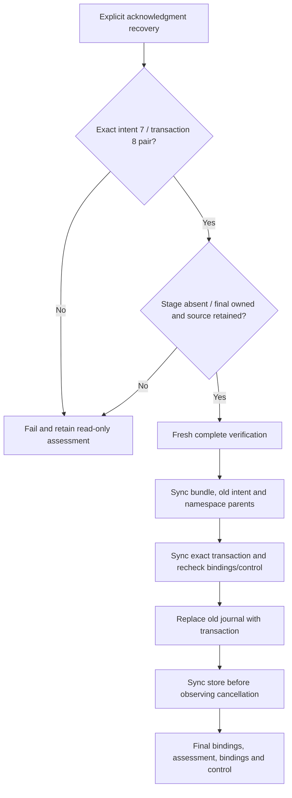

# Interrupted Published acknowledgment recovery (R6.1d.3)

Status: implemented and locally qualified in **R6.1d.3b**, 2026-10-14,
following the R6.1d.3a design reviewed against `6c0134e`.
[Qualification, measurements and limits](benchmark-results/2026-10-14-r61d3b/README.md) record the bounded evidence.
Existing publication/reconciliation/attestation/cleanup APIs retain their transaction
exclusions; only the new explicit API admits the exact pair described below.

[ADR-0070](adr/0070-matched-published-transaction-recovery.md) ·
[Implementation and qualification plan](published-acknowledgment-recovery-qualification.md) ·
[Intent reconciliation](publish-intent-reconciliation.md) ·
[Published attestation](published-output-attestation.md)

## Purpose and authority

An interrupted acknowledgment can leave the original version-2 PublishIntent
sequence 7 journal and a complete version-2 Published sequence 8 transaction beside
an already published bundle. A new explicit operation may finish this one local
journal transition after fresh verification. It cannot establish whether the earlier
call succeeded, whether the transaction was previously synced, or whether an earlier
storage error was repaired.

The caller supplies the original locked store and destination, explicit output,
artifact and source selection, and bounded RetainedOptions. Both locks are consumed
and held through final assessment and binding/control checks. No writable capability,
remote request, automatic dispatch, retry, cleanup or rollback escapes. Source
CompletedLease admission remains mandatory; source cleanup makes recovery unavailable.
A report or a transaction checksum alone grants no authority.

Authority comes from the entire matched record pair, original private-store/source/
destination bindings, stamped members, fresh native/source/RAW verification and the
current namespace. Trusted stable ancestors, cooperating writers, no outstanding
writable handles and no hostile same-user mutation or offline rollback remain the
existing trust boundary. Locks and checks do not make a pathname rename an atomic
compare-and-swap against an adversarial writer. This is a local filesystem protocol;
network filesystem error semantics and physical power-loss/controller qualification
are outside its bounded acceptance campaign.

## Code-review findings and originating outcomes

| Existing code at `6c0134e` | Consequence |
|---|---|
| [`commit_output`](../crates/rvvdk-vsphere/src/ownership/retained/output.rs) creates an exclusive transaction, writes two halves, syncs it, replaces the current journal and syncs the store | `record_partial`, `record_written` and `record_synced` precede journal replacement. A fresh call must distinguish partial bytes from a complete matching successor. |
| [Normal publication](../crates/rvvdk-vsphere/src/ownership/retained/output/publication.rs) and [reconciliation](../crates/rvvdk-vsphere/src/ownership/retained/output/publication/reconciliation.rs) set only state and sequence for the terminal commit | The sole accepted successor is the admitted intent record with state Published and sequence 8; all other record fields must match exactly. |
| `read_output` validates only the current journal; `output_recovery` reports transaction existence | Existing assessment cannot validate a transaction or authorize its promotion. Keep that API read-only and unchanged. |
| `CheckedOutput::current` rejects any output transaction, including a matching one | Share byte validation through an explicit private binding guard, not by hiding the transaction or weakening existing callers' no-transaction gate. |
| [`members` and `admit`](../crates/rvvdk-vsphere/src/ownership/retained.rs) require CompletedLease and no source transaction | Output transaction recovery must not admit or recover source transactions. |
| [Existing originating crash tests](../crates/rvvdk-vsphere/src/ownership/retained/output/publication/attestation/tests/crash.rs) preserve transactions and reject them in attestation | Retain those assertions; add a separate invocation of the new operation. |

These are design-time code observations; the linked implementation report records
runtime qualification of the separate recovery API.

| Originating acknowledgment boundary | Current journal / output transaction after process loss | Planned next explicit operation |
|---|---|---|
| Before terminal transaction creation | PublishIntent 7 / absent | Existing intent reconciliation, subject to its own gates. |
| Creation or interrupted first/second write | PublishIntent 7 / empty or partial | Reject and preserve. No truncation, completion or deletion. |
| `record_partial` hook | PublishIntent 7 / first half only | Reject and preserve. |
| `record_written` hook | PublishIntent 7 / complete Published 8 | Candidate for this operation; no prior file-sync claim. |
| `record_synced` hook | PublishIntent 7 / complete Published 8 | Same candidate; repeat fresh verification and syncs. |
| `record_renamed` hook | Published 8 / absent | Separate fresh attestation; never infer previous store sync. |
| `record_durable` or lost response after return | Published 8 / absent | Separate fresh attestation; earlier success still cannot be inferred. |

The table applies to normal publication and both reconciliation origins. For an
actual I/O failure inspect the current state rather than infer it from the attempted
call: a failed write can leave incomplete bytes, and a complete transaction does not
prove earlier sync success. Unsupported or ambiguous pairs remain blocked. SIGKILL
observations do not establish what survives machine power loss.

## Exact record and namespace gates

Read both generated names through the pinned store descriptor, read-only and without
following symlinks. Require private owner/type/permissions, single-link regular files,
bounded envelopes (existing MAX_RECORD = 8192), checksum and unknown-field checks,
valid version/state/sequence, explicit selection and original store binding. Reject
empty, partial, oversized, duplicate-field or trailing-invalid JSON, unknown versions,
invalid stamps or checksum mismatch. JSON whitespace is not mutation authority.

Pin each record's exact envelope bytes and inode through one checked open; retain
bounded snapshots and descriptors until promotion. The two inodes must be distinct.
Revalidate both names against their pinned bytes, identities and parsed values at
subsequent gates. Identical-byte inode replacement and same-inode byte replacement
both fail. Do not infer transaction identity from its generated name alone.

Let `old` be the valid v2 PublishIntent sequence 7 journal. Construct an in-memory
`expected = old.clone()` with only `state = Published` and `sequence = 8`. The parsed
transaction must equal `expected`, with its own valid checksum. Specifically retain
version, store, output, artifact, source, container contract, operation, logical size,
stage/member stamps, RAW digest, publication parent and absent cleanup marker. Do not
normalize or rewrite the transaction envelope; successful promotion preserves its
exact original bytes and inode at the journal name.

| Current journal | No output transaction | Complete exact Published successor | Any other output transaction |
|---|---|---|---|
| Prepared | Reject | Reject | Reject |
| StageIntent | Reject | Reject | Reject |
| Staged | Reject | Reject | Reject |
| ConvertIntent | Reject | Reject | Reject |
| Converted | Reject | Reject | Reject |
| VerifyIntent | Reject | Reject | Reject |
| Verified | Reject; normal publication separate | Reject | Reject, including PublishIntent 7 |
| PublishIntent | Reject; intent reconciliation separate | Eligible only for v2 sequence 7 → 8 and all remaining gates | Reject, including an identical PublishIntent copy |
| Published | Reject; attestation separate | Reject, including an identical Published copy | Reject, including CleanupIntent |
| CleanupIntent | Reject | Reject | Reject |
| Cleaned | Reject | Reject | Reject |
| Missing or invalid current journal | Reject | Reject orphan; never reconstruct old authority | Reject |

The successor column cannot actually match an incompatible old state; it explicitly
excludes a complete Published record beside any such current journal. Any source
transaction blocks every row, even if complete and checksum-valid. Invalid current
records are never replaced to make assessment work. Partial/foreign transactions are
never unlinked, quarantined, renamed aside or repaired by this API.

Both records must name the original locked same-filesystem publication destination
outside the store. Require retained CompletedLease source, complete bound metadata,
original journal/member identities and native admission. Classify stage and final
using original stamps, exact member set, private permissions, single-link members
and owner marker. An inspection error is not absence. Owned describes identity,
not content; full verification remains a separate requirement.

| Stage | Final bundle | Decision |
|---|---|---|
| Absent | Owned | Eligible for fresh verification and journal promotion. |
| Absent | Absent | Reject missing payload. |
| Absent | ForeignOrInvalid | Reject final collision. |
| Owned | Absent | Reject; this API never moves a bundle. |
| Owned | Owned | Reject ambiguity. |
| Owned | ForeignOrInvalid | Reject ambiguity/collision. |
| ForeignOrInvalid | Absent | Reject foreign stage and missing payload. |
| ForeignOrInvalid | Owned | Reject foreign stage. |
| ForeignOrInvalid | ForeignOrInvalid | Reject both locations. |

## API and report

```rust,ignore
impl JobStore {
    pub fn recover_publication_acknowledgment(
        self,
        output: OutputId,
        artifact: ArtifactId,
        source: SourceSelection,
        destination: PublicationDirectory,
        options: RetainedOptions,
    ) -> PublicationAcknowledgmentRecoveryReport;
}
```

Synchronous callers must await blocking completion. Borrow the store for admission;
transfer it to RetainedArtifact only on success, preserving the original locked
store for read-only assessment on failed admission. Do not reopen it by path.

| Report field | Observation made by this invocation |
|---|---|
| `logical_bytes_verified: u64` | Actual comparison progress, including partial progress on failure. |
| `content_verified: bool` | Full source/native/RAW/metadata/digest and post-read checks passed. |
| `bundle_synced: bool` | Three checked members and bundle directory synced. |
| `intent_synced: bool` | Exact old intent file and store directory synced before promotion. |
| `directories_synced: bool` | Store and destination namespace syncs both completed. |
| `transaction_synced: bool` | Exact admitted Published transaction file synced after namespace barriers. |
| `transaction_promoted: bool` | This call observed successful replacement of the old journal by that transaction. |
| `acknowledgment_durable: bool` | This call observed the store sync after successful promotion. |
| `bindings_rechecked: bool` | After assessment, source/output/namespace bindings and absence of both transactions checked. |
| `primary_error: Option<OwnershipError>` | First operation, validation or control error. |
| `assessment_error: Option<OwnershipError>` | Independent read-only assessment failure. |
| `recovery: Option<PublicationRecovery>` | Final current journal and namespace observations, not transaction validity or authority. |

`is_success` requires all eight booleans, no errors and final Published sequence 8,
no output transaction, absent stage and owned final bundle. Source transaction absence
and exact successor journal identity are covered by the final binding flag; output
assessment alone cannot establish them. Preserve earlier flags and the primary error
on later failure. A visible Published record never overrides an error or supplies a
missing flag. Debug/Serialize contain only sanitized counts, flags and existing
errors/assessment; no IDs, paths, hashes, bytes or assumed origin history. Reports
cannot be passed back to skip any checks. No new wire state, version or sequence 9.

## Required durability and control order

One Control starts at entry and covers the entire operation, including assessment
and final checks. Reject invalid options or pre-cancellation before sync/mutation.
Use cooperative checks during admission/verification; kernel calls may block beyond
the deadline. Keep bounded native maps/decoder and the two fixed 1 MiB comparison
buffers. Bounded record snapshots add at most two MAX_RECORD-sized byte buffers.

1. **Admit and pin the pair.** Validate both records, explicit bindings, source
   transaction absence and exact Absent/Owned namespace. Pin the old and candidate
   bytes/inodes. Freshly admit the retained source using the same control.
2. **Verify all logical bytes.** Use the existing complete content algorithm at the
   final bundle: compare metadata/contract, exact RAW length, every data/zero byte
   against fresh native reads, and full RAW SHA-256. Reread metadata, verify encoded
   source bytes again and recheck source, old/candidate records, namespace and members.
   No persistence phase begins on failed verification.
3. **Sync the final bundle (calls 1–4).** Recheck full bindings at phase entry, then
   member/bundle identity and control before each sync: RAW, metadata, owner, bundle.
   No byte writes or allocation repair. Set bundle_synced only after all four succeed.
4. **Sync the exact old intent (calls 5–6).** Recheck the pair/source/namespace and
   control immediately before syncing the admitted old journal, then store directory.
   Defer cancellation between the pair, but stop on I/O failure. Set intent_synced
   only after both; then check control. No commit_output call or intent rewrite.
5. **Sync namespace parents (calls 7–8).** Recheck the full pair and bindings, then
   control. Sync store then destination; defer cancellation between the pair unless
   I/O fails. Set directories_synced after both, then check control. There is no
   bundle rename; even already-visible final placement gets fresh parent barriers.
6. **Sync the candidate (call 9).** Recheck the pair/source/namespace, check control
   and sync the exact admitted transaction descriptor. Set transaction_synced only
   after success. Repeat full pair/source/namespace checks and check control directly
   before the mutation, with no intervening arbitrary callback. Cancellation or drift
   here prevents promotion even if the candidate has just been synced. Never rewrite its bytes or infer prior sync.
7. **Promote and acknowledge (one rename, call 10).** Replace the exact admitted old
   journal name with the exact candidate name using descriptor-relative renameat2
   with flags 0 within the pinned store. Both names must still match their admitted
   bytes/inodes at the preceding gate. This intentional journal replacement uses
   different semantics from no-replace bundle publication. On successful rename set
   transaction_promoted; sync the store without an intervening control observation,
   unless an I/O error stops execution. Set acknowledgment_durable after that sync,
   then observe control. Recheck the journal at its new name against the candidate
   bytes/inode and expected record, output transaction absence and all source/bundle/
   destination bindings. Do not require the replaced old inode to remain linked.
8. **Assess and recheck.** Always attempt bounded independent assess_publication
   while both locks remain held, even after an earlier failure; retain separate
   errors. On an otherwise successful primary path recheck final bindings both
   before and after assessment. Set bindings_rechecked only after the post-assessment
   check, then check the original control again. Assessment failure still prevents
   success. Release source handles before store/locks. No repair or cleanup follows.

The successful path makes **ten explicit sync calls and one journal rename**. It
creates no file, writes no application payload/journal bytes and never renames the
bundle. It does change the current journal name's inode from old to candidate and
consumes the transaction name. Zero calls to commit_output does **not** mean zero
acknowledgment mutations; measure the promotion separately. Old journal bytes remain
unchanged on an open descriptor, but its pathname is intentionally replaced; there
is no backup/rollback record.

Linux rename replacement preserves the renamed file's open descriptors and replaces
the destination name atomically; flags 0 gives renameat semantics. This is a namespace
property, not a persistence acknowledgment. [Linux rename(2)](https://man7.org/linux/man-pages/man2/rename.2.html).
File synchronization does not by itself establish durability of its directory entry;
the explicit directory sync remains required. [Linux fsync(2)](https://man7.org/linux/man-pages/man2/fsync.2.html).
The ten-call order is this project's conservative protocol choice. It does not prove
historical completion, repair earlier writeback errors or suppress early filesystem
writeback. The earlier intent sync is retained as an explicit pre-promotion barrier,
not as evidence of when the original call reached it.



Every failed gate/barrier returns failure with assessment; the diagram shows the
successful path after admission. No failure arrow implies an automatic retry.

## Failure and subsequent invocation policy

Malformed record/envelope failures use Record, identity/namespace drift uses Identity,
wrong state or absent candidate uses Transition, source transactions use Uncertain,
and content failures retain the existing Content/Io distinctions. Sync failures
before promotion use Io for bundle/intent/candidate file sync and Uncertain for
namespace barriers. Any promotion or final-store-sync error is Uncertain. Preserve
Cancelled/Deadline control errors and never wrap them into success. Implementation
must keep these distinctions visible through sanitized existing OwnershipError.

Before promotion, rejection/failure leaves the old journal and candidate bytes,
inodes and names intact, apart from external fixture mutation being tested or normal
filesystem metadata/writeback effects. After an attempted promotion, no rollback,
retry, unlink or alternate-name reconstruction is permitted. A failed rename call
never sets transaction_promoted, even if later assessment sees Published. A failed
final sync leaves acknowledgment_durable false. Test hooks can stop between successful
syscalls; those are distinct from actual syscall failures or control cancellation.

| Fresh observation after an interrupted recovery | Later explicit action |
|---|---|
| Original intent 7 plus exact complete candidate 8, Absent/Owned | A new recovery call repeats every admission, verification and sync. |
| Published 8, no candidate, Absent/Owned | This operation rejects; caller may separately invoke fresh attestation. |
| Intent 7, no candidate | This operation rejects; caller may separately invoke intent reconciliation. |
| Partial/foreign candidate, changed old record, missing/ambiguous bundle or source transaction | Preserve and reject; no automatic repair. |
| Source cleaned/missing | Reject; no export replay or source reconstruction. |

Current publication, reconciliation, attestation, assessment and cleanup contracts
remain unchanged. Cleanup still rejects any pending output transaction; after a
successful recovery Published cleanup is independently eligible under its existing
checks. Source cleanup can still make fresh verification unavailable. General source
transaction recovery, earlier output transitions, conversion resume, unstamped stages,
CLI/live composition, power-loss guarantees and capacity proof remain later work.
PERF.0 retains ambient tmpfs allocation and the approximately 15% 256 MiB tmpfs
attestation timing spread in the [previous report](benchmark-results/2026-10-14-r61d2b/README.md).
