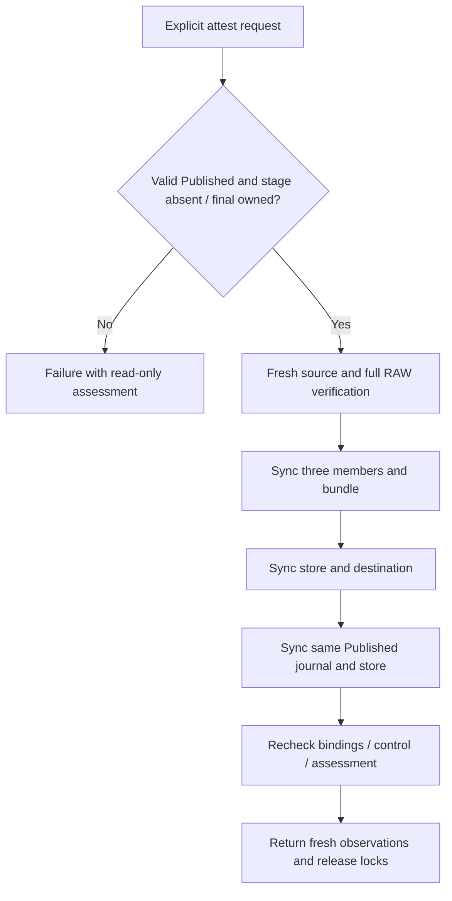

# Fresh Published-output attestation (R6.1d.2)

Status: implemented in **R6.1d.2b**, following the R6.1d.2a design accepted on
2026-10-14. [Local qualification, measurements and limits](benchmark-results/2026-10-14-r61d2b/README.md)
record the bounded evidence; general recovery and PERF.0 remain open.

A process can lose its response after publication succeeds, or fail after the
Published journal rename but before the store-directory sync. A later invocation
sees the same Published sequence 8 in both cases. It cannot establish which earlier
steps completed. Explicit attestation freshly verifies the current source and
output and observes new synchronization barriers, without relabeling the earlier
call as successful.

[ADR-0069](adr/0069-fresh-published-output-attestation.md) ·
[Implementation and qualification plan](published-output-attestation-qualification.md) ·
[Existing intent reconciliation](publish-intent-reconciliation.md)

## Scope and authority

The caller supplies the original locked `JobStore`, explicit `OutputId`, `ArtifactId`
and `SourceSelection`, original locked `PublicationDirectory` and bounded
`RetainedOptions`. The operation consumes both locks through final assessment and
returns observations only. It is synchronous work that must be awaited in a blocking
context. No writable handle, publication capability, remote lease or replay request
escapes. Dropping resources releases handles/locks; it performs no cleanup or retry.

Attestation requires the retained CompletedLease source. A correct-looking RAW and
stored digest cannot replace source admission and a full logical comparison. Source
cleanup deliberately makes later attestation ineligible; the caller must preserve
its source until any desired attestation completes. Existing explicit Published
cleanup can still operate under its own contract without source payload bytes.

Attestation is not a signature, immutable certificate, retained success token or
promise that output survives a later separately authorized cleanup. Checksums detect
corruption within the current private-store model. Trusted stable ancestors,
cooperating writers, no outstanding writable handles and no hostile same-user
mutation/offline rollback remain requirements. Advisory locks do not freeze bytes
against noncooperating writers. Successful sync calls are observations under the
filesystem/device contract, not physical-media verification or repair of an earlier
writeback failure. This step makes no power-loss/controller qualification claim.

## Code-review findings

| Current code | Consequence for this design |
|---|---|
| [`commit_output`](../crates/rvvdk-vsphere/src/ownership/retained/output.rs) renames a synced transaction before syncing the store, then calls `record_durable` | Both normal publication and reconciliation can leave Published visible after an uncertain return. A retry needs its own result semantics. |
| `valid_record` in [publication.rs](../crates/rvvdk-vsphere/src/ownership/retained/output/publication.rs) fixes Published at version 2, sequence 8 | Keep the record, checksum, operation, stamps, destination binding and sequence unchanged. No new state, migration or sequence 9 acknowledgment. |
| `assess_publication` checks record/namespace observations, not source bytes or all RAW bytes | Preserve it as read-only assessment; it cannot supply an attestation success flag. |
| `CheckedOutput::validate_at` already validates a selected bundle's full content | Reuse this private borrowed validator for the final bundle. Do not broaden `VerifiedOutput::open` or construct a Verified capability from Published. |
| [`admit`, `check_current`, `members`](../crates/rvvdk-vsphere/src/ownership/retained.rs) validate retained source bytes, metadata, identity and transaction absence | Use fresh admission and the validator's post-read source checks; repeat structural source/journal checks at final barriers. |
| [`reconcile_publication`](../crates/rvvdk-vsphere/src/ownership/retained/output/publication/reconciliation.rs) accepts only PublishIntent and reports a new acknowledgment | Keep that API and its success predicate unchanged. Attestation neither renames nor commits a journal, so needs a separate report. |
| Cleanup accepts eligible Published output without requiring retained source bytes | Keep deletion a separate explicit operation; attestation never invokes it or grants new cleanup authority. |

## Admission tables

Require valid version-2 Published sequence 8 with original nonzero operation,
recorded store/source/artifact/output bindings, stage/member stamps, RAW digest,
container contract and destination identity. `cleanup_from` must be absent.
Validate checksum, bounded parsing, unknown-field policy and all existing record
constraints. Pin the admitted output record value **and its current journal inode**.
A replacement journal with identical bytes after admission is still a mismatch.

No source or output transaction may exist, regardless of contents/type. Reject even
a complete, checksum-valid transaction matching the current Published record. Do not
open a transaction as instructions, promote it, remove it or infer it is redundant.
Source admission requires CompletedLease, complete metadata, original source members,
encoded integrity, native structure and present grains. Store and destination must
remain private/locked with the original recorded identities, same filesystem and
destination outside the store. No directory is created or rediscovered by name.

Observe generated stage/final components through pinned parent descriptors.
`Owned` means all recorded directory/member identities, types, private permissions,
single-link regular files, operation marker and exact member set match. It does not
establish content correctness. An inspection error is never absence.

| Stage | Final bundle | Attestation decision |
|---|---|---|
| Absent | Owned | Eligible for fresh verification and sync; no rename. |
| Absent | Absent | Reject missing output; never reconstruct it. |
| Absent | ForeignOrInvalid | Reject invalid final output. |
| Owned | Absent | Reject misplaced Published output; never finish a rename here. |
| Owned | Owned | Reject ambiguity; never choose or delete either bundle. |
| Owned | ForeignOrInvalid | Reject both the stage and final collision. |
| ForeignOrInvalid | Absent | Reject foreign stage and missing output. |
| ForeignOrInvalid | Owned | Reject foreign stage even if final bundle is owned. |
| ForeignOrInvalid | ForeignOrInvalid | Reject both invalid locations. |

| Output state | Attestation decision |
|---|---|
| Prepared | Reject; no unstamped-resource adoption. |
| StageIntent | Reject; no unstamped-resource adoption. |
| Staged | Reject; no conversion resume. |
| ConvertIntent | Reject; no conversion resume. |
| Converted | Reject; no verification resume. |
| VerifyIntent | Reject; no verification resume. |
| Verified | Reject; normal fresh publication remains separate. |
| PublishIntent | Reject; explicit intent reconciliation remains separate. |
| Published | Admit only sequence 8 and all requirements above. |
| CleanupIntent | Reject; never reverse or interrupt deletion. |
| Cleaned | Reject; never recreate payload or reuse a reserved output ID. |

Invalid versions, checksums, sequences, fields, bindings and either transaction reject
regardless of the table. Only a fresh explicit invocation can reconsider a failure.
There is no dispatch from attestation into publication, reconciliation or cleanup.

## API and report

```rust,ignore
impl JobStore {
    pub fn attest_publication(
        self,
        output: OutputId,
        artifact: ArtifactId,
        source: SourceSelection,
        destination: PublicationDirectory,
        options: RetainedOptions,
    ) -> PublicationAttestationReport;
}
```

| Report field | Observation made by this invocation |
|---|---|
| `logical_bytes_verified: u64` | Bytes actually compared; partial progress may survive failure. |
| `content_verified: bool` | Full native/source/RAW/metadata/digest and post-read checks passed. |
| `bundle_synced: bool` | All three checked members and the final bundle directory synced. |
| `directories_synced: bool` | Store and destination namespace syncs both completed. |
| `published_record_synced: bool` | The exact admitted Published journal file and subsequent store-directory sync both completed, after bundle/parent barriers. |
| `bindings_rechecked: bool` | After assessment, original source/output journal and member bindings, no transactions, destination, absent stage and owned final bundle all rechecked. |
| `primary_error: Option<OwnershipError>` | First admission, verification, sync, binding or control failure; never overwritten by an assessment error. |
| `assessment_error: Option<OwnershipError>` | Independent failure of final read-only assessment. |
| `recovery: Option<PublicationRecovery>` | Final state/namespace observations, never mutation authority. |

Derive sanitized Debug/Serialize using only these counts, flags and existing sanitized
errors/assessment. No path, ID, fingerprint, digest, source metadata or fixture data.
No `rename_observed`, origin history, prior-success flag or `acknowledgment_durable`
field: no new rename or acknowledgment is performed, and prior history is unknown.

`is_success` requires no primary/assessment error, all five flags true, final
Published sequence 8 with no output transaction, absent stage and owned final bundle.
Source transaction absence is part of `bindings_rechecked`; assessment alone does
not check it. Partial flags survive a later failure but cannot convert it to success.
Byte count alone is insufficient. The report is neither accepted as an input nor
usable to skip fresh validation on another invocation.

## Required order and controls

One `Control` starts at call entry and covers admission, validation, syncs and final
checks. Reuse its absolute deadline, never reset it per phase. Invalid options or
pre-cancellation reject before any sync. Kernel I/O remains cooperatively bounded;
no promise is made to interrupt a blocked syscall.

1. **Admit and pin.** Under both locks validate output record, no transactions,
   destination and exact Absent/Owned pair. Pin the Published journal identity and
   record. Freshly admit the retained source with the same control. Keep the original
   locked store available for assessment if source admission fails, transferring
   ownership into `RetainedArtifact` only after borrowed admission succeeds.
2. **Verify completely.** Use `CheckedOutput::validate_at` only at the admitted final
   parent/component. Compare bounded metadata with the record/source contract; compare
   all logical RAW bytes, including zeros, with fresh native source reads and compute
   SHA-256. Check exact length/digest, reread metadata and encoded source bytes, and
   recheck member/source/output journal bindings and both transaction names. Preserve
   the existing two fixed 1 MiB comparison buffers and bounded native map/decoder.
3. **Sync final bundle.** Check control, exact bindings and namespace before entering
   this phase. Before each member sync recheck the bundle/member identity and control;
   sync RAW, metadata, owner, then bundle directory. Check control before the directory
   sync as well. Stop on any error. Set `bundle_synced` after all four calls succeed.
4. **Sync both namespace parents.** Recheck source/output bindings, no transactions,
   original destination and exact pair; check control **after** these checks, directly
   before sync. Sync store then destination, with no control check between them.
   As in intent reconciliation, finish the pair unless I/O fails, then observe control.
   Set `directories_synced` only if both calls succeeded. No rename happens here.
5. **Sync existing Published record last.** Recheck the admitted journal's exact
   record/inode, source binding, transactions and namespace. Open/check that original
   journal, then check control immediately before syncing it. Sync the journal file,
   then store directory without a control check between them; an I/O error stops
   immediately. Set `published_record_synced` only after both calls succeed, then
   observe control. Do not call `commit_output`, create a transaction, rewrite bytes,
   replace a journal inode or increment sequence. The final store sync is required
   even though the store was synced in step 4.
6. **Final binding check and assessment.** Recheck original journal values/inodes,
   source metadata/member binding and transaction absence, output bundle/destination
   identity and exact namespace, then observe control. Always attempt bounded read-only
   `assess_publication` under the held locks, including on earlier failure, retaining
   separate errors. If the primary path still has no error, repeat those binding checks
   **after** assessment and only then set `bindings_rechecked`; this also catches a
   source transaction or journal substitution at the assessment boundary. Check the
   same control after that final recheck; late cancellation/expiry prevents success.
   No additional sync, repair or deletion follows failure or assessment. Release
   descriptors and locks on return, in the established source-before-store order.

The successful path makes **eight explicit sync calls**: three members, bundle,
store, destination, Published journal, store. It makes **zero journal commits, zero
renames and zero output/source byte writes**. The linked qualification checks the exact calls and audits syscall intervals. The source journal and payload are verified but not re-synced or rewritten;
the operation attests the selected Published output, not source retention durability.

File sync alone does not ensure the containing directory entry is persisted; a
separate directory sync is required by the Linux interface. The ordering above is
our protocol choice, keeping the terminal journal barrier after the bundle/parent
barriers. [Linux fsync(2)](https://man7.org/linux/man-pages/man2/fsync.2.html).

The already-visible journal may be persisted by a filesystem earlier than these
steps. This operation cannot hide it or retroactively impose an atomic ordering on
prior work. Its success says that this call completed **all** required barriers and
checks. On any interruption a new invocation must repeat every gate.



Every failure retains resources; the diagram shows the successful path only.

## Failures, retries and compatibility

| Event | Outcome |
|---|---|
| Non-Published record, source no longer retained, transaction, invalid binding or namespace | Reject before any sync; preserve all entries. Read-only assessment may still return observations. |
| Source/RAW corruption, metadata mismatch, jointly forged RAW/digest claims | Content failure before persistence work; source comparison remains authoritative. |
| Late source/output journal or member replacement, new transaction or stage entry | Reject at the next fresh binding check, preserve foreign entries. Never switch location or adopt a replacement. |
| Member/bundle sync failure | Return Io with completed flags; stop before parent/record phases. |
| Parent or Published journal/store sync failure | Return Uncertain with completed flags; stop, no rewrite/retry/rollback. Even visible Published is not attestation success. |
| Cancellation/expiry between ordinary checks or member syncs | Stop before further sync; retain resources and flags. |
| Cancellation/expiry inside either paired sync phase | Finish that pair unless I/O fails, then return the control error; do not enter the next phase. |
| Error after all barriers, including final assessment or post-assessment control | Preserve completed observations; success is false. |
| Lost successful response or process loss during attestation | No attestation-owned transaction/state is left behind. A new explicit call must re-admit and repeat full verification/all syncs. |

Repeated attestation can succeed on unchanged valid Published output but is never a
cached success query. After a process crash, re-open original parents and assess;
if the record is PublishIntent use its separate explicit operation, and if a
transaction/ambiguous resource exists leave it blocked. No automatic cross-operation
retry is introduced. Sync failure does not imply persistent bytes were repaired;
storage-error diagnosis and physical durability qualification remain separate.

Normal publication, intent reconciliation, read-only assessment and explicit cleanup
keep their current acceptance and report semantics. There is no CLI/pipeline dispatch
or remote integration in R6.1d.2b. No new ESXi, credentials, license, VM or vCenter is
needed for local synthetic qualification.

The [acceptance matrix](published-output-attestation-qualification.md) maps to the
linked implementation report, including frozen normal/reconciliation comparisons. Existing
[measurements and plots](benchmark-results/2026-10-14-r61d1b/README.md) remain unchanged;
PERF.0 timing variation, ambient tmpfs allocation and larger-working-set/hash tuning
remain open. Transaction repair, unstamped-stage adoption and general R6 recovery
are independent later work.
